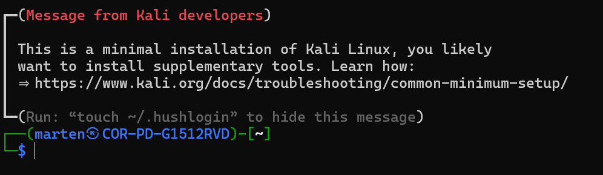

# DVWA installeren

**DVWA** staat voor *Damn Vulnerable Web Application*. Het is een webapplicatie die met opzet vol kwetsbaarheden zit, zodat je er veilig op kunt oefenen. Je installeert DVWA op je eigen Kali Linux in WSL. Heb je WSL nog niet, doe dan eerst [2.1 WSL installeren](site:dvwa/docs/linux/wsl/installeren) uit de Linux-cursus.

:::caution
Oefen alleen op je eigen DVWA-installatie. De technieken die je hier leert, mag je nooit toepassen op websites of systemen die niet van jou zijn — dat is strafbaar.
:::

## Stap 1: Kali Linux erbij installeren

Kali Linux is een Linux die speciaal is gemaakt voor beveiligingswerk. Hij komt naast je Ubuntu in WSL te staan. Open `Windows PowerShell` en typ:

```powershell
wsl --install kali-linux
```

Kali vraagt een **gebruikersnaam** en een **wachtwoord**, net als Ubuntu bij de installatie van WSL. Onthoud ze goed. Ook hier zie je niets terwijl je het wachtwoord typt.

## Stap 2: Kali openen

Open Kali met dit commando in PowerShell, of zoek in het startmenu naar **Kali Linux**:

```powershell
wsl -d kali-linux
```

Je komt in de Kali Linux-shell terecht en je zou iets als dit moeten zien:



## Stap 3: Het installatiecommando uitvoeren

Kopieer het volgende commando (let op: het is één lange regel) in je Kali-shell en druk op Enter:

```bash
sudo bash -c "$(curl --fail --show-error --silent --location https://raw.githubusercontent.com/IamCarron/DVWA-Script/main/Install-DVWA.sh)"
```

Tijdens de installatie krijg je een paar vragen. Beantwoord ze zo:

- **`[sudo] password for ...:`** — vul het wachtwoord in dat je bij de installatie van Kali Linux hebt gekozen.
- **`Enter SQL user:`** — druk op Enter (laat leeg).
- **`Enter SQL password (press Enter for no password):`** — druk op Enter (laat leeg).

De installatie geeft veel tekst weer en duurt een paar minuten. Laat 'm rustig zijn werk doen.

## Stap 4: DVWA opstarten

Kijk in de [Cheatsheet](site:dvwa/docs/cheatsheet) hoe je DVWA opstart, hoe je inlogt en welke instellingen je na de installatie nog moet doorlopen.
