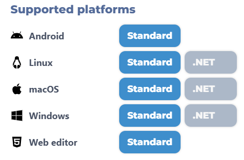
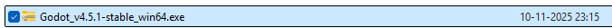
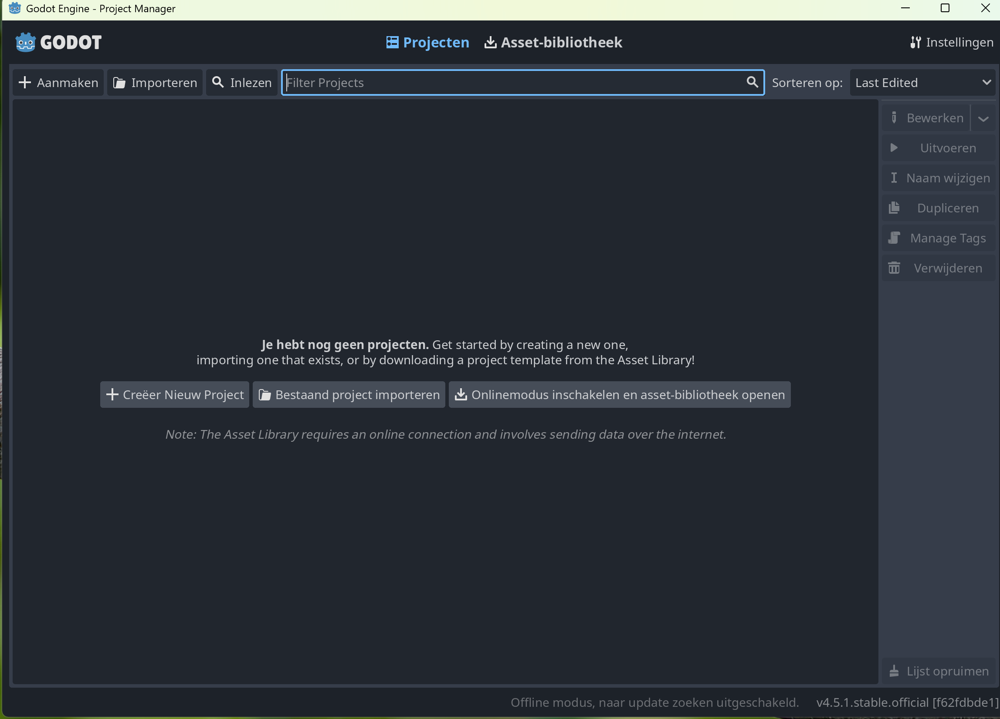

# Installatie

Voordat je je eerste game kunt bouwen, heb je de Godot-editor nodig. Dat is het programma waarin je je scènes tekent en je code schrijft. Op deze pagina installeer je Godot 4 op je eigen computer.

## Stap 1: Godot downloaden

:::note[Chromebook]
Op een Chromebook kun je geen programma's installeren. Gebruik in dat geval de **online editor** in je browser: [editor.godotengine.org](https://editor.godotengine.org/). Je kunt daar direct beginnen. Sla je project op door het te exporteren als zip. De rest van de handleiding werkt hetzelfde.
:::

Ga naar [godotengine.org/download/archive](https://godotengine.org/download/archive/) en zoek de nieuwste versie die begint met `4.7.` (bijvoorbeeld `4.7-stable` of nieuwer binnen de 4.7-lijn).

Klik op **Download**, zoek het kopje **Windows** en klik op **Standard**.

## Stap 2: Uitpakken en starten

#### Pak het zip-bestand uit

In je `Downloads`-map staat na het downloaden een zip-bestand met een naam als `Godot_v4.7-stable_win64.zip`.

Dubbelklik erop en kies bovenaan voor **Alles uitpakken**. Verplaats de uitgepakte bestanden naar een vaste map op je computer waar je ze later snel terugvindt (bijvoorbeeld `Documenten\Godot\`).

#### Start Godot

Dubbelklik op het Godot-bestand. De bestandsnaam ziet er ongeveer zo uit; op het plaatje staat een oudere versie, bij jou staat er `4.7` in de naam.

## Stap 3: De Project Manager \{#de-project-manager}

Na het starten van Godot beland je in het **Project Manager**-venster:

De schermafbeelding komt uit een editor die op Nederlands staat; bij jou staan er Engelse namen op de knoppen. Is jouw editor ook grijzer? Dat klopt: sinds Godot 4.6 is het standaard thema grijswaarden. De stappen blijven hetzelfde.

#### Check je versie

Het versienummer staat in kleine letters onderaan het Project Manager-venster, in de rechterhoek. Op de schermafbeelding staat daar `v4.5.1`; bij jou hoort het nummer met `4.7` te beginnen. Zie je een andere versie, download dan de juiste bij Godot downloaden.

Heb je straks een project open, dan vind je hetzelfde nummer ook via **Help → About Godot**.

## Opdracht 1.1.a: verken de Project Manager

Voordat je in de volgende les een project aanmaakt, kijk je even rond in het Project Manager-venster. Zoek twee dingen op:

1. Waar je de **taal** van de editor kunt veranderen.
2. Waar je kant-en-klare onderdelen van andere makers kunt vinden (daar heb je later iets aan).

Klik hier voor een tip.

Kijk langs de bovenrand van het Project Manager-venster: in het midden staan twee tabbladen van Godot, in de rechterhoek een knop voor de instellingen.

Klik hier voor de oplossing.

- De taal staat bij de instellingen van de Project Manager: de knop in de rechterbovenhoek. Op de schermafbeelding bij De Project Manager heet hij Instellingen, omdat die editor op Nederlands staat.
- De onderdelen van anderen staan achter het tweede tabblad bovenaan het venster, naast je projectenlijst. In Godot 4.7 heet het **Asset Store**; op de schermafbeelding, van een oudere versie, Asset-bibliotheek.

Laat de taal op Engels staan. Deze cursus gebruikt de Engelse namen van knoppen en menu's, dus dan komt alles op je scherm overeen met de lessen.

## Er gaat iets mis

Bij het openen van Godot krijg ik een DLL-fout / "kan niet starten"

**Oorzaak:** Op oudere Windows-installaties ontbreekt de Visual C++ runtime die Godot nodig heeft.

**Oplossing:**

1. Download "Visual C++ Redistributable for Visual Studio" via [aka.ms/vs/17/release/vc_redist.x64.exe](https://aka.ms/vs/17/release/vc_redist.x64.exe).
2. Installeer dat bestand.
3. Probeer Godot opnieuw te openen.

Mijn antivirus blokkeert het bestand

**Oorzaak:** Windows Defender of een ander antivirusprogramma kent het uitvoerbare bestand niet en blokkeert het uit voorzorg.

**Oplossing:**

- Controleer dat je het bestand echt via [godotengine.org](https://godotengine.org/download/) hebt gedownload (niet een willekeurige andere site).
- In Windows: klik in de melding op **Meer informatie** → **Toch uitvoeren**, of voeg `Godot_v4.7.x-stable_win64.exe` toe als uitzondering in Windows Defender.

Ik kan het uitgepakte bestand niet vinden

**Oorzaak:** Het bestand staat nog in `Downloads`, of is uitgepakt in een dubbele submap (`Godot_v4.7.../Godot_v4.7.../...`).

**Oplossing:**

1. Open Verkenner en zoek op `Godot_v4.7`.
2. Verplaats het `.exe`-bestand naar een vaste map, bijvoorbeeld `Documenten\Godot\`.
3. Maak eventueel een snelkoppeling op je bureaublad: rechts-klikken → **Verzenden naar** → **Bureaublad**.

