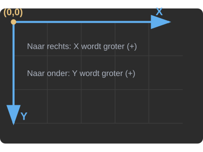

# Het bewegingsscript bouwen — Deel 7: Springen

Je karakter loopt en valt. Er ontbreekt één ding: omhoog. In deze les maak je het bewegingsscript af.

<Voorkennis
  items={[
    {site: 'python', to: '/docs/beslissen/05c-and-or-elif', label: 'And, or en elif'},
  ]}
/>

## Wat je nu gaat toevoegen

Twee begrippen: het verschil tussen **`just_pressed`** en **`pressed`**, en **`and`** om twee voorwaarden te combineren. Daarna is je bewegingsscript compleet en heb je het helemaal zelf getypt.

## Voorspel: welke kant is omhoog? \{#springen}

Springen betekent `velocity.y` een waarde geven. **Moet dat een positief of een negatief getal zijn?**

<details>
<summary>Antwoord</summary>

Negatief. In Godot ligt `(0, 0)` in de **linkerbovenhoek** van het scherm:

- naar rechts wordt `x` groter
- naar beneden wordt `y` groter
- naar boven wordt `y` dus **kleiner**, en dat betekent negatief

Een sprong is beweging naar boven, dus `velocity.y` moet negatief worden.



</details>

## Stap 1: De sprong

### Sprongkracht en sprong

Zet deze regel onder je bestaande `const SPEED`:

```gdscript
const JUMP_VELOCITY = -400.0
```

Een negatief getal, precies zoals je voorspelde. Hoe verder van nul, hoe hoger de sprong.

Zet dit binnen de functie, ónder het zwaartekracht-blok en bóven de regels voor lopen:

```gdscript
    if Input.is_action_just_pressed("ui_accept") and is_on_floor():
        velocity.y = JUMP_VELOCITY
```

`ui_accept` is een standaardactie van Godot, gekoppeld aan de spatiebalk en Enter.

Start met `F5`. Je karakter loopt, springt met de spatiebalk, valt terug en kan niet in de lucht nog een keer springen. In de volgende stappen zoek je uit waarom de regel er precies zo uitziet.

### `just_pressed` of `pressed`?

In je sprongregel staat `Input.is_action_just_pressed("ui_accept")`. Godot heeft twee manieren om naar een toets te kijken:

| Functie                                     | Wanneer is het `true`?                              |
| :------------------------------------------ | :--------------------------------------------------- |
| `Input.is_action_pressed("ui_accept")`      | zolang je de toets **ingedrukt houdt**               |
| `Input.is_action_just_pressed("ui_accept")` | alleen op het ene frame dat je hem **indrukt**       |

**Wat denk je dat er gebeurt als je `just_pressed` vervangt door `pressed`?**

<details>
<summary>Antwoord</summary>

Zolang je de spatie vasthoudt, blijft je karakter springen: hij landt en is meteen weer weg, als een stuiterbal. Hoger dan een gewone sprong komt hij niet, want `and is_on_floor()` laat de sprong alleen toe op de grond. Maar elke keer dat hij landt, is de toets nog ingedrukt.

Met `just_pressed` gebeurt het één keer per druk, en moet de speler loslaten voor een volgende sprong.

</details>

Het verschil staat ook in de [GDScript-tips](site:godot/gdscript-tips#input).

### Twee voorwaarden met `and`

```gdscript
    if Input.is_action_just_pressed("ui_accept") and is_on_floor():
        velocity.y = JUMP_VELOCITY
```

De `if` van je sprong bestaat uit twee delen: de speler drukt op de knop **en** het karakter staat op de grond. Met `and` moeten ze allebei waar zijn.

**Wat gebeurt er als je het tweede deel, `and is_on_floor()`, weghaalt?**

<details>
<summary>Antwoord</summary>

Je kunt in de lucht springen. Tijdens een sprong nog eens drukken geeft opnieuw de volle sprongkracht, en zo kun je jezelf omhoog blijven pompen. Elk gat is dan over te steken en je level wordt betekenisloos.

</details>

Los oefenen wat je hier gebruikte kan bij GDQuest:

<GDQuestLes slug="movement-afsluiter" />

### `=` en niet `+=`

Bij de zwaartekracht schreef je `velocity += get_gravity() * delta`, bij de sprong `velocity.y = JUMP_VELOCITY`. De ene keer `+=`, de andere keer `=`: dat is bewust.

**Maakt het in jouw script uit als je bij de sprong `velocity.y += JUMP_VELOCITY` schrijft?**

<details>
<summary>Antwoord</summary>

Nu nog niet. Je springt alleen als je op de grond staat, en daar is `velocity.y` `0`: het zwaartekracht-blok telt dan niets op. `0 + (-400)` blijft `-400`.

Het gaat mis zodra je ook in de lucht mag springen, zoals bij dubbel springen in opdracht 5.7.b. Val je al met `velocity.y = 200`, dan geeft `+=` `200 + (-400) = -200`, en springt je karakter half zo hoog. Met `=` vervang je de verticale snelheid helemaal door `-400`. Een sprong is dan altijd even hoog, waar je ook bent.

</details>

## Je complete script

Je bewegingsscript is compleet, en je hebt geen regel gekregen die je niet zelf hebt getypt.

De gemarkeerde regels zijn nieuw of veranderd in deze les.

```gdscript {4,10-11}
extends CharacterBody2D

const SPEED = 300.0
const JUMP_VELOCITY = -400.0

func _physics_process(delta: float) -> void:
    if not is_on_floor():
        velocity += get_gravity() * delta

    if Input.is_action_just_pressed("ui_accept") and is_on_floor():
        velocity.y = JUMP_VELOCITY

    var direction := Input.get_axis("ui_left", "ui_right")
    if direction == 0:
        velocity.x = move_toward(velocity.x, 0, SPEED)
    else:
        velocity.x = direction * SPEED

    move_and_slide()
```

## WASD en video

### De Input Map openen

Veel platformers laten je naast de pijltjestoetsen ook met WASD spelen: W om te springen, A en D voor links en rechts. Dat doe je door **extra toetsen te koppelen aan bestaande acties**, zonder de pijltjestoetsen te slopen.

1. Klik bovenin op **Project → Project Settings**.
2. Klik in dat venster op het tabblad **Input Map** (naast *General*).
3. In de lijst onder *All Actions* staan `ui_accept`, `ui_left`, `ui_right` en meer. Klap een actie open met het pijltje ervoor om de huidige toetsen te zien.

### Toetsen toevoegen

1. Zoek in de Input Map `ui_accept` en klik op het **plus-icoontje (+)** ernaast.
2. Er verschijnt een venster: druk op de **W**-toets.
3. Klik op **OK**.

Doe hetzelfde voor A en D. Bij `ui_left`: klik **+**, druk **A**, klik **OK**. Bij `ui_right`: klik **+**, druk **D**, klik **OK**.

Start met `F5`. WASD en de pijltjestoetsen werken allebei.

:::tip
Een toets juist vervangen in plaats van toevoegen? Klap de actie open en klik op het prullenbak-icoontje naast de toets die weg mag.
:::

### Hoe anderen dit doen

Veel makers laten Godot het bewegingsscript invullen met de kant-en-klare template en passen daarna wat getallen aan. Kijk in dit Engelstalige fragment van ruim twee minuten welke regels je herkent uit je eigen script.

<iframe width="100%" height="300px" src="https://www.youtube-nocookie.com/embed/5V9f3MT86M8?start=570&end=712" title="Start Your Game Creation Journey Today. (Godot beginner tutorial)" frameborder="0" allow="accelerometer; autoplay; clipboard-write; encrypted-media; gyroscope; picture-in-picture; web-share" referrerpolicy="strict-origin-when-cross-origin" allowfullscreen></iframe>

## Opdracht 5.7.a: kies je sprongkracht

In [Opdracht 5.5.a](site:godot/docs/movement-krachten#opdracht-55a-kies-je-eigen-loopsnelheid) koos je een loopsnelheid. Stem je sprong daar nu op af. Probeer minstens drie waarden voor `JUMP_VELOCITY`, bijvoorbeeld `-400.0`, `-800.0` en `-1200.0`, en kies de waarde waarmee je net op je hoogste platform komt.

<details>
<summary>Klik hier voor een tip.</summary>

Hoe negatiever het getal, hoe harder je omhoog gaat. Spring vanaf de vloer naast een platform en kijk of je er bovenop komt, en of je bij een gat niet over het volgende platform heen schiet.

</details>

<details>
<summary>Klik hier voor de oplossing.</summary>

Een goede waarde hangt af van je level. Als richtlijn, met de zwaartekracht van Godot:

| `JUMP_VELOCITY` | Zo hoog kom je ongeveer |
| :---: | :---: |
| `-400.0` | 85 pixels |
| `-800.0` | 330 pixels |
| `-1200.0` | 740 pixels |

Twee keer zo hard afzetten geeft dus vier keer zo hoog. Vanaf hoofdstuk 6 staat in de lessen `-800.0`. Koos jij iets anders, houd dan je eigen waarde aan.

</details>

## Opdracht 5.7.b: voeg een eigen kracht toe

### De opdracht

Je script kent nu vallen, lopen en springen. Voeg er zelf iets bij dat niet in de les staat. Kies er één:

- **Sprinten**: houd shift ingedrukt en je loopt sneller.
- **Dubbel springen**: één keer extra springen terwijl je in de lucht bent.

:::info
Dit is de eerste opdracht zonder uitgewerkte oplossing, en dat is met opzet. Tot nu toe kon je je antwoord vergelijken met het onze. Vanaf hier gaat het erom dat je zelf iets bedenkt met wat je kent — een oplossing die je overschrijft leert je iets anders dan een oplossing die je vindt.
:::

### Denk na

Beantwoord deze vragen voor jezelf voordat je gaat typen. Ze wijzen allebei de weg.

**Bij sprinten:**

- Welke waarde moet er anders zijn als shift ingedrukt is? En welke regel zet die waarde nu?
- Je script kijkt naar een actie, niet naar een toets. Kies in de lijst van de Input Map een actie die je nog niet gebruikt en hang daar shift aan, zoals je bij WASD een toets toevoegde (het tabblad WASD en video van deze les). Welke functie uit het tabblad De sprong kijkt of een actie ingedrukt blijft?

**Bij dubbel springen:**

- Je moet onthouden hóé vaak er al gesprongen is sinds de laatste landing. Een `const` kan dat niet bijhouden — wat wel?
- Waar zet je dat, zodat het niet elke frame opnieuw begint: binnen je functie, of erboven, bij je `const`-regels?
- Waar in je functie weet je zeker dat het karakter net geland is?

<details>
<summary>Vastgelopen?</summary>

Bouw het in twee helften. Zorg eerst dat je in **Uitvoer** kunt zien dat je nieuwe toets wordt herkend, met een `print()`. Werkt dat, dan pas de snelheid of de sprong aanpassen.

Zo weet je bij een fout meteen aan welke kant je moet zoeken: bij het uitlezen van de toets, of bij het toepassen ervan.

</details>

## Er gaat iets mis

<details>
<summary>Mijn karakter springt niet</summary>

**Oorzaak:** De `if` staat op het verkeerde niveau, of `ui_accept` is niet aan een toets gekoppeld.

**Oplossing:**

1. Controleer dat de `if`-regel op hetzelfde niveau staat als de andere regels binnen de functie.
2. Controleer in **Project → Project Settings → Input Map** dat `ui_accept` bestaat en aan de spatiebalk hangt.
3. Zet `print("spring")` binnen de `if` om te zien of hij überhaupt wordt bereikt.

</details>

<details>
<summary>Mijn karakter blijft stuiteren zolang ik de spatie vasthoud</summary>

**Oorzaak:** Er staat `is_action_pressed` in plaats van `is_action_just_pressed`. Elke keer dat je karakter landt, is de toets nog ingedrukt, dus springt hij meteen weer.

**Oplossing:** Vergelijk je regel letterlijk met die in het tabblad De sprong. Het verschil tussen de twee staat daar ook, in de stap `just_pressed` of `pressed`.

</details>

<details>
<summary>Mijn karakter kan in de lucht steeds opnieuw springen</summary>

**Oorzaak:** De `and is_on_floor()` ontbreekt. Dan geeft elke druk op de spatie de volle sprongkracht, ook midden in een sprong.

**Oplossing:** Zet `and is_on_floor()` achter de check op de toets, zoals in het tabblad De sprong.

</details>
