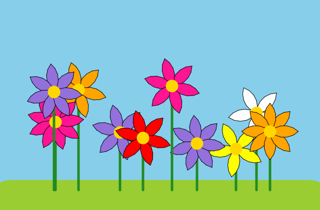
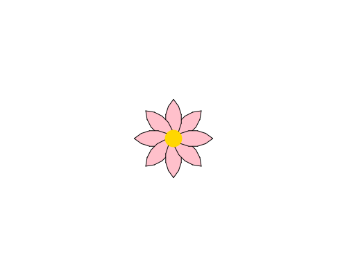

import CodeExercise from '@site/src/components/CodeExercise';

# Stap 1: Eén bloem (for-loop)

:::info
Dit project komt na de [turtle-lijn](site:python/docs/projecten/turtle), en
tekent met de commando's die je daar hebt geleerd. Deze stap gebruikt:

- de for-loop, uit [For-loop](site:python/docs/herhalen/06a-for-loop);
- `left`, uit [Lijnen en hoeken](site:python/docs/projecten/turtle/lijnen/stap-1-forward);
- `fillcolor`, `begin_fill` en `end_fill`, uit [Kleur en dikte](site:python/docs/projecten/turtle/kleuren/stap-2-vullen);
- `circle` met een hoek, uit [Cirkels en bogen](site:python/docs/projecten/turtle/cirkels/stap-2-boog);
- `dot` en `hideturtle`, uit [Een dobbelsteen](site:python/docs/projecten/turtle/dobbelsteen/stap-2-stippen).
:::

Aan het eind van dit project tekent de computer een veld vol bloemen, op
plekken en in kleuren die hij zelf kiest:



Dat programma schrijf je zelf, in zes stappen. Je begint met één bloem.

## Een blaadje

Een blaadje is twee bogen, en na elke boog draait de schildpad 90 graden:

```python
import turtle

turtle.fillcolor("pink")
turtle.begin_fill()
turtle.circle(40, 90)
turtle.left(90)
turtle.circle(40, 90)
turtle.left(90)
turtle.end_fill()
```

<CodeExercise>{`import turtle

turtle.fillcolor("pink")
turtle.begin_fill()
turtle.circle(40, 90)
turtle.left(90)
turtle.circle(40, 90)
turtle.left(90)
turtle.end_fill()`}</CodeExercise>

Na het blaadje staat de schildpad weer waar hij begon, en hij kijkt ook
weer dezelfde kant op: twee bogen van 90 graden en twee draaien van 90
graden zijn samen precies één rondje.

## Opdracht: een bloem met acht blaadjes

Schrijf een programma dat:

1. het blaadje acht keer tekent met een for-loop;
2. de schildpad na elk blaadje een stukje verder draait, zodat de acht
   blaadjes samen een hele kring maken;
3. in het midden een gouden hart zet: een stip van 25 breed in `"gold"`;
4. aan het eind de schildpad verbergt.

Gebruik de variabele `blaadjes` en niet het getal 8 zelf. In stap 3
krijgt elke bloem zijn eigen aantal.



<CodeExercise>{`import turtle

blaadjes = 8`}</CodeExercise>

<details>
<summary>Klik hier voor een tip.</summary>

Welke regels horen bij één blaadje? Die gaan de loop in, samen met de
draai. Hoe ver draai je? Een hele kring is 360 graden, en die verdeel je
over alle blaadjes. Het hart komt pas na de loop, anders teken je er
acht.

</details>

<details>
<summary>Klik hier voor de oplossing.</summary>

{/* turtle-plaatje: img/stap-1-bloem.svg */}

```python
import turtle

blaadjes = 8

turtle.fillcolor("pink")
for blad in range(blaadjes):
    turtle.begin_fill()
    turtle.circle(40, 90)
    turtle.left(90)
    turtle.circle(40, 90)
    turtle.left(90)
    turtle.end_fill()
    turtle.left(360 / blaadjes)
turtle.dot(25, "gold")
turtle.hideturtle()
```

`360 / blaadjes` is hier 45. Zet je `blaadjes` op 6, dan draait de
schildpad 60 graden, en sluit de kring nog steeds.

</details>

## Er gaat iets mis

**Je ziet maar één blaadje.**

**Oorzaak:** de regel met `turtle.left(360 / blaadjes)` springt niet in.
Dan hoort hij niet bij de loop, en draait de schildpad pas als alle acht
blaadjes er al staan. Ze liggen dan precies op elkaar.

**Oplossing:** laat die regel vier spaties inspringen, net als de regels
van het blaadje.

Kopieer je programma voordat je verdergaat: de editor bewaart het niet.

Door naar [stap 2: twee bloemen in het gras](site:python/docs/projecten/bloemenveld/stap-2-functie).
