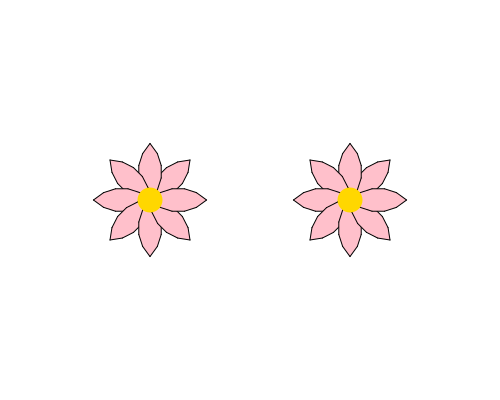

import CodeExercise from '@site/src/components/CodeExercise';

# Stap 2: Twee bloemen (een functie)

:::info
Deze stap gebruikt functies, uit [Functies](site:python/docs/functies/functies).
:::

Een veld heeft meer dan één bloem. Je kunt de regels van je bloem
kopiëren, maar dan staat alles dubbel, en bij tien bloemen tien keer. Zet
de bloem liever in een functie. Dan teken je hem met één regel, zo vaak
als je wilt.

Zo ziet een functie eruit die een gouden stip zet:

```python
import turtle

def hart():
    turtle.dot(25, "gold")

hart()
turtle.penup()
turtle.goto(100, 0)
hart()
```

Alles wat onder `def hart():` inspringt, hoort bij de functie. Er gebeurt
pas iets als je hem aanroept. Hier gebeurt dat twee keer, dus zie je twee
stippen.

## Opdracht: twee bloemen naast elkaar

Plak je programma uit stap 1 in het veld. Ben je het kwijt, neem dan de
oplossing van [stap 1](site:python/docs/projecten/bloemenveld/stap-1-for-loop).

Maak een functie `bloem()` die de bloem uit stap 1 tekent op de plek
waar de schildpad staat. Teken er daarna twee: één met het midden op
`(-100, 0)` en één op `(100, 0)`. Tussen de bloemen loopt de schildpad
zonder een lijn te trekken.



<CodeExercise>{`# Plak hier je programma uit stap 1`}</CodeExercise>

<details>
<summary>Klik hier voor een tip.</summary>

Alles wat bij één bloem hoort, gaat de functie in: de kleur, de loop en
het hart. De variabele `blaadjes` mag erboven blijven staan. Onder de
functie loop je met de pen omhoog naar de eerste plek, zet je de pen
weer neer, en roep je `bloem` aan. Voor de tweede bloem doe je dat nog
een keer.

</details>

<details>
<summary>Klik hier voor de oplossing.</summary>

{/* turtle-plaatje: img/stap-2-twee-bloemen.svg */}

```python
import turtle

blaadjes = 8

def bloem():
    turtle.fillcolor("pink")
    for blad in range(blaadjes):
        turtle.begin_fill()
        turtle.circle(40, 90)
        turtle.left(90)
        turtle.circle(40, 90)
        turtle.left(90)
        turtle.end_fill()
        turtle.left(360 / blaadjes)
    turtle.dot(25, "gold")

turtle.penup()
turtle.goto(-100, 0)
turtle.pendown()
bloem()
turtle.penup()
turtle.goto(100, 0)
turtle.pendown()
bloem()
turtle.hideturtle()
```

De loop staat nu in de functie, dus de regels van het blaadje springen
twee keer in: acht spaties.

</details>

## Er gaat iets mis

{/* foutmelding-van: bloem()\ndef bloem():\n    pass */}

```
NameError: name 'bloem' is not defined
```

**Oorzaak:** je roept `bloem()` aan boven de regel met `def bloem():`.
Python leest je programma van boven naar beneden, en kent de functie op
die plek nog niet.

**Oplossing:** zet de functie bovenaan, direct onder `import turtle` en
`blaadjes = 8`, en de aanroepen eronder.

Kopieer je programma voordat je verdergaat: de editor bewaart het niet.

Door naar [stap 3: elke bloem anders](site:python/docs/projecten/bloemenveld/stap-3-parameters).
