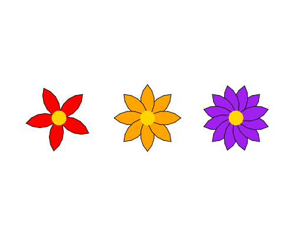

import CodeExercise from '@site/src/components/CodeExercise';

# Stap 3: Elke bloem anders (parameters)

:::info
Deze stap gebruikt parameters, uit [Parameters](site:python/docs/functies/09a-parameters).
:::

Je twee bloemen zijn precies hetzelfde. In een echt veld heeft elke bloem
zijn eigen kleur, en de ene heeft meer blaadjes dan de andere. Met
parameters geef je elke aanroep zijn eigen waarden mee:

```python
import turtle

def hart(x, y):
    turtle.penup()
    turtle.goto(x, y)
    turtle.dot(25, "gold")

hart(-100, 0)
hart(100, 50)
```

Bij `hart(-100, 0)` is `x` gelijk aan -100 en `y` gelijk aan 0. De functie
loopt nu zelf naar zijn plek, dus onder de functie hoef je niet meer te
lopen.

## Opdracht: drie verschillende bloemen

Plak je programma uit stap 2 in het veld. Ben je het kwijt, neem dan de
oplossing van [stap 2](site:python/docs/projecten/bloemenveld/stap-2-functie).

Maak van je functie `bloem(x, y, kleur, blaadjes)`. De functie loopt zelf
naar `(x, y)`, kleurt de blaadjes in `kleur` en tekent er `blaadjes`
stuks. Teken daarmee drie bloemen:

1. een rode (`"red"`) met 5 blaadjes op `(-150, 0)`;
2. een oranje (`"orange"`) met 8 blaadjes op `(0, 0)`;
3. een paarse (`"purple"`) met 12 blaadjes op `(150, 0)`.

De regel `blaadjes = 8` boven de functie kan weg: het aantal komt nu uit
de aanroep. De functie `gras()` en de blauwe lucht blijven zoals ze zijn.



<CodeExercise>{`# Plak hier je programma uit stap 2`}</CodeExercise>

<details>
<summary>Klik hier voor een tip.</summary>

De parameters vervangen wat nu vaststaat: de plek, de kleur en het
aantal. Zoek in je functie de plek waar `"pink"` staat. Het lopen naar de
plek, met `penup`, `goto` en `pendown`, gaat de functie in. De waarden in
een aanroep staan in dezelfde volgorde als de parameters.

</details>

<details>
<summary>Klik hier voor de oplossing.</summary>

{/* turtle-plaatje: img/stap-3-drie-bloemen.svg */}

```python
import turtle

def bloem(x, y, kleur, blaadjes):
    turtle.penup()
    turtle.goto(x, y)
    turtle.pendown()
    turtle.fillcolor(kleur)
    for blad in range(blaadjes):
        turtle.begin_fill()
        turtle.circle(40, 90)
        turtle.left(90)
        turtle.circle(40, 90)
        turtle.left(90)
        turtle.end_fill()
        turtle.left(360 / blaadjes)
    turtle.dot(25, "gold")

def gras():
    turtle.penup()
    turtle.goto(-300, -160)
    turtle.fillcolor("yellowgreen")
    turtle.begin_fill()
    turtle.goto(300, -160)
    turtle.goto(300, -260)
    turtle.goto(-300, -260)
    turtle.goto(-300, -160)
    turtle.end_fill()

turtle.bgcolor("skyblue")
gras()
bloem(-150, 0, "red", 5)
bloem(0, 0, "orange", 8)
bloem(150, 0, "purple", 12)
turtle.hideturtle()
```

Omdat de draai `360 / blaadjes` is, sluit de kring bij elk aantal: 72
graden bij vijf blaadjes, 30 bij twaalf.

</details>

## Er gaat iets mis

{/* foutmelding-van: import turtle\nturtle.fillcolor("kleur") */}

```
turtle.TurtleGraphicsError: bad color string: kleur
```

**Oorzaak:** er staan aanhalingstekens om `kleur`, dus
`turtle.fillcolor("kleur")`. Met aanhalingstekens is het de tekst
`kleur`, en een kleur met die naam bestaat niet. Een parameter schrijf
je zonder aanhalingstekens.

**Oplossing:** schrijf `turtle.fillcolor(kleur)`. Dan gebruikt Python de
waarde uit de aanroep, zoals `"red"`.

Kopieer je programma voordat je verdergaat: de editor bewaart het niet.

Door naar [stap 4: bloemen met een steel](site:python/docs/projecten/bloemenveld/stap-4-return).
