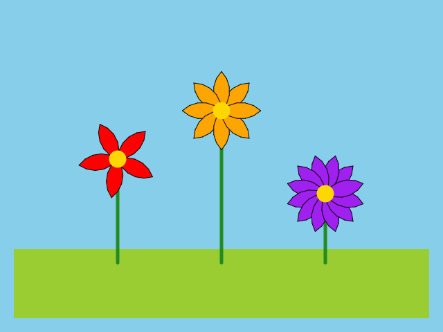

import CodeExercise from '@site/src/components/CodeExercise';

# Stap 4: Bloemen met een steel (return)

:::info
Deze stap gebruikt `return`, uit [Return](site:python/docs/functies/09b-return),
en `pencolor` en `pensize`, uit [Kleur en dikte](site:python/docs/projecten/turtle/kleuren/stap-1-pen).
:::

Je bloemen zweven nog boven het gras. Ze krijgen een steel, en de bloem
komt bovenop. Waar dat is, hangt af van hoe lang de steel is. De functie
die de steel tekent, weet het, en geeft het terug met `return`:

```python
def boven(y, lengte):
    return y + lengte

top = boven(-180, 150)
print(top)   # -30
```

`return` geeft een waarde terug aan de plek waar je de functie aanriep.
Hier vangt de variabele `top` die waarde op.

## Opdracht: drie bloemen met een steel

Plak je programma uit stap 3 in het veld. Ben je het kwijt, neem dan de
oplossing van [stap 3](site:python/docs/projecten/bloemenveld/stap-3-parameters).

Schrijf een functie `steel(x, y, lengte)` die:

1. een groene (`"forestgreen"`) steel van 5 dik tekent, van `(x, y)`
   recht omhoog, `lengte` lang;
2. de pen daarna terugzet op zwart en 1 dik, anders krijgen je blaadjes
   een dikke groene rand;
3. met `return` de y teruggeeft van de bovenkant van de steel.

Teken daarmee je drie bloemen van stap 3 op een steel. Elke steel begint
op een y van -180, een stukje in het gras. De rode krijgt een steel van
150 lang, de oranje van 220 en de paarse van 100.



<CodeExercise>{`# Plak hier je programma uit stap 3`}</CodeExercise>

<details>
<summary>Klik hier voor een tip.</summary>

Een rechte steel omhoog is een `goto` naar het punt recht boven het
begin: dezelfde x, en een y die `lengte` hoger ligt. Die y geeft de
functie ook terug. Na `return` doet de functie niets meer, dus zet je de
pen daarvoor terug. Vang wat `steel` teruggeeft op in een variabele, en
geef die aan `bloem` mee als y.

</details>

<details>
<summary>Klik hier voor de oplossing.</summary>

{/* turtle-plaatje: img/stap-4-stelen.svg */}

```python
import turtle

def bloem(x, y, kleur, blaadjes):
    turtle.penup()
    turtle.goto(x, y)
    turtle.pendown()
    turtle.fillcolor(kleur)
    for blad in range(blaadjes):
        turtle.begin_fill()
        turtle.circle(40, 90)
        turtle.left(90)
        turtle.circle(40, 90)
        turtle.left(90)
        turtle.end_fill()
        turtle.left(360 / blaadjes)
    turtle.dot(25, "gold")

def steel(x, y, lengte):
    turtle.penup()
    turtle.goto(x, y)
    turtle.pendown()
    turtle.pencolor("forestgreen")
    turtle.pensize(5)
    turtle.goto(x, y + lengte)
    turtle.pencolor("black")
    turtle.pensize(1)
    return y + lengte

def gras():
    turtle.penup()
    turtle.goto(-300, -160)
    turtle.fillcolor("yellowgreen")
    turtle.begin_fill()
    turtle.goto(300, -160)
    turtle.goto(300, -260)
    turtle.goto(-300, -260)
    turtle.goto(-300, -160)
    turtle.end_fill()

turtle.bgcolor("skyblue")
gras()
top = steel(-150, -180, 150)
bloem(-150, top, "red", 5)
top = steel(0, -180, 220)
bloem(0, top, "orange", 8)
top = steel(150, -180, 100)
bloem(150, top, "purple", 12)
turtle.hideturtle()
```

Eerst het gras, dan de steel, en de bloem als laatste. Zo staat de steel
in het gras, en ligt de bloem over het eind van de steel heen.

</details>

## Er gaat iets mis

{/* foutmelding-van: import turtle\ndef steel(x, y, lengte):\n    turtle.goto(x, y + lengte)\ntop = steel(0, -180, 100)\nturtle.goto(0, top) */}

```
TypeError: turtle.Vec2D() argument after * must be an iterable, not int
```

**Oorzaak:** de regel met `return` ontbreekt in `steel`. Een functie
zonder `return` geeft `None` terug: geen waarde. Dan is `top` gelijk aan
`None`, en krijgt `bloem` die `None` mee als y.

De melding wijst naar de regel met `goto` in `bloem`, want daar loopt het
vast: `goto` kan niet naar een y die `None` is. Maar `bloem` doet niets
fout. De fout zit eerder, in `steel`, die geen y teruggaf. Zet een
`print(top)` onder de aanroep van `steel`, dan zie je `None` staan.

**Oplossing:** zet `return y + lengte` als laatste regel in `steel`.

**Er lopen dunne zwarte lijnen schuin door je tekening.**

**Oorzaak:** in `steel` staat geen `penup()` vóór de eerste `goto`. Dan
trekt de schildpad een lijn van waar hij stond naar het begin van de
steel: van het hart van de vorige bloem naar de voet van de volgende.
Bij de eerste steel zie je niets, want na `gras()` staat de pen nog
omhoog.

**Oplossing:** zet in `steel` de pen omhoog, loop naar `(x, y)`, en zet
de pen pas daar weer neer, net zoals `bloem` doet.

Kopieer je programma voordat je verdergaat: de editor bewaart het niet.

Door naar [stap 5: een veld klaprozen](site:python/docs/projecten/bloemenveld/stap-5-random).
