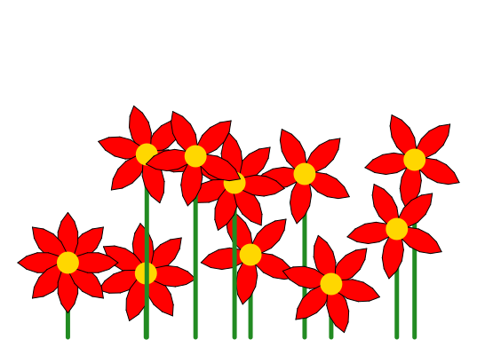

import CodeExercise from '@site/src/components/CodeExercise';

# Stap 5: Een veld klaprozen (de module random)

:::info
Deze stap gebruikt `import` uit [Modules importeren](site:python/docs/modules/09d-modules).
:::

Drie bloemen zet je nog met de hand neer. Voor een veld wil je er tien,
en dan wil je niet elke plek zelf bedenken. Laat de computer kiezen, met
de module **`random`**. De functie `randint` daarin geeft een willekeurig
geheel getal:

{/* uitvoer-varieert: random kiest elke keer andere getallen */}

```python
import random

for keer in range(3):
    print(random.randint(-220, 220))
```

Elke keer dat je op Uitvoeren drukt, komen er drie andere getallen, van
-220 tot en met 220. Het tweede getal kan zelf ook uitkomen.

<CodeExercise>{`import random

for keer in range(3):
    print(random.randint(-220, 220))`}</CodeExercise>

## Opdracht: tien klaprozen

Plak je programma uit stap 4 in het veld. Ben je het kwijt, neem dan de
oplossing van [stap 4](site:python/docs/projecten/bloemenveld/stap-4-return).

Haal de drie bloemen onder je functies weg. Teken in plaats daarvan met
een for-loop tien rode bloemen op een steel. Elke steel begint op een y
van -180, en per bloem kiest de computer:

1. de x, van -220 tot en met 220;
2. de lengte van de steel, van 60 tot en met 220;
3. het aantal blaadjes, van 5 tot en met 9.

Jouw veld ziet er anders uit dan het plaatje, want de computer kiest elke
keer andere getallen. Druk een paar keer op Uitvoeren: elk veld is nieuw.



:::tip
Tien bloemen tekenen duurt een tijdje. Met `turtle.speed(0)` bovenaan je
programma tekent de schildpad zo snel als hij kan, en zie je meteen het
hele veld.
:::

<CodeExercise>{`# Plak hier je programma uit stap 4`}</CodeExercise>

<details>
<summary>Klik hier voor een tip.</summary>

Wat elke bloem anders heeft, kies je in de loop, vlak voordat je de steel
en de bloem tekent: drie keer `randint`. En waar in je programma moet
`import random` staan?

</details>

<details>
<summary>Klik hier voor de oplossing.</summary>

{/* turtle-plaatje met zaad 735: img/stap-5-klaprozen.svg */}

```python
import turtle
import random

def bloem(x, y, kleur, blaadjes):
    turtle.penup()
    turtle.goto(x, y)
    turtle.pendown()
    turtle.fillcolor(kleur)
    for blad in range(blaadjes):
        turtle.begin_fill()
        turtle.circle(40, 90)
        turtle.left(90)
        turtle.circle(40, 90)
        turtle.left(90)
        turtle.end_fill()
        turtle.left(360 / blaadjes)
    turtle.dot(25, "gold")

def steel(x, y, lengte):
    turtle.penup()
    turtle.goto(x, y)
    turtle.pendown()
    turtle.pencolor("forestgreen")
    turtle.pensize(5)
    turtle.goto(x, y + lengte)
    turtle.pencolor("black")
    turtle.pensize(1)
    return y + lengte

turtle.speed(0)
for keer in range(10):
    x = random.randint(-220, 220)
    lengte = random.randint(60, 220)
    blaadjes = random.randint(5, 9)
    top = steel(x, -180, lengte)
    bloem(x, top, "red", blaadjes)
turtle.hideturtle()
```

De functies zijn niet veranderd. Alleen wat eronder staat is nieuw: de
loop kiest de getallen, en de functies tekenen ermee.

</details>

## Er gaat iets mis

**Je ziet maar één bloem.**

**Oorzaak:** de drie regels met `randint` staan boven de loop in plaats
van erin. Dan kiest de computer de getallen één keer, en tekent hij tien
keer dezelfde bloem op dezelfde plek. Ze liggen precies op elkaar.

**Oplossing:** zet de regels met `randint` in de loop. Dan kiest de
computer bij elke bloem opnieuw.

Kopieer je programma voordat je verdergaat: de editor bewaart het niet.

Door naar [stap 6: een bont bloemenveld](site:python/docs/projecten/bloemenveld/stap-6-lijst).
