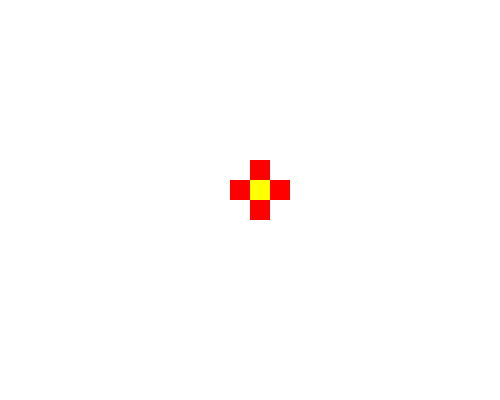

import CodeExercise from '@site/src/components/CodeExercise';

# Stap 1: Eén vakje (def en parameters)

:::info
Deze stap gebruikt een functie met parameters, uit [Functies](site:python/docs/functies/functies) en [Parameters](site:python/docs/functies/09a-parameters). Het tekenen ken je uit de turtle-projecten: inkleuren uit [Kleuren](site:python/docs/projecten/turtle/kleuren/stap-2-vullen), `penup` uit [Een huis](site:python/docs/projecten/turtle/een-huis/stap-2-raam), en `goto` en `hideturtle` uit [Dobbelsteen](site:python/docs/projecten/turtle/dobbelsteen/stap-1-goto).
:::

Oude computerspellen tekenden hun poppetjes met grote, gekleurde vakjes:
pixel art. Zo'n plaatje kun je ook als tekst opschrijven, met één teken per
vakje:

```
.##.##.
#######
#######
.#####.
..###..
...#...
```

Elke `#` is een zwart vakje, elke `.` een leeg vakje. Je ziet het hart al
staan. In zes stappen schrijf je een programma dat van zulke tekst een
echte tekening maakt, in kleur. Aan het eind ontwerp je je eigen plaatje.

Alles begint bij één vakje.

## Opdracht: een bloem van vijf vakjes

Schrijf een functie `vakje(x, y, kleur)` die een ingekleurd vierkant van 20
bij 20 tekent:

1. De linkeronderhoek van het vakje ligt op `(x, y)`.
2. De schildpad loopt er met de pen omhoog naartoe, zodat er geen streep
   komt.
3. Het vakje krijgt de kleur `kleur`, zonder zwarte rand eromheen.

Teken daarmee een bloem van vijf vakjes: een geel hart op `(0, 0)`, met
links, rechts, boven en onder een rood blaadje. Verstop de schildpad met
`turtle.hideturtle()`, anders staat hij midden in je bloem.



<CodeExercise>{`import turtle`}</CodeExercise>

<details>
<summary>Klik hier voor een tip.</summary>

Een vierkant is een for-loop die vier keer `forward` en `left` doet. Zet
die loop tussen `begin_fill` en `end_fill`. Til de pen op voor je naar het
vakje loopt, en laat hem omhoog: de schildpad vult het vierkant dan wel,
maar trekt er geen lijn omheen. Een blaadje ligt precies één vakje naast
het hart, dus 20 stappen verder.

</details>

<details>
<summary>Klik hier voor de oplossing.</summary>

{/* turtle-plaatje: img/stap-1-bloem.svg */}

```python
import turtle

def vakje(x, y, kleur):
    turtle.penup()
    turtle.goto(x, y)
    turtle.fillcolor(kleur)
    turtle.begin_fill()
    for zijde in range(4):
        turtle.forward(20)
        turtle.left(90)
    turtle.end_fill()

turtle.hideturtle()
vakje(0, 0, "yellow")
vakje(-20, 0, "red")
vakje(20, 0, "red")
vakje(0, 20, "red")
vakje(0, -20, "red")
```

Na `penup()` zet de schildpad de pen nergens meer neer. Dat hoeft ook niet:
`begin_fill` en `end_fill` kleuren het vierkant in, ook als hij er geen
lijn omheen trekt.

</details>

## Er gaat iets mis

{/* foutmelding-van: vakje = print\nvakje(0, 20, red) */}

```
NameError: name 'red' is not defined
```

**Oorzaak:** je schreef `vakje(0, 20, red)`, zonder aanhalingstekens. Dan
zoekt Python een variabele die `red` heet, en die bestaat niet.

**Oplossing:** een kleur is tekst, dus zet hem tussen aanhalingstekens:
`vakje(0, 20, "red")`.

Kopieer je programma voordat je verdergaat: de editor bewaart het niet.

Door naar [stap 2: een rij uit tekst](site:python/docs/projecten/pixel-art/stap-2-rij).
