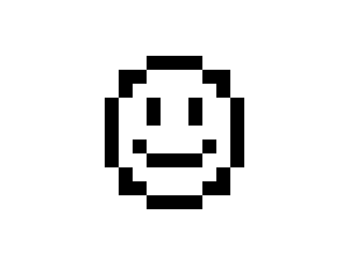

import CodeExercise from '@site/src/components/CodeExercise';

# Stap 3: Een heel plaatje (een lijst)

:::info
Deze stap gebruikt een lijst en een for-loop over een lijst, uit [Lijsten](site:python/docs/data/10a-lijsten-basis).
:::

Voor het hart roep je zes keer `rij` aan, elke keer met een andere `y`. Bij
een plaatje van twintig regels wordt dat een lange rij aanroepen, en één
verkeerde `y` zet een regel scheef. Zet de regels liever in een lijst. Een
for-loop loopt ze dan voor je af:

```python
hart = [
    ".##.##.",
    "#######",
    "#######",
    ".#####.",
    "..###..",
    "...#...",
]

for regel in hart:
    print(regel)
```

Uitvoer:

```
.##.##.
#######
#######
.#####.
..###..
...#...
```

Elke ronde is `regel` de volgende tekst uit de lijst. Met `print` zie je het
plaatje al, in tekens. Voor een tekening roep je in de loop `rij` aan in
plaats van `print`.

## Opdracht: een smiley

Plak je programma uit stap 2 in het veld. Ben je het kwijt, neem dan de
oplossing van [stap 2](site:python/docs/projecten/pixel-art/stap-2-rij).

Zet deze smiley in je programma:

```python
smiley = [
    "...####...",
    ".##....##.",
    ".#......#.",
    "#..#..#..#",
    "#..#..#..#",
    "#........#",
    "#.#....#.#",
    "#..####..#",
    ".#......#.",
    ".##....##.",
    "...####...",
]
```

Teken hem met een for-loop over de lijst, in plaats van de zes losse
aanroepen voor het hart. De bovenste regel begint op `(-100, 100)`, en elke
volgende regel 20 lager.

Bij zoveel vakjes duurt het even voordat de tekening klaar is. Zet
`turtle.speed(0)` bovenaan, dan zie je meteen het eindresultaat.



<CodeExercise>{`# Plak hier je programma uit stap 2`}</CodeExercise>

<details>
<summary>Klik hier voor een tip.</summary>

Je hebt een variabele nodig voor de hoogte van de regel. Die krijgt zijn
eerste waarde boven de loop. In de loop roep je `rij` aan met de regel en
die hoogte, en daarna gaat er 20 van de hoogte af. De `x` blijft voor elke
regel hetzelfde: alle regels beginnen links.

</details>

<details>
<summary>Klik hier voor de oplossing.</summary>

{/* turtle-plaatje: img/stap-3-smiley.svg */}

```python
import turtle

def vakje(x, y, kleur):
    turtle.penup()
    turtle.goto(x, y)
    turtle.fillcolor(kleur)
    turtle.begin_fill()
    for zijde in range(4):
        turtle.forward(20)
        turtle.left(90)
    turtle.end_fill()

def rij(regel, x, y):
    for teken in regel:
        if teken == "#":
            vakje(x, y, "black")
        x = x + 20

smiley = [
    "...####...",
    ".##....##.",
    ".#......#.",
    "#..#..#..#",
    "#..#..#..#",
    "#........#",
    "#.#....#.#",
    "#..####..#",
    ".#......#.",
    ".##....##.",
    "...####...",
]

turtle.speed(0)
turtle.hideturtle()
y = 100
for regel in smiley:
    rij(regel, -100, y)
    y = y - 20
```

Wil je het hart weer zien, zet dan een lijst `hart` in je programma en loop
daaroverheen. Aan `rij` verandert niets.

</details>

## Er gaat iets mis

**Je ziet maar één rij: een streep vol vakjes, en geen smiley.**

**Oorzaak:** `y = 100` staat in de loop. Dan begint elke regel weer op
hoogte 100, en tekent de schildpad alle regels over elkaar heen.

**Oplossing:** zet `y = 100` boven de loop. In de loop hoort alleen de regel
die er 20 van afhaalt.

Kopieer je programma voordat je verdergaat: de editor bewaart het niet.

Door naar [stap 4: kleuren](site:python/docs/projecten/pixel-art/stap-4-kleuren).
