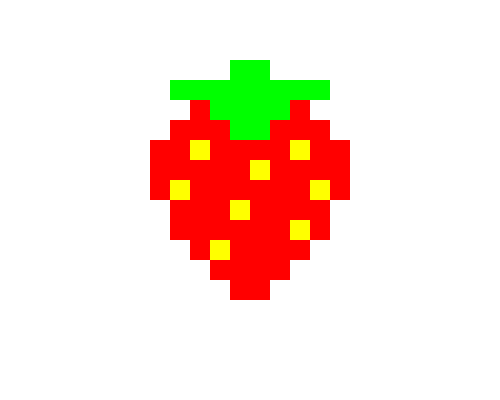

import CodeExercise from '@site/src/components/CodeExercise';

# Stap 4: Kleuren (een dictionary)

:::info
Deze stap gebruikt een dictionary, uit [Dictionaries](site:python/docs/data/11a-dictionaries-basis).
De functie `rij` leest die dictionary van buiten de functie, zoals in
[Scope](site:python/docs/functies/09c-scope).
:::

Met alleen zwart blijft je pixel art wat kaal. Geef daarom elke kleur een
eigen letter: `R` voor rood, `G` voor groen, `Y` voor geel. De letters komen
van de Engelse namen, net als de kleuren van turtle zelf. Welke kleur bij
welke letter hoort, zet je in een dictionary:

```python
kleuren = {"#": "black", "R": "red", "G": "green", "Y": "yellow"}

print(kleuren["R"])   # red

teken = "G"
print(kleuren[teken])   # green
```

De letter is de sleutel, de kleur de waarde. Je kunt de sleutel ook in een
variabele stoppen, zoals `teken`: dan zoekt Python de kleur op van het teken
dat er op dat moment in zit. Dat is precies wat er in `rij` gebeurt.

De dictionary zet je buiten de functies, onder `rij`. Toch mag `rij` hem
gebruiken, zonder dat je hem als parameter meegeeft: een functie mag lezen wat
erbuiten staat. Hij moet alleen bestaan op het moment dat je `rij` aanroept.

## Opdracht: een aardbei

Plak je programma uit stap 3 in het veld. Ben je het kwijt, neem dan de
oplossing van [stap 3](site:python/docs/projecten/pixel-art/stap-3-plaatje).

Pas `rij` aan, zodat elk teken behalve `.` een vakje wordt, in de kleur die
in `kleuren` bij dat teken hoort. Zet de dictionary van hierboven in je
programma, kopieer deze aardbei erbij, en teken hem in plaats van de smiley.
De bovenste regel begint op `(-100, 120)`.

```python
aardbei = [
    "....GG....",
    ".GGGGGGGG.",
    "..RGGGGR..",
    ".RRRGGRRR.",
    "RRYRRRRYRR",
    "RRRRRYRRRR",
    "RYRRRRRRYR",
    ".RRRYRRRR.",
    ".RRRRRRYR.",
    "..RYRRRR..",
    "...RRRR...",
    "....RR....",
]
```



<CodeExercise>{`# Plak hier je programma uit stap 3`}</CodeExercise>

<details>
<summary>Klik hier voor een tip.</summary>

De vraag in `rij` is niet meer of een teken een `#` is, maar of het géén `.`
is. De kleur van het vakje zoek je op in `kleuren`, met het teken als
sleutel. `kleuren` hoef je niet mee te geven aan `rij`: de functie leest
hem van buiten. De smiley werkt daarna nog steeds, want `#` staat ook in de
dictionary.

</details>

<details>
<summary>Klik hier voor de oplossing.</summary>

{/* turtle-plaatje: img/stap-4-aardbei.svg */}

```python
import turtle

def vakje(x, y, kleur):
    turtle.penup()
    turtle.goto(x, y)
    turtle.fillcolor(kleur)
    turtle.begin_fill()
    for zijde in range(4):
        turtle.forward(20)
        turtle.left(90)
    turtle.end_fill()

def rij(regel, x, y):
    for teken in regel:
        if teken != ".":
            vakje(x, y, kleuren[teken])
        x = x + 20

kleuren = {"#": "black", "R": "red", "G": "green", "Y": "yellow"}

aardbei = [
    "....GG....",
    ".GGGGGGGG.",
    "..RGGGGR..",
    ".RRRGGRRR.",
    "RRYRRRRYRR",
    "RRRRRYRRRR",
    "RYRRRRRRYR",
    ".RRRYRRRR.",
    ".RRRRRRYR.",
    "..RYRRRR..",
    "...RRRR...",
    "....RR....",
]

turtle.hideturtle()
y = 120
for regel in aardbei:
    rij(regel, -100, y)
    y = y - 20
```

`rij` staat boven `kleuren`, maar dat geeft niets: Python kijkt pas in
`kleuren` als `rij` draait, en dan bestaat de dictionary al.

</details>

## Er gaat iets mis

{/* foutmelding-van: kleuren = {"R": "red"}\nkleuren["r"] */}

```
KeyError: 'r'
```

**Oorzaak:** je plaatje gebruikt een teken dat niet in `kleuren` staat. Hier
is het een kleine `r`, terwijl de sleutel een hoofdletter `R` is. Voor Python
zijn dat twee verschillende tekens.

**Oplossing:** verbeter het teken in je plaatje, of zet het als sleutel in
`kleuren`. De melding noemt het teken dat ontbreekt.

Kopieer je programma voordat je verdergaat: de editor bewaart het niet.

Door naar [stap 5: spiegelen](site:python/docs/projecten/pixel-art/stap-5-spiegelen).
