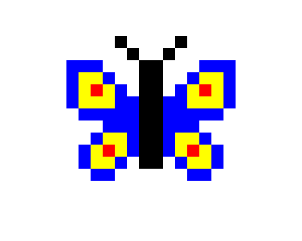

import CodeExercise from '@site/src/components/CodeExercise';

# Stap 5: Spiegelen (tekst aan elkaar plakken)

:::info
Nieuw in deze stap is tekst aan elkaar plakken met `+`. Daar is geen les voor;
het staat hieronder. De loop over de tekens van een tekst ken je uit
[stap 2](site:python/docs/projecten/pixel-art/stap-2-rij).
:::

Een vlinder is links en rechts hetzelfde, alleen gespiegeld. Dan hoef je maar
de helft op te schrijven, en maakt de computer de andere helft. Daarvoor draai
je elke regel om, en plak je die achter de regel zelf. Van `"BYR"` maak je zo
`"BYRRYB"`.

Met `+` plak je twee teksten aan elkaar:

```python
links = "BYR"
print(links + "#")   # BYR#
print("#" + links)   # #BYR
```

Wat links van de `+` staat, komt vooraan.

Een tekst kun je ook in een loop opbouwen, teken voor teken. Je begint met een
lege tekst: `""`, twee aanhalingstekens met niets ertussen. Elke ronde plak je
er een teken bij:

```python
opgebouwd = ""
for teken in "BYR":
    opgebouwd = opgebouwd + teken
    print(opgebouwd)
```

Uitvoer:

```
B
BY
BYR
```

In de eerste ronde is `opgebouwd` nog leeg, en plakt Python er `B` achter.
Daarna komt `Y` achter `B`, en dan `R` achter `BY`. Klik in het veld hieronder
op Stap voor stap, en blader door de rondes: je ziet `opgebouwd` per ronde
een teken langer worden.

<CodeExercise>{`opgebouwd = ""
for teken in "BYR":
    opgebouwd = opgebouwd + teken
    print(opgebouwd)`}</CodeExercise>

Stap voor stap werkt ook op je hele tekenprogramma, maar daar heb je weinig
aan: de knop stopt na 1000 stappen, en de vlinder hieronder kost er bijna
drie keer zoveel. In dit kleine veld zie je alles.

## Opdracht: een vlinder

Plak je programma uit stap 4 in het veld. Ben je het kwijt, neem dan de
oplossing van [stap 4](site:python/docs/projecten/pixel-art/stap-4-kleuren).

Schrijf een functie `spiegelrij(regel, x, y)` die een regel tekent met zijn
spiegelbeeld erachter:

1. Eerst bouwt hij in een loop het spiegelbeeld van `regel` op: dezelfde
   tekens, in omgekeerde volgorde. Bij `"BYR"` is dat `"RYB"`.
2. Daarna roept hij `rij` aan, met `regel` en het spiegelbeeld aan elkaar
   geplakt.

Teken daarmee deze vlinder, met een loop over de lijst zoals in stap 3. In de
lijst staat alleen de linkerhelft. Kopieer hem naar je programma. De vlinder
is blauw, dus zet ook `"B": "blue"` in `kleuren`. De bovenste regel begint op
`(-140, 120)`.

```python
vlinder = [
    "....#..",
    ".....#.",
    "BBB...#",
    "BYYB..#",
    "BYRYB.#",
    "BYYYBB#",
    ".BBBBB#",
    "...BBB#",
    "..BYYB#",
    ".BYRYB#",
    ".BYYB.#",
    "..BB...",
]
```



<CodeExercise>{`# Plak hier je programma uit stap 4`}</CodeExercise>

<details>
<summary>Klik hier voor een tip.</summary>

Begin in `spiegelrij` met een lege tekst, net als hierboven. Het verschil zit
in de plek waar het nieuwe teken komt. Hierboven kwam het achteraan, en dan
krijg je dezelfde volgorde terug. Voor een spiegelbeeld zet je elk nieuw teken
vooraan, vóór wat je al hebt. Pas als de loop klaar is, roep je `rij` aan.

</details>

<details>
<summary>Klik hier voor de oplossing.</summary>

{/* turtle-plaatje: img/stap-5-vlinder.svg */}

```python
import turtle

def vakje(x, y, kleur):
    turtle.penup()
    turtle.goto(x, y)
    turtle.fillcolor(kleur)
    turtle.begin_fill()
    for zijde in range(4):
        turtle.forward(20)
        turtle.left(90)
    turtle.end_fill()

def rij(regel, x, y):
    for teken in regel:
        if teken != ".":
            vakje(x, y, kleuren[teken])
        x = x + 20

def spiegelrij(regel, x, y):
    omgedraaid = ""
    for teken in regel:
        omgedraaid = teken + omgedraaid
    rij(regel + omgedraaid, x, y)

kleuren = {"#": "black", "R": "red", "G": "green", "Y": "yellow", "B": "blue"}

vlinder = [
    "....#..",
    ".....#.",
    "BBB...#",
    "BYYB..#",
    "BYRYB.#",
    "BYYYBB#",
    ".BBBBB#",
    "...BBB#",
    "..BYYB#",
    ".BYRYB#",
    ".BYYB.#",
    "..BB...",
]

turtle.hideturtle()
y = 120
for regel in vlinder:
    spiegelrij(regel, -140, y)
    y = y - 20
```

Bij `"BYR"` is `omgedraaid` na elke ronde `"B"`, dan `"YB"` en dan `"RYB"`:
elk nieuw teken komt vooraan. Wil je dat zien gebeuren, verander dan in het
kleine veld bovenaan deze pagina `opgebouwd + teken` in `teken + opgebouwd`,
en klik op Stap voor stap.

</details>

## Er gaat iets mis

**Je vlinder heeft twee linkerhelften: beide vleugels wijzen dezelfde kant op,
en er staan twee lijfjes.**

**Oorzaak:** in `spiegelrij` staat `omgedraaid = omgedraaid + teken`. Dan komt
elk teken achteraan, en krijg je de regel zelf terug in plaats van zijn
spiegelbeeld.

**Oplossing:** zet het nieuwe teken vooraan: `omgedraaid = teken + omgedraaid`.

{/* foutmelding-van: blok-eronder */}

```
UnboundLocalError: cannot access local variable 'omgedraaid' where it is not associated with a value
```

**Oorzaak:** je bent de regel `omgedraaid = ""` vergeten:

{/* niet-draaien: valt expres om, de melding staat erboven */}

```python
def spiegelrij(regel, x, y):
    for teken in regel:
        omgedraaid = teken + omgedraaid
    rij(regel + omgedraaid, x, y)

spiegelrij("BYR", 0, 0)
```

In de eerste ronde wil Python `teken` vóór `omgedraaid` plakken, maar
`omgedraaid` heeft dan nog geen waarde.

**Oplossing:** geef `omgedraaid` boven de loop de lege tekst als beginwaarde:
`omgedraaid = ""`.

Kopieer je programma voordat je verdergaat: de editor bewaart het niet.

Door naar [stap 6: een ruimtemannetje](site:python/docs/projecten/pixel-art/stap-6-ruimtemannetje).
