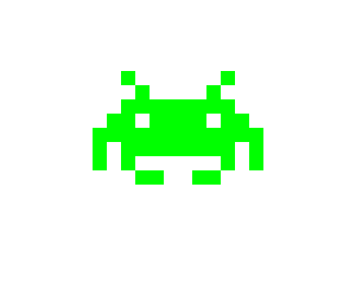

import CodeExercise from '@site/src/components/CodeExercise';

# Stap 6: Een ruimtemannetje (return)

:::info
Deze stap gebruikt `return`, uit [Return](site:python/docs/functies/09b-return).
:::

`spiegelrij` doet twee dingen tegelijk: hij draait een regel om, en hij tekent.
Of het omdraaien goed gaat, zie je pas aan de tekening. Een functie die alleen
omdraait en het spiegelbeeld teruggeeft, kun je los testen met `print`. En wat
hij teruggeeft, kun je gebruiken op elke plek waar een tekst mag staan.

Zo ziet een functie eruit die een tekst teruggeeft:

```python
def dubbel(regel):
    return regel + regel

print(dubbel("#."))
```

Uitvoer:

```
#.#.
```

`dubbel` print zelf niets. Hij plakt de tekst twee keer aan elkaar en geeft
het resultaat terug, en `print` laat het zien. In plaats van printen kun je
het resultaat ook doorgeven aan een andere functie, zoals `rij`.

## Opdracht: een ruimtemannetje

Plak je programma uit stap 5 in het veld. Ben je het kwijt, neem dan de
oplossing van [stap 5](site:python/docs/projecten/pixel-art/stap-5-spiegelen).

Schrijf een functie `spiegel(regel)` die het spiegelbeeld van `regel`
teruggeeft, en niets tekent. Test hem eerst los: `print(spiegel("BYR"))` moet
`RYB` geven.

Teken daarna dit ruimtemannetje, met in de loop over de lijst een aanroep van
`rij` met de regel en zijn spiegelbeeld aan elkaar. `spiegelrij` heb je dan
niet meer nodig. Kopieer de lijst naar je programma, en laat de vlinder
staan: die heb je in stap 7 weer nodig. De bovenste regel begint op
`(-120, 80)`.

```python
ruimtemannetje = [
    "..G...",
    "...G..",
    "..GGGG",
    ".GG.GG",
    "GGGGGG",
    "G.GGGG",
    "G.G...",
    "...GG.",
]
```



<CodeExercise>{`# Plak hier je programma uit stap 5`}</CodeExercise>

<details>
<summary>Klik hier voor een tip.</summary>

Het opbouwen van het spiegelbeeld neem je over uit `spiegelrij`. Alleen tekent
`spiegel` niets: als de loop klaar is, geeft hij het spiegelbeeld terug. In de
loop over het ruimtemannetje plak je de regel en wat `spiegel` van die regel
teruggeeft aan elkaar, en dat geef je aan `rij`.

</details>

<details>
<summary>Klik hier voor de oplossing.</summary>

{/* turtle-plaatje: img/stap-6-ruimtemannetje.svg */}

```python
import turtle

def vakje(x, y, kleur):
    turtle.penup()
    turtle.goto(x, y)
    turtle.fillcolor(kleur)
    turtle.begin_fill()
    for zijde in range(4):
        turtle.forward(20)
        turtle.left(90)
    turtle.end_fill()

def rij(regel, x, y):
    for teken in regel:
        if teken != ".":
            vakje(x, y, kleuren[teken])
        x = x + 20

def spiegel(regel):
    omgedraaid = ""
    for teken in regel:
        omgedraaid = teken + omgedraaid
    return omgedraaid

kleuren = {"#": "black", "R": "red", "G": "green", "Y": "yellow", "B": "blue"}

vlinder = [
    "....#..",
    ".....#.",
    "BBB...#",
    "BYYB..#",
    "BYRYB.#",
    "BYYYBB#",
    ".BBBBB#",
    "...BBB#",
    "..BYYB#",
    ".BYRYB#",
    ".BYYB.#",
    "..BB...",
]

ruimtemannetje = [
    "..G...",
    "...G..",
    "..GGGG",
    ".GG.GG",
    "GGGGGG",
    "G.GGGG",
    "G.G...",
    "...GG.",
]

print(spiegel("BYR"))

turtle.hideturtle()
y = 80
for regel in ruimtemannetje:
    rij(regel + spiegel(regel), -120, y)
    y = y - 20
```

`spiegel` geeft een tekst terug, dus `regel + spiegel(regel)` is ook een
tekst: de regel met zijn spiegelbeeld erachter. Die gaat in één keer naar
`rij`.

</details>

## Er gaat iets mis

**`print(spiegel("BYR"))` geeft `B`, en van het ruimtemannetje zie je alleen
de linkerhelft, met hier en daar één vakje ernaast.**

**Oorzaak:** `return omgedraaid` springt even ver in als de regel erboven, en
staat dus in de loop. Een `return` stopt de functie meteen, al in de eerste
ronde, als `omgedraaid` pas één teken heeft.

**Oplossing:** laat `return omgedraaid` even ver inspringen als de `for`. Dan
komt hij pas aan de beurt als de loop klaar is.

{/* foutmelding-van: blok-erboven */}

```python
def spiegel(regel):
    omgedraaid = ""
    for teken in regel:
        omgedraaid = teken + omgedraaid
    print(omgedraaid)

regel = "BYR"
print(regel + spiegel(regel))
```

```
TypeError: can only concatenate str (not "NoneType") to str
```

**Oorzaak:** `spiegel` print het spiegelbeeld, maar geeft het niet terug.
Een functie zonder `return` geeft `None` terug, en tekst plus `None` kan
Python niet aan elkaar plakken.

**Oplossing:** vervang `print(omgedraaid)` door `return omgedraaid`.

Kopieer je programma voordat je verdergaat: de editor bewaart het niet.

Door naar [stap 7: groot en klein](site:python/docs/projecten/pixel-art/stap-7-groot-en-klein).
