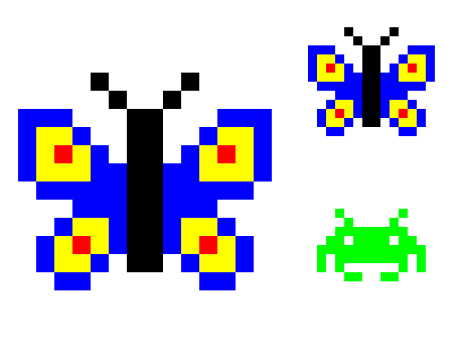

import CodeExercise from '@site/src/components/CodeExercise';

# Stap 7: Groot en klein (een parameter doorgeven)

:::info
Deze stap gebruikt een functie die een andere functie aanroept, uit
[Functies](site:python/docs/functies/functies), en geeft daarbij een parameter
door, zoals in [Parameters](site:python/docs/functies/09a-parameters).
:::

Je plaatjes hebben altijd vakjes van 20, en staan altijd op dezelfde plek.
Voor een hele zwerm zet je het tekenen van een plaatje in een
eigen functie, met de plek en de grootte als parameters. Die grootte heeft
uiteindelijk `vakje` nodig, maar die roep je niet zelf aan. Daarom geeft
elke functie de grootte door aan de functie die hij aanroept.

Zo werkt doorgeven, met tekst in plaats van vakjes:

```python
def groet(naam):
    print("Hallo", naam)

def groet_twee_keer(naam):
    groet(naam)
    groet(naam)

groet_twee_keer("Sam")
```

Uitvoer:

```
Hallo Sam
Hallo Sam
```

`groet_twee_keer` doet zelf niets met `naam`, behalve hem meegeven aan
`groet`. Pas daar komt de naam op het scherm.

## Opdracht: vlinders en een ruimtemannetje

Plak je programma uit stap 6 in het veld. Ben je het kwijt, neem dan de
oplossing van [stap 6](site:python/docs/projecten/pixel-art/stap-6-ruimtemannetje).

Maak een functie `teken_plaatje(plaatje, x, y, grootte)` die een heel
gespiegeld plaatje tekent. De bovenste regel begint op `(x, y)`, en elk
vakje is `grootte` breed en hoog. Geef ook `rij` en `vakje` een parameter
`grootte`.

Teken daarmee drie plaatjes:

1. een grote vlinder, met vakjes van 20, op `(-240, 100)`;
2. een kleinere vlinder, met vakjes van 10, op `(80, 160)`;
3. het ruimtemannetje, met vakjes van 10, op `(90, -40)`.



<CodeExercise>{`# Plak hier je programma uit stap 6`}</CodeExercise>

<details>
<summary>Klik hier voor een tip.</summary>

De loop over de regels gaat de nieuwe functie in. Zoek daarna elke plek waar
nog 20 staat: de zijde van een vakje, de stap naar rechts in `rij` en de
stap omlaag in de loop. Op al die plekken komt `grootte`. Vergeet niet om
`grootte` mee te geven bij elke aanroep, ook als `rij` het `vakje` aanroept.

</details>

<details>
<summary>Klik hier voor de oplossing.</summary>

{/* turtle-plaatje: img/stap-7-zwerm.svg */}

```python
import turtle

def vakje(x, y, kleur, grootte):
    turtle.penup()
    turtle.goto(x, y)
    turtle.fillcolor(kleur)
    turtle.begin_fill()
    for zijde in range(4):
        turtle.forward(grootte)
        turtle.left(90)
    turtle.end_fill()

def rij(regel, x, y, grootte):
    for teken in regel:
        if teken != ".":
            vakje(x, y, kleuren[teken], grootte)
        x = x + grootte

def spiegel(regel):
    omgedraaid = ""
    for teken in regel:
        omgedraaid = teken + omgedraaid
    return omgedraaid

def teken_plaatje(plaatje, x, y, grootte):
    for regel in plaatje:
        rij(regel + spiegel(regel), x, y, grootte)
        y = y - grootte

kleuren = {"#": "black", "R": "red", "G": "green", "Y": "yellow", "B": "blue"}

vlinder = [
    "....#..",
    ".....#.",
    "BBB...#",
    "BYYB..#",
    "BYRYB.#",
    "BYYYBB#",
    ".BBBBB#",
    "...BBB#",
    "..BYYB#",
    ".BYRYB#",
    ".BYYB.#",
    "..BB...",
]

ruimtemannetje = [
    "..G...",
    "...G..",
    "..GGGG",
    ".GG.GG",
    "GGGGGG",
    "G.GGGG",
    "G.G...",
    "...GG.",
]

turtle.hideturtle()
teken_plaatje(vlinder, -240, 100, 20)
teken_plaatje(vlinder, 80, 160, 10)
teken_plaatje(ruimtemannetje, 90, -40, 10)
```

`grootte` begint bij de aanroep van `teken_plaatje`, gaat naar `rij` en
komt zo bij `vakje` aan. Elk plaatje krijgt zijn eigen grootte, omdat elke
aanroep een andere waarde meegeeft. Welk plaatje er komt, bepaalt de eerste
parameter: dezelfde functie tekent een vlinder en een ruimtemannetje.

</details>

## Er gaat iets mis

**De grote vlinder klopt, maar de kleine plaatjes vallen uit elkaar: losse
vakjes met gaten ertussen.**

**Oorzaak:** in `rij` staat nog `x = x + 20`, of in `teken_plaatje` nog
`y = y - 20`. De vakjes zijn dan wel kleiner, maar de stappen ertussen
niet.

**Oplossing:** schuif op met `grootte` in plaats van met 20.

## Je eigen plaatje

Nu is het jouw beurt. Ontwerp je eigen figuur op ruitjespapier: kleur
vakjes in, en schrijf per regel de letters op. Omdat `teken_plaatje`
spiegelt, teken je alleen de linkerhelft. Denk aan een paddenstoel, een
kat, een bloem of een robot. Een nieuwe kleur geef je een
eigen letter in `kleuren`, bijvoorbeeld `"O": "orange"` of `"P": "pink"`.

Laat je plaatje daarna aan iemand naast je zien. Raadt die wat het is?

## Verder bouwen

Je pixel art werkt. Wil je verder, kies dan iets uit dit lijstje:

- Teken ook plaatjes die niet symmetrisch zijn, zoals de aardbei. Geef
  `teken_plaatje` een extra parameter, en spiegel alleen als die `True` is.
- Teken je figuur in twee standen naast elkaar, bijvoorbeeld een vlinder
  met de vleugels open en een met de vleugels half dicht.
- Zet een achtergrond achter je tekening met `turtle.bgcolor` (uit
  [Een gekleurde pen](site:python/docs/projecten/turtle/kleuren/stap-1-pen)),
  en laat een vlinder op een bloem zitten.
- Teken een rij vlinders die steeds kleiner worden, met een for-loop en
  `range`.
- Laat een plaatje op zijn kop staan: loop de regels van onder naar boven
  af.

Terug naar [het overzicht van de projecten](site:python/docs/projecten).
