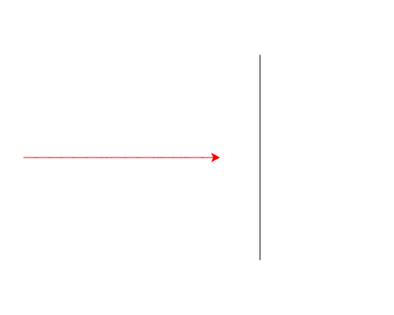

import CodeExercise from '@site/src/components/CodeExercise';

# Stap 1: Eén schildpad (random)

:::info
Dit project komt na de lijn [Tekenen met turtle](site:python/docs/projecten/turtle); maak die eerst af. Daaruit ken je `forward` ([Lijnen en hoeken](site:python/docs/projecten/turtle/lijnen/stap-1-forward)), `penup` en `pendown` ([Een huis](site:python/docs/projecten/turtle/een-huis/stap-2-raam)), `goto` ([Een dobbelsteen](site:python/docs/projecten/turtle/dobbelsteen/stap-1-goto)) en `pencolor` ([Kleur en dikte](site:python/docs/projecten/turtle/kleuren/stap-1-pen)). Uit de cursus gebruik je `import` uit [Modules importeren](site:python/docs/modules/09d-modules) en de for-loop uit [For-loop](site:python/docs/herhalen/06a-for-loop).
:::

Vier schildpadden racen naar een finishlijn. Niemand weet vooraf wie er
wint, want elke stap is een verrassing: soms een flinke sprong, soms maar
een klein stapje. Aan het eind zegt de winnaar het zelf. Zo kan een race
straks aflopen:


Dat programma schrijf je zelf, in acht stappen. Je begint met één
schildpad.

## Willekeurige getallen

Een stap van willekeurige lengte haal je uit de module **`random`**. De
functie `randint` daarin geeft een willekeurig geheel getal:

{/* uitvoer-varieert: random kiest elke keer een ander getal */}

```python
import random

print(random.randint(1, 20))
```

Elke keer dat je op Uitvoeren drukt, komt er een getal van 1 tot en met 20.
Anders dan bij `range` kan het tweede getal zelf ook uitkomen, dus 20 is een
mogelijke stap.

Zo'n getal kun je meteen aan de schildpad geven. Druk een paar keer op
Uitvoeren: de lijn is steeds anders lang.

<CodeExercise>{`import turtle
import random

turtle.forward(random.randint(1, 200))`}</CodeExercise>

## Opdracht: twintig stappen

Schrijf een programma dat:

1. een finishlijn tekent, van `(80, 130)` recht naar beneden tot
   `(80, -130)`;
2. de schildpad zonder te tekenen naar de start brengt, op `(-220, 0)`;
3. de pen van de schildpad rood maakt;
4. de schildpad 20 stappen vooruit laat zetten, elke stap met een
   willekeurige lengte van 1 tot en met 20.



Bij jou loopt de race anders dan op het plaatje, want de stappen zijn
willekeurig. Druk een paar keer op Uitvoeren. Haalt de schildpad ooit de
finish?

<CodeExercise>{`import turtle`}</CodeExercise>

<details>
<summary>Klik hier voor een tip.</summary>

Voor een lijn zonder te tekenen gebruik je `penup`, en daarna weer
`pendown`. Na de finishlijn kijkt de schildpad nog steeds naar rechts,
want `goto` draait hem niet. Voor de twintig stappen heb je een loop met
`range` nodig. De module voor willekeurige getallen moet je eerst
importeren, net als `turtle`.

</details>

<details>
<summary>Klik hier voor de oplossing.</summary>

{/* turtle-plaatje met zaad 11: img/stap-1-twintig-stappen.svg */}

```python
import turtle
import random

turtle.penup()
turtle.goto(80, 130)
turtle.pendown()
turtle.goto(80, -130)

turtle.penup()
turtle.goto(-220, 0)
turtle.pendown()
turtle.pencolor("red")

for stap in range(20):
    turtle.forward(random.randint(1, 20))
```

In elke ronde van de loop kiest `randint` een nieuw getal. Daarom is elke
stap anders lang.

</details>

<details>
<summary>Haalt hij ooit de finish?</summary>

Bijna nooit. Een stap is gemiddeld 10,5 lang, dus twintig stappen brengen
de schildpad gemiddeld 210 ver, en de finish ligt 300 verderop. Hij haalt
het alleen als bijna elke stap groot uitvalt: ongeveer één keer op de
5000 keer Uitvoeren. In stap 2 laat je hem doorlopen tot hij er is.

</details>

## Er gaat iets mis

{/* foutmelding-van: import random\nrandom.randint(20) */}

```
TypeError: Random.randint() missing 1 required positional argument: 'b'
```

**Oorzaak:** je schreef `random.randint(20)`, zoals bij `range(20)`. Maar
`randint` wil twee getallen: het kleinste en het grootste.

**Oplossing:** geef allebei mee, `random.randint(1, 20)`.

In de volgende stap bouw je verder op dit programma. Kopieer je programma
voordat je verdergaat: de editor bewaart het niet.

Door naar [stap 2: tot de finish](site:python/docs/projecten/schildpaddenrace/stap-2-while).
