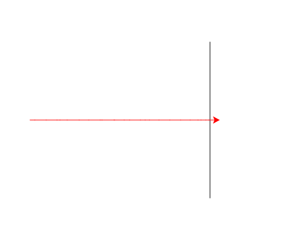

import CodeExercise from '@site/src/components/CodeExercise';

# Stap 2: Tot de finish (while)

:::info
Deze stap gebruikt de while-loop uit [While-loop](site:python/docs/herhalen/while-loop). Met `turtle.xcor()` heb je in [Een spiraal](site:python/docs/projecten/turtle/spiraal/stap-2-tot-de-rand) al een while-loop laten stoppen.
:::

Na twintig stappen staat de schildpad bijna altijd nog voor de finish.
Hoeveel stappen hij nodig heeft, weet je van tevoren niet:
dat hangt af van de getallen die `randint` kiest. Dat is werk voor een
`while`-loop.

De vraag in die loop gaat over de schildpad zelf. `turtle.xcor()` geeft
hoe ver hij naar rechts staat:

```python
import turtle

turtle.forward(70)
print(turtle.xcor())   # 70.0
```

De schildpad begon in het midden, op 0, en staat na 70 stappen op 70.

## Opdracht: lopen tot de streep

Plak je programma uit stap 1 in het veld. Ben je het kwijt, neem dan de
oplossing van [stap 1](site:python/docs/projecten/schildpaddenrace/stap-1-random).

Laat de schildpad stappen zetten zolang hij nog vóór de finishlijn staat.
Zodra hij de lijn raakt of eroverheen is, stopt hij. Elke stap is nog
steeds 1 tot en met 20 lang.



Bij jou is de schildpad misschien iets verder over de streep dan op het
plaatje, want de laatste stap is elke keer anders.

<CodeExercise>{`# Plak hier je programma uit stap 1`}</CodeExercise>

<details>
<summary>Klik hier voor een tip.</summary>

Alleen de loop verandert. Waar staat de finishlijn, als je kijkt naar de
x? Zolang `xcor` kleiner is dan dat getal, moet de schildpad nog een stap
zetten.

</details>

<details>
<summary>Klik hier voor de oplossing.</summary>

{/* turtle-plaatje met zaad 3: img/stap-2-tot-de-finish.svg */}

```python
import turtle
import random

turtle.penup()
turtle.goto(80, 130)
turtle.pendown()
turtle.goto(80, -130)

turtle.penup()
turtle.goto(-220, 0)
turtle.pendown()
turtle.pencolor("red")

while turtle.xcor() < 80:
    turtle.forward(random.randint(1, 20))
```

Elke stap verandert `xcor()`, dus de voorwaarde wordt vanzelf een keer
onwaar. Daarom stopt de loop altijd.

</details>

## Er gaat iets mis

{/* foutmelding-van: import turtle\nturtle.xcor < 80 */}

```
TypeError: '<' not supported between instances of 'function' and 'int'
```

**Oorzaak:** je schreef `turtle.xcor` zonder haakjes. Dan vraag je niet
naar de plek van de schildpad, maar heb je de functie zelf in handen. Een
functie kan Python niet met een getal vergelijken.

**Oplossing:** zet de haakjes erachter, `turtle.xcor()`. Pas dan voert
Python de functie uit en krijg je een getal terug.

Vanaf stap 3 heeft elke schildpad een eigen naam. Vergeet je de haakjes
dan, bij `rood.xcor`, dan staat er `'method'` in plaats van `'function'`.
Het is dezelfde fout, met dezelfde oplossing.

{/* foutmelding-van: import turtle\nturtle.goto(-220, 0)\nwhile turtle.xcor() != 80:\n    turtle.forward(7) */}

```
RuntimeError: De schildpad heeft al 50000 bewegingen gemaakt. Loopt je loop eindeloos door?
```

**Oorzaak:** je schreef `while turtle.xcor() != 80:`, dus "zolang hij niet
op de finish staat". Maar met stappen van 1 tot en met 20 springt de
schildpad meestal over de 80 heen, in ongeveer negen van de tien races.
Dan is `xcor()` nooit precies 80, blijft de vraag waar en loopt hij door,
ver voorbij de streep. Na 50000 bewegingen houdt de speeltuin ermee op.

**Oplossing:** vraag of hij er nog vóór staat, met `<`. Dan stopt de loop
ook als de schildpad over de 80 heen springt.

Kopieer je programma voordat je verdergaat: de editor bewaart het niet.

Door naar [stap 3: een tegenstander](site:python/docs/projecten/schildpaddenrace/stap-3-tweede-schildpad).
