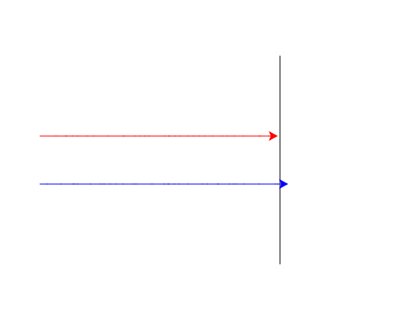

import CodeExercise from '@site/src/components/CodeExercise';

# Stap 3: Een tegenstander (turtle.Turtle)

:::info
Deze stap gebruikt `if` uit [If en else](site:python/docs/beslissen/05b-if-else), en `True` en `False` uit [Booleans en vergelijken](site:python/docs/beslissen/05a-booleans-en-vergelijken). Nieuw is `turtle.Turtle()`: dat staat hieronder.
:::

Een race in je eentje is niet spannend. Er moet een tegenstander bij.

Met `turtle.forward` stuur je steeds dezelfde schildpad. Wil je er meer,
dan maak je ze zelf, met `turtle.Turtle()`. Elke aanroep geeft een nieuwe
schildpad, die je in een variabele bewaart. Daarna schrijf je die naam
voor het commando, in plaats van `turtle`:

```python
import turtle

rood = turtle.Turtle()
rood.pencolor("red")
rood.forward(100)

blauw = turtle.Turtle()
blauw.pencolor("blue")
blauw.left(90)
blauw.forward(100)
```

<CodeExercise>{`import turtle

rood = turtle.Turtle()
rood.pencolor("red")
rood.forward(100)

blauw = turtle.Turtle()
blauw.pencolor("blue")
blauw.left(90)
blauw.forward(100)`}</CodeExercise>

Elke schildpad begint in het midden, kijkt naar rechts en heeft een eigen
pen. `blauw.left(90)` draait alleen de blauwe: de rode loopt rechtdoor.
Let op de haakjes achter `Turtle`, en op de hoofdletter T.

## Opdracht: twee schildpadden

Plak je programma uit stap 2 in het veld. Ben je het kwijt, neem dan de
oplossing van [stap 2](site:python/docs/projecten/schildpaddenrace/stap-2-while).

Pas je programma zo aan dat:

1. de schildpad van `turtle` alleen nog de finishlijn tekent, en daarna
   verdwijnt;
2. er twee nieuwe schildpadden zijn: `rood` met een rode pen, die begint op
   `(-200, 30)`, en `blauw` met een blauwe pen, die begint op `(-200, -30)`;
3. ze om de beurt een stap van 1 tot en met 20 zetten, eerst rood en dan
   blauw;
4. de race stopt als er één over de streep is.

Voor dat stoppen gebruik je een variabele `bezig`. Hij is `True` zolang
de race loopt, en wordt `False` zodra een schildpad over de finishlijn is.



Bij jou kan rood ook winnen: elke race loopt anders.

<CodeExercise>{`# Plak hier je programma uit stap 2`}</CodeExercise>

<details>
<summary>Klik hier voor een tip.</summary>

Verbergen ging met `hideturtle`. Elke nieuwe schildpad heeft zijn eigen
pen, dus `penup` en `pendown` doe je voor elk apart. In de loop zet eerst
`rood` een stap, en kijk je of hij over de streep is. Daarna doe je
hetzelfde voor `blauw`. De loop draait zolang `bezig` waar is.

</details>

<details>
<summary>Klik hier voor de oplossing.</summary>

{/* turtle-plaatje met zaad 5: img/stap-3-twee-schildpadden.svg */}

```python
import turtle
import random

turtle.penup()
turtle.goto(100, 130)
turtle.pendown()
turtle.goto(100, -130)
turtle.hideturtle()

rood = turtle.Turtle()
rood.pencolor("red")
rood.penup()
rood.goto(-200, 30)
rood.pendown()

blauw = turtle.Turtle()
blauw.pencolor("blue")
blauw.penup()
blauw.goto(-200, -30)
blauw.pendown()

bezig = True
while bezig:
    rood.forward(random.randint(1, 20))
    if rood.xcor() >= 100:
        bezig = False
    blauw.forward(random.randint(1, 20))
    if blauw.xcor() >= 100:
        bezig = False
```

Is rood over de streep, dan zet blauw nog zijn stap in die ronde. Pas
daarna kijkt de `while` weer naar `bezig`, en stopt de race.

</details>

## Er gaat iets mis

**Er lopen schuine lijnen vanuit het midden naar het begin van de banen.**

**Oorzaak:** een nieuwe schildpad begint in het midden, met zijn pen
omlaag. `turtle.penup()` zet alleen de pen van de schildpad van `turtle`
omhoog, niet die van `rood` of `blauw`. Loopt een nieuwe schildpad dan met
`goto` naar de start, dan tekent hij onderweg.

**Oplossing:** geef elke nieuwe schildpad zijn eigen `penup` vóór de
`goto`, en `pendown` erna.

Kopieer je programma voordat je verdergaat: de editor bewaart het niet.

Door naar [stap 4: vier schildpadden](site:python/docs/projecten/schildpaddenrace/stap-4-lijsten).
