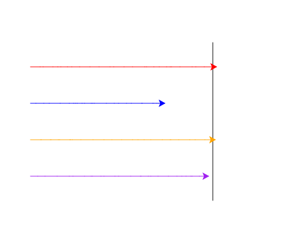

import CodeExercise from '@site/src/components/CodeExercise';

# Stap 4: Vier schildpadden (lijsten)

:::info
Deze stap gebruikt lijsten uit [Lijsten](site:python/docs/data/10a-lijsten-basis).
:::

Voor twee schildpadden schreef je alles twee keer: vijf regels om ze klaar
te zetten, en twee regels in de loop. Met vier wordt het vier keer, en met
tien tien keer. Dat kan korter: zet de schildpadden in een lijst.

In een lijst mag alles staan, ook schildpadden. Met een index haal je er
één uit, en met een for-loop loop je ze allemaal langs:

```python
import turtle

kleuren = ["red", "blue", "orange"]
schildpadden = [turtle.Turtle(), turtle.Turtle(), turtle.Turtle()]

for i in range(3):
    schildpadden[i].pencolor(kleuren[i])
    schildpadden[i].left(120 * i)

for schildpad in schildpadden:
    schildpad.forward(100)
```

<CodeExercise>{`import turtle

kleuren = ["red", "blue", "orange"]
schildpadden = [turtle.Turtle(), turtle.Turtle(), turtle.Turtle()]

for i in range(3):
    schildpadden[i].pencolor(kleuren[i])
    schildpadden[i].left(120 * i)

for schildpad in schildpadden:
    schildpad.forward(100)`}</CodeExercise>

De eerste loop gaat over de nummers 0, 1 en 2. Bij elk nummer `i` hoort
één schildpad, `schildpadden[i]`, en één kleur, `kleuren[i]`. Zo krijgt
schildpad 0 de kleur `red`, schildpad 1 `blue` en schildpad 2 `orange`.
Daar heb je de index nodig, want je zoekt in twee lijsten tegelijk.

De tweede loop heeft geen nummer nodig: elke schildpad zet 100 stappen,
in de richting waarin hij staat.

## Opdracht: een race met vier

Plak je programma uit stap 3 in het veld. Ben je het kwijt, neem dan de
oplossing van [stap 3](site:python/docs/projecten/schildpaddenrace/stap-3-tweede-schildpad).

Vervang `rood` en `blauw` door vier schildpadden in een lijst, met de
kleuren uit deze lijst:

```python
kleuren = ["red", "blue", "orange", "purple"]
```

De rode begint op `(-200, 90)`, en elke volgende baan ligt 60 lager: de
blauwe op `(-200, 30)`, de oranje op `(-200, -30)` en de paarse op
`(-200, -90)`. In de race zet elke schildpad om de beurt een stap, en de
race stopt na de ronde waarin er één over de streep is gegaan.



Bij jou loopt de race anders dan op het plaatje.

<CodeExercise>{`# Plak hier je programma uit stap 3`}</CodeExercise>

<details>
<summary>Klik hier voor een tip.</summary>

Zet je de kleuren met een loop, dan heb je `range` en een index nodig,
zoals in het voorbeeld. Voor de banen kun je een variabele `y` bijhouden
die elke ronde 60 kleiner wordt. In de race komen de twee stukken voor
`rood` en `blauw` samen in één loop over de lijst, binnen de
`while`.

</details>

<details>
<summary>Klik hier voor de oplossing.</summary>

{/* turtle-plaatje met zaad 12: img/stap-4-vier-schildpadden.svg */}

```python
import turtle
import random

turtle.penup()
turtle.goto(100, 130)
turtle.pendown()
turtle.goto(100, -130)
turtle.hideturtle()

kleuren = ["red", "blue", "orange", "purple"]
schildpadden = [turtle.Turtle(), turtle.Turtle(), turtle.Turtle(), turtle.Turtle()]

y = 90
for i in range(4):
    schildpadden[i].pencolor(kleuren[i])
    schildpadden[i].penup()
    schildpadden[i].goto(-200, y)
    schildpadden[i].pendown()
    y -= 60

bezig = True
while bezig:
    for schildpad in schildpadden:
        schildpad.forward(random.randint(1, 20))
        if schildpad.xcor() >= 100:
            bezig = False
```

Wil je zes schildpadden, dan voeg je twee kleuren en twee keer
`turtle.Turtle()` toe, en maak je van `range(4)` `range(6)`. De race zelf
hoeft niet te veranderen.

</details>

## Er gaat iets mis

{/* foutmelding-van: kleuren = ["red", "blue", "orange"]\nkleuren[3] */}

```
IndexError: list index out of range
```

**Oorzaak:** de loop vraagt om een plek die er niet is. Staan er drie
kleuren in je lijst, dan zijn de indexen 0, 1 en 2. Bij `range(4)` vraagt
de laatste ronde om `kleuren[3]`. Hetzelfde gebeurt als je een
`turtle.Turtle()` te weinig in de lijst zet.

**Oplossing:** zorg dat er net zoveel kleuren als schildpadden zijn, en dat
`range` niet verder telt dan dat aantal.

Kopieer je programma voordat je verdergaat: de editor bewaart het niet.

Door naar [stap 5: de winnaar](site:python/docs/projecten/schildpaddenrace/stap-5-break).
