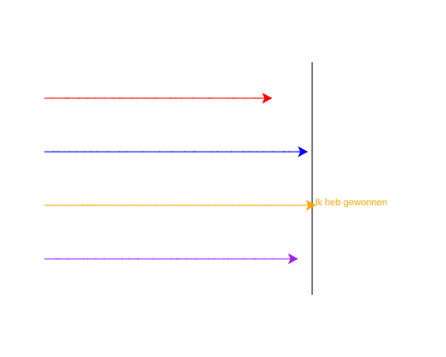

import CodeExercise from '@site/src/components/CodeExercise';

# Stap 5: De winnaar (break)

:::info
Deze stap gebruikt `break` uit [Stoppen met break](site:python/docs/herhalen/06d-break).
:::

Op het plaatje van stap 4 gingen rood en oranje in dezelfde ronde over de
streep. Wie heeft er dan gewonnen? Rood, want die was eerder aan de beurt.
Maar oranje zette daarna toch nog zijn stap. In een echte race stopt alles
zodra de eerste over de finish is.

Daar is `break` voor. Er zit alleen een addertje onder het gras: `break`
stopt de binnenste loop, niet de loop eromheen.

```python
for ronde in range(3):
    for dier in ["kat", "hond", "muis"]:
        if dier == "hond":
            break
        print(ronde, dier)
```

Uitvoer:

```
0 kat
1 kat
2 kat
```

Bij `hond` stopt de binnenste loop, dus `muis` komt nooit aan de beurt.
Maar de buitenste loop gaat door met de volgende ronde. In je race
is de `while` de buitenste loop, en die moet je dus zelf laten stoppen.

Een schildpad kan ook tekst op het scherm zetten. `write` schrijft op de
plek waar hij staat, in de kleur van zijn pen:

```python
import turtle

turtle.forward(50)
turtle.write("Hallo")
```

## Opdracht: wie is er het eerst?

Plak je programma uit stap 4 in het veld. Ben je het kwijt, neem dan de
oplossing van [stap 4](site:python/docs/projecten/schildpaddenrace/stap-4-lijsten).

Pas de race zo aan dat:

1. de race meteen stopt als een schildpad over de streep is, ook midden in
   een ronde;
2. je in een variabele `winnaar` onthoudt welke schildpad dat was;
3. de winnaar na de race `Ik heb gewonnen` op het scherm schrijft.



Bij jou wint waarschijnlijk een andere schildpad.

<CodeExercise>{`# Plak hier je programma uit stap 4`}</CodeExercise>

<details>
<summary>Klik hier voor een tip.</summary>

Op het moment dat een schildpad over de streep is, gebeuren er drie
dingen: je onthoudt hem als `winnaar`, je zet `bezig` op onwaar, en je
stopt de for-loop. Het schrijven doe je pas na de `while`, dus helemaal
links, zonder inspringen.

</details>

<details>
<summary>Klik hier voor de oplossing.</summary>

{/* turtle-plaatje met zaad 4: img/stap-5-winnaar.svg */}

```python
import turtle
import random

turtle.penup()
turtle.goto(100, 130)
turtle.pendown()
turtle.goto(100, -130)
turtle.hideturtle()

kleuren = ["red", "blue", "orange", "purple"]
schildpadden = [turtle.Turtle(), turtle.Turtle(), turtle.Turtle(), turtle.Turtle()]

y = 90
for i in range(4):
    schildpadden[i].pencolor(kleuren[i])
    schildpadden[i].penup()
    schildpadden[i].goto(-200, y)
    schildpadden[i].pendown()
    y -= 60

bezig = True
while bezig:
    for schildpad in schildpadden:
        schildpad.forward(random.randint(1, 20))
        if schildpad.xcor() >= 100:
            winnaar = schildpad
            bezig = False
            break

winnaar.write("Ik heb gewonnen")
```

`winnaar = schildpad` maakt geen nieuwe schildpad. Het is een tweede naam
voor dezelfde: `winnaar.write` laat de schildpad schrijven die net over de
streep ging.

</details>

## Er gaat iets mis

**De race stopt niet meer, en er verschijnt niets.**

**Oorzaak:** je hebt `break`, maar de regel met `bezig` ontbreekt. Dan
stopt alleen de for-loop. De `while` ziet dat `bezig` nog waar is en
begint een nieuwe ronde, en zo lopen de schildpadden voor altijd door: een
oneindige loop.

**Oplossing:** druk op Stop. Zet `bezig` op onwaar vóór de `break`, zodat
ook de `while` stopt.

Kopieer je programma voordat je verdergaat: de editor bewaart het niet.

Door naar [stap 6: de uitslag](site:python/docs/projecten/schildpaddenrace/stap-6-f-strings).
