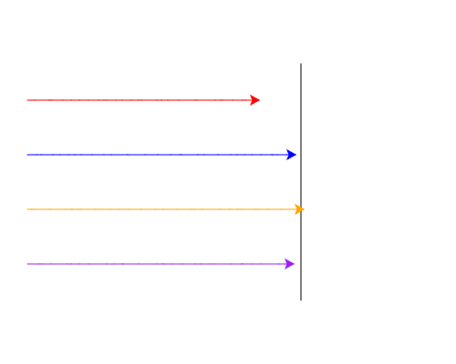

import CodeExercise from '@site/src/components/CodeExercise';

# Stap 5: Om de beurt (een loop in een loop)

:::info
Deze stap gebruikt de for-loop uit [For-loop](site:python/docs/herhalen/06a-for-loop) en de while-loop uit [While-loop](site:python/docs/herhalen/while-loop). Nieuw is dat de ene loop in de andere staat: dat staat hieronder.
:::

In je race staan vier regels die bijna hetzelfde zijn: elke schildpad zet
een stap. Dat kan met een for-loop over de lijst. Die for-loop komt binnen
de `while`, want in elke ronde van de race moeten alle schildpadden één
keer aan de beurt komen.

Een loop in een loop ziet er zo uit:

```python
ronde = 1
while ronde <= 2:
    for dier in ["kat", "hond", "muis"]:
        print(ronde, dier)
    ronde += 1
```

Uitvoer:

```
1 kat
1 hond
1 muis
2 kat
2 hond
2 muis
```

In de eerste ronde van de `while` loopt de for-loop het hele lijstje af:
kat, hond en muis. Pas als de for-loop klaar is, komt `ronde += 1` aan de
beurt, en begint de `while` aan ronde 2. Daarin loopt de for-loop weer
alle drie de dieren langs.

Kijk ook naar het inspringen. `print` staat twee keer ingesprongen, want
hij hoort bij de for-loop, en de for-loop hoort bij de `while`.
`ronde += 1` staat één keer ingesprongen: die hoort alleen bij de `while`.

## Opdracht: de race korter

Plak je programma uit stap 4 in het veld. Ben je het kwijt, neem dan de
oplossing van [stap 4](site:python/docs/projecten/schildpaddenrace/stap-4-lijsten).

Vervang de vier regels met `forward` in de race door een for-loop over de
lijst `schildpadden`. De race loopt daarna precies zoals in stap 4: om de
beurt een stap, zolang ze alle vier nog vóór de streep staan.



Bij jou loopt de race anders dan op het plaatje.

<CodeExercise>{`# Plak hier je programma uit stap 4`}</CodeExercise>

<details>
<summary>Klik hier voor een tip.</summary>

De for-loop staat binnen de `while`, dus één keer ingesprongen. De stap
zelf hoort bij de for-loop en staat dus nog een keer verder naar rechts.
Gebruik daarin de naam van de loopvariabele, niet die van één schildpad.

</details>

<details>
<summary>Klik hier voor de oplossing.</summary>

{/* turtle-plaatje met zaad 4: img/stap-5-om-de-beurt.svg */}

```python
import turtle
import random

turtle.penup()
turtle.goto(80, 130)
turtle.pendown()
turtle.goto(80, -130)
turtle.hideturtle()

rood = turtle.Turtle()
rood.pencolor("red")
blauw = turtle.Turtle()
blauw.pencolor("blue")
oranje = turtle.Turtle()
oranje.pencolor("orange")
paars = turtle.Turtle()
paars.pencolor("purple")

schildpadden = [rood, blauw, oranje, paars]

y = 90
for schildpad in schildpadden:
    schildpad.penup()
    schildpad.goto(-220, y)
    schildpad.pendown()
    y -= 60

while rood.xcor() < 80 and blauw.xcor() < 80 and oranje.xcor() < 80 and paars.xcor() < 80:
    for schildpad in schildpadden:
        schildpad.forward(random.randint(1, 20))
```

Elke ronde van de `while` loopt de for-loop de vier schildpadden langs.
Pas daarna stelt de `while` zijn vraag opnieuw.

</details>

## Er gaat iets mis

{/* foutmelding-van: import turtle\nschildpadden = [turtle.Turtle(), turtle.Turtle()]\nschildpadden.forward(10) */}

```
AttributeError: 'list' object has no attribute 'forward'
```

**Oorzaak:** je schreef `schildpadden.forward(...)`, met de naam van de
lijst. Een lijst kan niet lopen; alleen de schildpadden erin kunnen dat.

**Oplossing:** gebruik in de for-loop de loopvariabele, `schildpad`. Die
is in elke ronde één schildpad uit de lijst.

Kopieer je programma voordat je verdergaat: de editor bewaart het niet.

Door naar [stap 6: de winnaar](site:python/docs/projecten/schildpaddenrace/stap-6-break).
