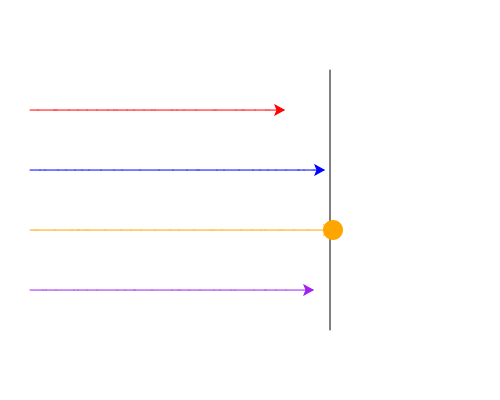

import CodeExercise from '@site/src/components/CodeExercise';

# Stap 6: De winnaar (break)

:::info
Deze stap gebruikt `break` uit [Stoppen met break](site:python/docs/herhalen/06d-break) en `dot` uit [Een dobbelsteen](site:python/docs/projecten/turtle/dobbelsteen/stap-2-stippen).
:::

Op het plaatje van stap 4 gingen rood en oranje in dezelfde ronde over de
streep. Wie heeft er dan gewonnen? Rood was eerder aan de beurt, maar
oranje zette daarna toch nog zijn stap. In een echte race is het
afgelopen zodra de eerste over de finish is.

Daar is `break` voor. In een loop in een loop stopt `break` alleen de
binnenste loop:

```python
ronde = 1
while ronde <= 3:
    for dier in ["kat", "hond", "muis"]:
        if dier == "hond":
            break
        print(ronde, dier)
    ronde += 1
```

Uitvoer:

```
1 kat
2 kat
3 kat
```

Bij `hond` stopt de for-loop, dus `muis` komt nooit aan de beurt. De
`while` gaat wel verder: `ronde += 1`, en dan de volgende ronde.

In je race is dat precies goed. Na de `break` stelt de `while` zijn vraag:
staan ze alle vier nog vóór de streep? De schildpad die net over de streep
ging, staat daar niet meer, dus het antwoord is nee. Zo stopt ook de race.

## Opdracht: wie is er het eerst?

Plak je programma uit stap 5 in het veld. Ben je het kwijt, neem dan de
oplossing van [stap 5](site:python/docs/projecten/schildpaddenrace/stap-5-loop-in-loop).

Pas de race zo aan dat:

1. de race meteen stopt als een schildpad over de streep is, ook midden in
   een ronde;
2. je in een variabele `winnaar` onthoudt welke schildpad dat was;
3. de winnaar na de race een stip van 20 groot zet op de plek waar hij
   staat.



Bij jou wint waarschijnlijk een andere schildpad.

<CodeExercise>{`# Plak hier je programma uit stap 5`}</CodeExercise>

<details>
<summary>Klik hier voor een tip.</summary>

Na de stap van een schildpad kijk je met een `if` of hij over de streep
is. Is dat zo, dan onthoud je hem eerst als `winnaar`, en stop je daarna
de for-loop. De stip komt pas na de race, dus na de `while`, helemaal
links.

</details>

<details>
<summary>Klik hier voor de oplossing.</summary>

{/* turtle-plaatje met zaad 4: img/stap-6-winnaar.svg */}

```python
import turtle
import random

turtle.penup()
turtle.goto(80, 130)
turtle.pendown()
turtle.goto(80, -130)
turtle.hideturtle()

rood = turtle.Turtle()
rood.pencolor("red")
blauw = turtle.Turtle()
blauw.pencolor("blue")
oranje = turtle.Turtle()
oranje.pencolor("orange")
paars = turtle.Turtle()
paars.pencolor("purple")

schildpadden = [rood, blauw, oranje, paars]

y = 90
for schildpad in schildpadden:
    schildpad.penup()
    schildpad.goto(-220, y)
    schildpad.pendown()
    y -= 60

while rood.xcor() < 80 and blauw.xcor() < 80 and oranje.xcor() < 80 and paars.xcor() < 80:
    for schildpad in schildpadden:
        schildpad.forward(random.randint(1, 20))
        if schildpad.xcor() >= 80:
            winnaar = schildpad
            break

winnaar.dot(20)
```

`winnaar = schildpad` maakt geen nieuwe schildpad. Het is een tweede naam
voor dezelfde: `winnaar.dot` laat de schildpad een stip zetten die net
over de streep ging.

</details>

## Er gaat iets mis

{/* foutmelding-van: for schildpad in ["rood", "blauw"]:\n    if schildpad == "rood":\n        break\n        winnaar = schildpad\nprint(winnaar) */}

```
NameError: name 'winnaar' is not defined
```

**Oorzaak:** de regel `winnaar = schildpad` staat ná de `break`. Na een
`break` voert Python niets meer uit in de loop, ook de regels eronder niet.
Dan krijgt `winnaar` nooit een waarde, en kent Python die naam na de race
niet.

**Oplossing:** zet `winnaar = schildpad` vóór de `break`.

Kopieer je programma voordat je verdergaat: de editor bewaart het niet.

Door naar [stap 7: ik heb gewonnen](site:python/docs/projecten/schildpaddenrace/stap-7-write).
