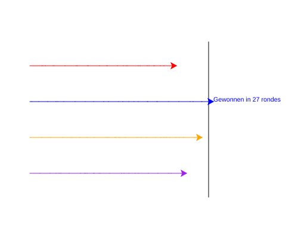

import CodeExercise from '@site/src/components/CodeExercise';

# Stap 6: De uitslag (f-strings)

:::info
Deze stap gebruikt f-strings uit [Slimme berichten met f-strings](site:python/docs/tekst/04a-f-strings).
:::

De winnaar staat in beeld, maar was het een snelle race of een slome?
Laat hem erbij schrijven hoeveel rondes hij nodig had. Dat getal verandert
elke race, dus het moet in de tekst worden ingevuld. Dat doet een
f-string, en die werkt in `write` net als in `print`:

```python
rondes = 27
print(f"Gewonnen in {rondes} rondes")   # Gewonnen in 27 rondes
```

## Opdracht: hoeveel rondes?

Plak je programma uit stap 5 in het veld. Ben je het kwijt, neem dan de
oplossing van [stap 5](site:python/docs/projecten/schildpaddenrace/stap-5-break).

Tel in een variabele `rondes` hoeveel rondes de race duurt. Een ronde is
één keer door de `while`: elke schildpad zet dan een stap, behalve na de
winnaar. Laat de winnaar aan het eind schrijven: `Gewonnen in 27 rondes`,
met het echte aantal.



Bij jou wint er misschien een ander, en na een ander aantal rondes.

<CodeExercise>{`# Plak hier je programma uit stap 5`}</CodeExercise>

<details>
<summary>Klik hier voor een tip.</summary>

Tellen doe je met een teller: een variabele die op 0 begint, en er elke
ronde één bij krijgt. Elke ronde begint bovenaan in de `while`, dus daar
hoort het tellen. Gebruik daarna een f-string in `write`.

</details>

<details>
<summary>Klik hier voor de oplossing.</summary>

{/* turtle-plaatje met zaad 37: img/stap-6-uitslag.svg */}

```python
import turtle
import random

turtle.penup()
turtle.goto(100, 130)
turtle.pendown()
turtle.goto(100, -130)
turtle.hideturtle()

kleuren = ["red", "blue", "orange", "purple"]
schildpadden = [turtle.Turtle(), turtle.Turtle(), turtle.Turtle(), turtle.Turtle()]

y = 90
for i in range(4):
    schildpadden[i].pencolor(kleuren[i])
    schildpadden[i].penup()
    schildpadden[i].goto(-200, y)
    schildpadden[i].pendown()
    y -= 60

rondes = 0
bezig = True
while bezig:
    rondes += 1
    for schildpad in schildpadden:
        schildpad.forward(random.randint(1, 20))
        if schildpad.xcor() >= 100:
            winnaar = schildpad
            bezig = False
            break

winnaar.write(f"Gewonnen in {rondes} rondes")
```

Staat `rondes += 1` in de for-loop in plaats van in de `while`, dan tel
je stappen in plaats van rondes: ongeveer vier keer zo veel.

</details>

## Er gaat iets mis

**Op het scherm staat letterlijk `Gewonnen in {rondes} rondes`.**

**Oorzaak:** de `f` voor de aanhalingstekens ontbreekt. Zonder `f` is het
een gewone tekst, en vult Python niets in.

**Oplossing:** zet een `f` direct voor het eerste aanhalingsteken:
`f"Gewonnen in {rondes} rondes"`.

## Verder bouwen

Je race werkt. Wil je verder, kies dan iets uit dit lijstje:

- Laat elke schildpad na de race schrijven hoe ver hij nog van de finish
  af was.
- Laat de speler vóór de race met `input()` een kleur kiezen, en schrijf na
  de race of hij goed gegokt had.
- Doe mee met zes schildpadden. Wat moet je allemaal aanpassen, en kan het
  zo dat je alleen de lijst met kleuren hoeft te veranderen?
- Geef de schildpadden het uiterlijk van een schildpad met `shape`. Kijk wat
  er dan met de tekst van de winnaar gebeurt.
- Maak een functie `race()` die de hele race laat lopen en de winnaar
  teruggeeft.

Terug naar [het overzicht van de projecten](site:python/docs/projecten).
