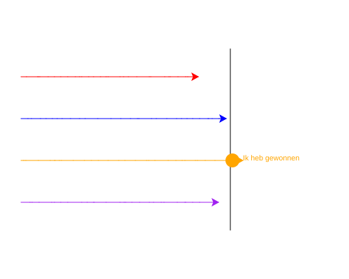

import CodeExercise from '@site/src/components/CodeExercise';

# Stap 7: Ik heb gewonnen (write)

:::info
Deze stap neemt geen nieuwe les. Nieuw is het turtle-commando `write`: dat staat hieronder.
:::

De winnaar heeft een stip, maar hij mag het ook zeggen. Een schildpad kan
tekst op het scherm zetten met **`write`**:

```python
import turtle

turtle.forward(50)
turtle.write("Hallo")
```

<CodeExercise>{`import turtle

turtle.forward(50)
turtle.write("Hallo")`}</CodeExercise>

De tekst begint waar de schildpad staat en loopt naar rechts, in de kleur
van zijn pen. De schildpad zelf blijft staan, met zijn punt aan het begin
van de tekst.

## Opdracht: de winnaar zegt het

Plak je programma uit stap 6 in het veld. Ben je het kwijt, neem dan de
oplossing van [stap 6](site:python/docs/projecten/schildpaddenrace/stap-6-break).

Laat de winnaar na de race, na zijn stip:

1. zonder te tekenen nog 15 stappen vooruit lopen, zodat de tekst los van
   de streep en de stip komt te staan;
2. `Ik heb gewonnen` op het scherm schrijven.



Bij jou wint waarschijnlijk een andere schildpad.

<CodeExercise>{`# Plak hier je programma uit stap 6`}</CodeExercise>

<details>
<summary>Klik hier voor een tip.</summary>

Lopen zonder te tekenen ging met `penup`. Alles wat de winnaar doet, schrijf
je met `winnaar` ervoor, na de `while`.

</details>

<details>
<summary>Klik hier voor de oplossing.</summary>

{/* turtle-plaatje met zaad 4: img/stap-7-ik-heb-gewonnen.svg */}

```python
import turtle
import random

turtle.penup()
turtle.goto(80, 130)
turtle.pendown()
turtle.goto(80, -130)
turtle.hideturtle()

rood = turtle.Turtle()
rood.pencolor("red")
blauw = turtle.Turtle()
blauw.pencolor("blue")
oranje = turtle.Turtle()
oranje.pencolor("orange")
paars = turtle.Turtle()
paars.pencolor("purple")

schildpadden = [rood, blauw, oranje, paars]

y = 90
for schildpad in schildpadden:
    schildpad.penup()
    schildpad.goto(-220, y)
    schildpad.pendown()
    y -= 60

while rood.xcor() < 80 and blauw.xcor() < 80 and oranje.xcor() < 80 and paars.xcor() < 80:
    for schildpad in schildpadden:
        schildpad.forward(random.randint(1, 20))
        if schildpad.xcor() >= 80:
            winnaar = schildpad
            break

winnaar.dot(20)
winnaar.penup()
winnaar.forward(15)
winnaar.write("Ik heb gewonnen")
```

De winnaar staat na de race op de streep of net erachter. Met 15 stappen
extra begint de tekst altijd voorbij de stip.

</details>

## Er gaat iets mis

**De tekst staat zwart, onderaan de finishlijn.**

**Oorzaak:** je schreef `turtle.write(...)`. Dan schrijft de schildpad die
de finishlijn tekende. Die staat nog onderaan de streep, waar hij klaar
was, en zijn pen is zwart.

**Oplossing:** laat de winnaar schrijven: `winnaar.write(...)`.

Kopieer je programma voordat je verdergaat: de editor bewaart het niet.

Door naar [stap 8: de uitslag](site:python/docs/projecten/schildpaddenrace/stap-8-f-strings).
