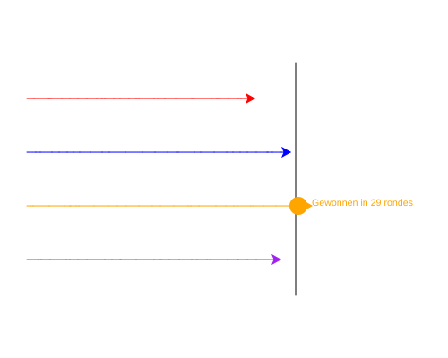

import CodeExercise from '@site/src/components/CodeExercise';

# Stap 8: De uitslag (f-strings)

:::info
Deze stap gebruikt f-strings uit [Slimme berichten met f-strings](site:python/docs/tekst/04a-f-strings). Een teller met `+=` ken je uit [While-loop](site:python/docs/herhalen/while-loop).
:::

De winnaar staat in beeld, maar was het een snelle race of een slome?
Laat hem erbij schrijven hoeveel rondes hij nodig had. Dat getal verandert
elke race, dus het moet in de tekst worden ingevuld. Dat doet een
f-string, en die werkt in `write` net als in `print`:

```python
rondes = 27
print(f"Gewonnen in {rondes} rondes")   # Gewonnen in 27 rondes
```

## Opdracht: hoeveel rondes?

Plak je programma uit stap 7 in het veld. Ben je het kwijt, neem dan de
oplossing van [stap 7](site:python/docs/projecten/schildpaddenrace/stap-7-write).

Tel in een variabele `rondes` hoeveel rondes de race duurt. Een ronde is
één keer door de `while`. Laat de winnaar aan het eind schrijven:
`Gewonnen in 29 rondes`, met het echte aantal.



Bij jou wint er misschien een ander, en na een ander aantal rondes.

<CodeExercise>{`# Plak hier je programma uit stap 7`}</CodeExercise>

<details>
<summary>Klik hier voor een tip.</summary>

Een teller begint op 0, vóór de loop. Elke ronde begint bovenaan in de
`while`, dus daar hoort het tellen. Zet de tekst daarna in een f-string.

</details>

<details>
<summary>Klik hier voor de oplossing.</summary>

{/* turtle-plaatje met zaad 4: img/stap-8-uitslag.svg */}

```python
import turtle
import random

turtle.penup()
turtle.goto(80, 130)
turtle.pendown()
turtle.goto(80, -130)
turtle.hideturtle()

rood = turtle.Turtle()
rood.pencolor("red")
blauw = turtle.Turtle()
blauw.pencolor("blue")
oranje = turtle.Turtle()
oranje.pencolor("orange")
paars = turtle.Turtle()
paars.pencolor("purple")

schildpadden = [rood, blauw, oranje, paars]

y = 90
for schildpad in schildpadden:
    schildpad.penup()
    schildpad.goto(-220, y)
    schildpad.pendown()
    y -= 60

rondes = 0
while rood.xcor() < 80 and blauw.xcor() < 80 and oranje.xcor() < 80 and paars.xcor() < 80:
    rondes += 1
    for schildpad in schildpadden:
        schildpad.forward(random.randint(1, 20))
        if schildpad.xcor() >= 80:
            winnaar = schildpad
            break

winnaar.dot(20)
winnaar.penup()
winnaar.forward(15)
winnaar.write(f"Gewonnen in {rondes} rondes")
```

Staat `rondes += 1` in de for-loop in plaats van in de `while`, dan tel
je stappen in plaats van rondes: ongeveer vier keer zo veel.

</details>

## Er gaat iets mis

**Op het scherm staat letterlijk `Gewonnen in {rondes} rondes`.**

**Oorzaak:** de `f` voor de aanhalingstekens ontbreekt. Zonder `f` is het
een gewone tekst, en vult Python niets in.

**Oplossing:** zet een `f` direct voor het eerste aanhalingsteken:
`f"Gewonnen in {rondes} rondes"`.

{/* foutmelding-van: import turtle\nrondes = 27\nturtle.write("Gewonnen in", rondes, "rondes") */}

```
KeyError: 'rondes'
```

**Oorzaak:** je schreef de stukken met komma's ertussen, zoals bij
`print`: `winnaar.write("Gewonnen in", rondes, "rondes")`. Maar `write`
neemt alleen het eerste stuk als tekst. Wat na de komma's komt, leest hij
als instellingen, en op de derde plek verwacht hij hoe de tekst uitgelijnd
moet worden. Het woord `"rondes"` kent hij daar niet. Met alleen
`"Gewonnen in", rondes` krijg je geen melding, maar dan schrijft hij
alleen `Gewonnen in`, zonder getal.

**Oplossing:** maak er één f-string van, met het getal tussen accolades.

## Verder bouwen

Je race werkt. Wil je verder, kies dan iets uit dit lijstje:

- Laat na de race elke schildpad schrijven hoe ver hij nog van de finish
  af was. Dat is een for-loop over de lijst, een rekensom met `xcor()` en
  een f-string.
- Laat de speler vóór de race met `input()` raden hoeveel rondes de race
  duurt, en laat de winnaar erbij schrijven of de race korter of langer
  duurde. Een antwoord van `input()` maak je een getal zoals in
  [Tekst naar getal](site:python/docs/basis/03b-tekst-naar-getal).
- Doe mee met zes schildpadden. Wat moet je allemaal aanpassen, en passen
  zes banen nog tussen de uiteinden van de finishlijn?
- Geef de schildpadden het uiterlijk van een schildpad: `rood.shape("turtle")`
  verandert de pijl van de rode in een schildpadje. Dat kan voor alle vier
  in de loop die ze klaarzet. Een schildpadje is groter dan een pijl, dus
  kijk of de tekst van de winnaar nog vrij staat.
- Zet de hele race in een functie `race()` die de winnaar teruggeeft met
  `return`, zoals in [Return](site:python/docs/functies/09b-return).

Terug naar [het overzicht van de projecten](site:python/docs/projecten).
