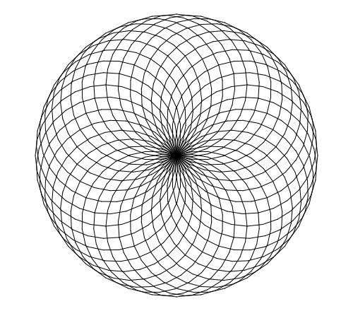

import CodeExercise from '@site/src/components/CodeExercise';

# Stap 1: Een ring van cirkels (for-loop)

:::info
Deze stap gebruikt de for-loop uit [For-loop](site:python/docs/herhalen/06a-for-loop), en
`turtle.circle` uit [Cirkels en bogen](site:python/docs/projecten/turtle/cirkels/stap-1-cirkel).
:::

Teken een vorm, draai een klein stukje, en teken hem nog een keer. Doe dat
vaak genoeg, en er ontstaat een patroon dat er veel ingewikkelder uitziet
dan de code die het maakt. Zo werkt een spirograaf. In zes stappen bouw je
er zelf een, met kleuren, andere vormen en een spiraal die groeit.

Je begint met cirkels. Vier cirkels, met na elke cirkel een kwartslag
draaien, geven een klavertje vier:

```python
import turtle

for i in range(4):
    turtle.circle(100)
    turtle.left(90)
```

Elke cirkel begint en eindigt op hetzelfde punt, in het midden. Na de cirkel
draait de schildpad 90 graden, dus de volgende cirkel ligt een kwartslag
verder. Vier keer 90 graden is precies één keer rond.

## Opdracht: 36 cirkels

Teken 36 cirkels met een straal van 100. Draai na elke cirkel 10 graden naar
links.



<CodeExercise>{`import turtle`}</CodeExercise>

<details>
<summary>Klik hier voor een tip.</summary>

Begin met het klavertje hierboven. Wat moet er anders, zodat de loop 36 keer
gaat en de schildpad steeds 10 graden draait? Na 36 keer 10 graden is hij
weer precies rond, net als bij het klavertje.

</details>

<details>
<summary>Klik hier voor de oplossing.</summary>

{/* turtle-plaatje: img/stap-1-ring.svg */}

```python
import turtle

for i in range(36):
    turtle.circle(100)
    turtle.left(10)
```

De cirkels overlappen elkaar zo vaak dat er nieuwe vormen tussen lijken te
staan: kleine ruitjes, en bogen die van het midden naar buiten draaien. Die
heb je niet getekend. Ze ontstaan vanzelf.

</details>

## Er gaat iets mis

```python
import turtle

for i in range(36):
    turtle.circle(100)
turtle.left(10)
```

Je verwacht een ring, maar je ziet één cirkel.

**Oorzaak:** `turtle.left(10)` springt niet in, dus hij hoort niet bij de
loop. De schildpad tekent 36 keer dezelfde cirkel, precies over elkaar heen,
en draait pas als de loop klaar is.

**Oplossing:** laat de regel met `left` net zo ver inspringen als de regel
met `circle`.

In de volgende stap bouw je verder op dit programma. Kopieer je programma
voordat je verdergaat: de editor bewaart het niet.

Door naar [stap 2: kleuren uit een lijst](site:python/docs/projecten/spirograaf/stap-2-lijst).
