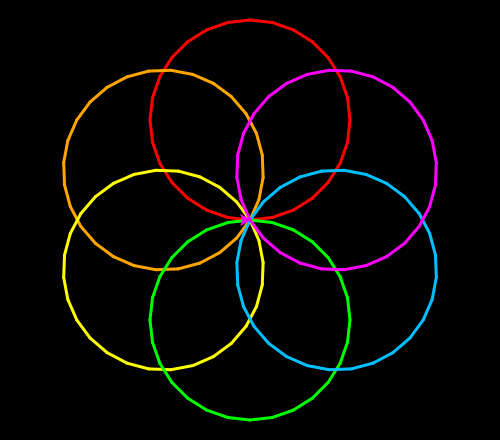

import CodeExercise from '@site/src/components/CodeExercise';

# Stap 2: Kleuren uit een lijst (een lijst)

:::info
Deze stap gebruikt een loop over een lijst, uit [Lijsten](site:python/docs/data/10a-lijsten-basis).
`pencolor` en `pensize` ken je uit [Kleur en dikte](site:python/docs/projecten/turtle/kleuren/stap-1-pen).
:::

Zwart op wit is mooi, maar een spirograaf wordt pas echt wat met kleur. Zet
de kleuren in een lijst, en laat een for-loop over die lijst lopen. Elke
ronde krijgt de loopvariabele de volgende kleur:

```python
import turtle

kleuren = ["red", "yellow", "deepskyblue"]

turtle.bgcolor("black")
turtle.pensize(5)
for kleur in kleuren:
    turtle.pencolor(kleur)
    turtle.forward(100)
    turtle.left(120)
```

<CodeExercise>{`import turtle

kleuren = ["red", "yellow", "deepskyblue"]

turtle.bgcolor("black")
turtle.pensize(5)
for kleur in kleuren:
    turtle.pencolor(kleur)
    turtle.forward(100)
    turtle.left(120)`}</CodeExercise>

Dit tekent een driehoek met drie gekleurde zijden. De loop gaat drie keer
rond, omdat er drie kleuren in de lijst staan. Nieuw is **`bgcolor`**: dat
kleurt de hele achtergrond. Op zwart lichten de kleuren op.

## Opdracht: een bloem van zes kleuren

Plak je programma uit stap 1 in het veld. Ben je het kwijt, neem dan de
oplossing van [stap 1](site:python/docs/projecten/spirograaf/stap-1-for-loop).

Verander je programma zo, dat het:

1. de zes kleuren `"red"`, `"orange"`, `"yellow"`, `"lime"`,
   `"deepskyblue"` en `"magenta"` in een lijst `kleuren` bewaart;
2. een zwarte achtergrond en een pen van 3 breed heeft;
3. voor elke kleur uit de lijst één cirkel tekent, in die kleur, met een
   straal van 100.

De zes cirkels liggen samen één keer rond, als de blaadjes van een bloem.



<CodeExercise>{`# Plak hier je programma uit stap 1`}</CodeExercise>

<details>
<summary>Klik hier voor een tip.</summary>

De loop gaat nu niet meer over een getal, maar over de lijst. Zet de kleur
vóór de cirkel, anders tekent de eerste cirkel nog in zwart. Zes cirkels
moeten samen precies één keer rond: hoeveel graden draai je dan na elke
cirkel? De achtergrond en de dikte van de pen hoeven maar één keer, dus die
staan boven de loop.

</details>

<details>
<summary>Klik hier voor de oplossing.</summary>

{/* turtle-plaatje: img/stap-2-bloem.svg */}

```python
import turtle

kleuren = ["red", "orange", "yellow", "lime", "deepskyblue", "magenta"]

turtle.bgcolor("black")
turtle.pensize(3)
for kleur in kleuren:
    turtle.pencolor(kleur)
    turtle.circle(100)
    turtle.left(60)
```

Zes keer 60 graden is 360: na de laatste cirkel kijkt de schildpad weer naar
rechts.

</details>

## Er gaat iets mis

{/* foutmelding-van: import turtle\nkleuren = ["red", "orange", "yellow", "lime", "deepskyblue", "magenta"]\nturtle.pencolor(kleuren) */}

```
turtle.TurtleGraphicsError: bad color arguments: ['red', 'orange', 'yellow', 'lime', 'deepskyblue', 'magenta']
```

**Oorzaak:** je schreef `turtle.pencolor(kleuren)`, met de hele lijst. De
schildpad kan maar één kleur tegelijk hebben, en weet niet wat hij met zes
kleuren moet.

**Oplossing:** geef de loopvariabele mee: `kleur`, zonder n. Die bevat elke
ronde één kleur uit de lijst.

Kopieer je programma voordat je verdergaat: de editor bewaart het niet.

Door naar [stap 3: rondom in kleur](site:python/docs/projecten/spirograaf/stap-3-functie).
