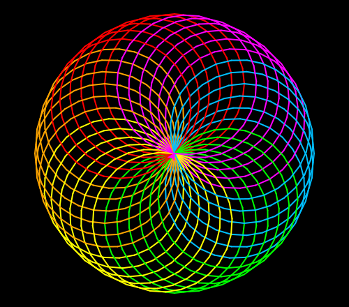

import CodeExercise from '@site/src/components/CodeExercise';

# Stap 3: Rondom in kleur (een functie)

:::info
Deze stap gebruikt een functie, uit [Functies](site:python/docs/functies/functies).
:::

De bloem heeft zes cirkels, de ring uit stap 1 had er 36. Wil je 36 cirkels
in zes kleuren, dan moet de bloem zes keer: steeds een klein stukje
gedraaid. Dat lukt door de bloem in een functie te zetten, en die functie in
een loop aan te roepen.

Een functie met een loop erin ziet er zo uit:

```python
import turtle

def driehoek():
    for zijde in range(3):
        turtle.forward(100)
        turtle.left(120)

for i in range(3):
    driehoek()
    turtle.left(30)
```

<CodeExercise>{`import turtle

def driehoek():
    for zijde in range(3):
        turtle.forward(100)
        turtle.left(120)

for i in range(3):
    driehoek()
    turtle.left(30)`}</CodeExercise>

Er staan nu twee loops in je programma. De onderste gaat drie keer rond, en
elke ronde roept hij `driehoek()` aan. Die loopt dan zijn eigen loop helemaal
af: drie zijden. Daarna draait de schildpad 30 graden, en begint de volgende
ronde. Samen zijn dat drie driehoeken, met negen zijden. Druk op Stap voor
stap, dan zie je Python heen en weer gaan tussen de twee loops.

## Opdracht: zes bloemen rond

Plak je programma uit stap 2 in het veld. Ben je het kwijt, neem dan de
oplossing van [stap 2](site:python/docs/projecten/spirograaf/stap-2-lijst).

Zet het tekenen van de bloem in een functie `bloem()`. Teken daarmee zes
bloemen, en draai na elke bloem 10 graden naar links. Maak de pen 2 breed,
want er komen veel lijnen bij.

Zo heb je weer 36 cirkels, net als in stap 1, maar nu in zes kleuren die
rondom terugkomen.



<CodeExercise>{`# Plak hier je programma uit stap 2`}</CodeExercise>

<details>
<summary>Klik hier voor een tip.</summary>

De loop over de kleuren gaat helemaal de functie in, één stap verder
ingesprongen. De lijst `kleuren`, de achtergrond en de pen blijven buiten de
functie. Onderaan komt een nieuwe loop die zes keer gaat. Wat moet er in elke
ronde gebeuren?

</details>

<details>
<summary>Klik hier voor de oplossing.</summary>

{/* turtle-plaatje: img/stap-3-rozet.svg */}

```python
import turtle

kleuren = ["red", "orange", "yellow", "lime", "deepskyblue", "magenta"]

def bloem():
    for kleur in kleuren:
        turtle.pencolor(kleur)
        turtle.circle(100)
        turtle.left(60)

turtle.bgcolor("black")
turtle.pensize(2)
for i in range(6):
    bloem()
    turtle.left(10)
```

Na één bloem kijkt de schildpad weer naar rechts. Draai je dan 10 graden,
dan ligt de volgende bloem net naast de vorige. Elke kleur heeft zo zes
cirkels vlak naast elkaar, en die vormen samen een gekleurd vlak.

</details>

## Er gaat iets mis

{/* foutmelding-van: bloem() */}

```
NameError: name 'bloem' is not defined
```

**Oorzaak:** de loop die `bloem()` aanroept, staat boven de `def`. Python
leest je programma van boven naar beneden. Bij de aanroep heeft hij de
functie nog niet gezien.

**Oplossing:** zet de functie bovenaan, onder de lijst `kleuren`, en de loop
die hem aanroept eronder.

Kopieer je programma voordat je verdergaat: de editor bewaart het niet.

Door naar [stap 4: vijfhoeken](site:python/docs/projecten/spirograaf/stap-4-parameters).
