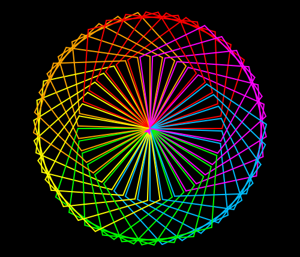

import CodeExercise from '@site/src/components/CodeExercise';

# Stap 4: Vijfhoeken (parameters)

:::info
Deze stap gebruikt parameters, uit [Parameters](site:python/docs/functies/09a-parameters).
Hoe je een veelhoek tekent, staat in [Elke veelhoek](site:python/docs/projecten/turtle/veelhoeken/stap-2-veelhoek).
:::

Een spirograaf hoeft niet van cirkels te zijn. Met een driehoek, een vierkant
of een vijfhoek krijg je heel andere patronen. Welke vorm het wordt, geef je
mee als parameter:

```python
import turtle

def vorm(zijden, lengte):
    for zijde in range(zijden):
        turtle.forward(lengte)
        turtle.left(360 / zijden)

vorm(3, 100)
vorm(6, 60)
```

<CodeExercise>{`import turtle

def vorm(zijden, lengte):
    for zijde in range(zijden):
        turtle.forward(lengte)
        turtle.left(360 / zijden)

vorm(3, 100)
vorm(6, 60)`}</CodeExercise>

`vorm(3, 100)` tekent een driehoek met zijden van 100, `vorm(6, 60)` een
zeshoek met zijden van 60. Het eerste getal komt in `zijden`, het tweede in
`lengte`. De schildpad draait na elke zijde `360 / zijden` graden, dus na de
laatste zijde is hij precies één keer rond.

## Opdracht: een spirograaf van vijfhoeken

Plak je programma uit stap 3 in het veld. Ben je het kwijt, neem dan de
oplossing van [stap 3](site:python/docs/projecten/spirograaf/stap-3-functie).

Zet de functie `vorm(zijden, lengte)` in je programma. Geef ook `bloem` de
parameters `zijden` en `lengte`, en laat hem daarmee een vorm tekenen in
plaats van een cirkel. Teken zo de zes bloemen met vijfhoeken met zijden van
120.



<CodeExercise>{`# Plak hier je programma uit stap 3`}</CodeExercise>

<details>
<summary>Klik hier voor een tip.</summary>

Op de plek waar nu `circle` staat, komt de aanroep van `vorm`. De functie
`bloem` weet zelf niet welke vorm het is: hij krijgt de zijden en de lengte
mee, en geeft ze door aan `vorm`. Zo gaf `huis` in
[Een straat vol huizen](site:python/docs/projecten/turtle/straat-vol-huizen/stap-2-parameters)
zijn grootte door aan `muren`. Onderaan, in de loop, staan dan de getallen 5
en 120.

</details>

<details>
<summary>Klik hier voor de oplossing.</summary>

{/* turtle-plaatje: img/stap-4-vijfhoeken.svg */}

```python
import turtle

def vorm(zijden, lengte):
    for zijde in range(zijden):
        turtle.forward(lengte)
        turtle.left(360 / zijden)

def bloem(zijden, lengte):
    kleuren = ["red", "orange", "yellow", "lime", "deepskyblue", "magenta"]
    for kleur in kleuren:
        turtle.pencolor(kleur)
        vorm(zijden, lengte)
        turtle.left(60)

turtle.bgcolor("black")
turtle.pensize(2)
for i in range(6):
    bloem(5, 120)
    turtle.left(10)
```

`bloem(5, 120)` geeft 5 en 120 aan `bloem`, en die geeft ze bij elke kleur
door aan `vorm`. Probeer ook eens `bloem(3, 150)` of `bloem(8, 60)`.

</details>

## Er gaat iets mis

### Een melding over twee parameters

{/* foutmelding-van: def bloem(zijden, lengte): pass\nbloem() */}

```
TypeError: bloem() missing 2 required positional arguments: 'zijden' and 'lengte'
```

**Oorzaak:** je gaf `bloem` in de `def` twee parameters, maar in de loop
onderaan staat nog de aanroep uit stap 3: `bloem()`, zonder getallen. Python
noemt de twee parameters die hij niet kan vullen.

**Oplossing:** geef bij de aanroep twee getallen mee, in de volgorde van de
`def`: `bloem(5, 120)`.

### Cirkels in plaats van vijfhoeken

Je verwacht vijfhoeken, maar je krijgt weer cirkels.

**Oorzaak:** je schreef `bloem(120, 5)`, met de getallen omgedraaid. Python
vult de parameters op volgorde: `zijden` wordt 120 en `lengte` 5. Een vorm
met 120 korte zijden ziet er bijna uit als een cirkel.

**Oplossing:** zet de getallen in dezelfde volgorde als de parameters in de
`def`: eerst het aantal zijden, dan de lengte.

Kopieer je programma voordat je verdergaat: de editor bewaart het niet.

Door naar [stap 5: een groeiende spiraal](site:python/docs/projecten/spirograaf/stap-5-range).
