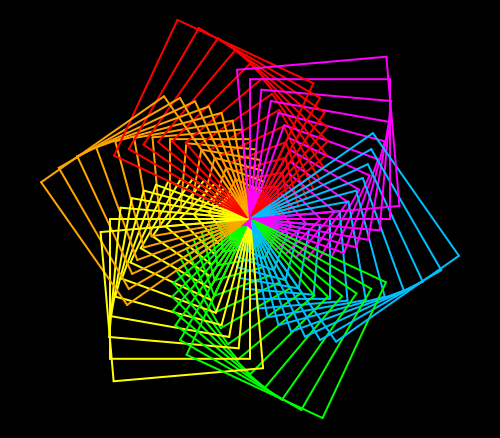

import CodeExercise from '@site/src/components/CodeExercise';

# Stap 5: Een groeiende spiraal (range met stappen)

:::info
Deze stap gebruikt `range` met een begin en een stapgrootte, uit [Range met start en stappen](site:python/docs/herhalen/06b-range-stappen).
:::

Tot nu toe was elke bloem even groot. Laat je de vormen bij elke bloem een
beetje groeien, dan draait het patroon als een spiraal naar buiten. De
lengtes tellen op in vaste stappen, en dat is werk voor `range` met drie
getallen:

```python
import turtle

for lengte in range(20, 120, 20):
    turtle.forward(lengte)
    turtle.left(90)
```

<CodeExercise>{`import turtle

for lengte in range(20, 120, 20):
    turtle.forward(lengte)
    turtle.left(90)`}</CodeExercise>

De loopvariabele `lengte` is achter elkaar 20, 40, 60, 80 en 100. Elke lijn
is dus 20 langer dan de vorige, en de schildpad loopt een vierkante spiraal
naar buiten. Het eind, 120, doet zelf niet mee.

## Opdracht: een spiraal van vierkanten

Plak je programma uit stap 4 in het veld. Ben je het kwijt, neem dan de
oplossing van [stap 4](site:python/docs/projecten/spirograaf/stap-4-parameters).

Teken bloemen van vierkanten. De eerste bloem heeft vierkanten van 20, en
elke volgende bloem is 10 groter, tot en met 150. Draai na elke bloem 5
graden naar links.



<CodeExercise>{`# Plak hier je programma uit stap 4`}</CodeExercise>

<details>
<summary>Klik hier voor een tip.</summary>

De loop onderaan telt nu niet meer een vast aantal bloemen, maar loopt over
de lengtes zelf: begin bij 20, en tel steeds 10 op. Het eind van een `range`
doet niet mee, dus kies een eind boven de 150. Wat geef je dan aan `bloem`
mee als lengte?

</details>

<details>
<summary>Klik hier voor de oplossing.</summary>

{/* turtle-plaatje: img/stap-5-spiraal.svg */}

```python
import turtle

def vorm(zijden, lengte):
    for zijde in range(zijden):
        turtle.forward(lengte)
        turtle.left(360 / zijden)

def bloem(zijden, lengte):
    kleuren = ["red", "orange", "yellow", "lime", "deepskyblue", "magenta"]
    for kleur in kleuren:
        turtle.pencolor(kleur)
        vorm(zijden, lengte)
        turtle.left(60)

turtle.bgcolor("black")
turtle.pensize(2)
for grootte in range(20, 160, 10):
    bloem(4, grootte)
    turtle.left(5)
```

Dat zijn 14 bloemen van zes vierkanten: 84 vierkanten in één tekening. Elke
kleur draait zijn eigen arm naar buiten, omdat elk vierkant net iets groter
is en net iets verder gedraaid dan het vorige van die kleur.

De loopvariabele heet `grootte`, zodat je hem niet verwart met de parameter
`lengte` van `bloem` en `vorm`.

Druk je bij dit programma op Stap voor stap, dan stopt die na 1000 stappen,
in de negende bloem. De eerste acht kun je dus helemaal volgen, en je ziet
`grootte` elke ronde 10 groter worden. De hele spiraal zie je met Uitvoeren.

</details>

## Er gaat iets mis

Alle vierkanten zijn even groot, en er ontstaat geen spiraal.

**Oorzaak:** in de loop staat nog een vast getal, zoals `bloem(4, 100)`. De
loopvariabele `grootte` verandert elke ronde wel, maar je gebruikt hem
nergens.

**Oplossing:** geef de loopvariabele mee aan `bloem`, op de plek van de
lengte.

Kopieer je programma voordat je verdergaat: de editor bewaart het niet.

Door naar [stap 6: jij kiest](site:python/docs/projecten/spirograaf/stap-6-input).
