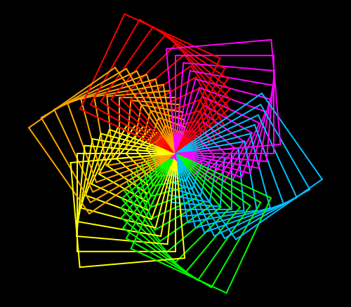

import CodeExercise from '@site/src/components/CodeExercise';

# Stap 6: Jij kiest (input)

:::info
Deze stap gebruikt `input()` en `int()`, uit [Tekst naar getal](site:python/docs/basis/03b-tekst-naar-getal).
:::

Elke keer dat je een ander patroon wilt, pas je nu de getallen in je code
aan. Handiger is het als het programma ernaar vraagt. Dan probeer je in een
minuut tien spirografen uit, zonder één regel te veranderen.

`input()` geeft altijd tekst, en `int()` maakt daar een getal van:

{/* invoer: 5 */}

```python
aantal = int(input("Hoeveel zijden? "))
print(360 / aantal)
```

Uitvoer als je 5 typt:

```
Hoeveel zijden? 5
72.0
```

## Opdracht: de gebruiker kiest

Plak je programma uit stap 5 in het veld. Ben je het kwijt, neem dan de
oplossing van [stap 5](site:python/docs/projecten/spirograaf/stap-5-range).

Laat het programma eerst twee vragen stellen:

1. `Hoeveel zijden? ` bepaalt welke vorm de schildpad tekent;
2. `Hoeveel groeit elke bloem? ` bepaalt hoeveel groter elke volgende bloem
   wordt.

Daarna tekent het de spirograaf met die getallen. Typ je 4 en 10, dan krijg
je de spiraal van stap 5 terug:

```
Hoeveel zijden? 4
Hoeveel groeit elke bloem? 10
```



Probeer daarna ook 3 en 5, 6 en 20, en 8 en 15. Hoe kleiner de groei, hoe
meer bloemen er komen.

<CodeExercise>{`# Plak hier je programma uit stap 5`}</CodeExercise>

<details>
<summary>Klik hier voor een tip.</summary>

De twee vragen komen boven de loop die de bloemen tekent, elk met een eigen
variabele. Een `range` werkt alleen met hele getallen, dus wat de gebruiker
typt, moet je eerst omzetten. Zet daarna je variabelen op de plekken waar nu
4 en 10 staan.

</details>

<details>
<summary>Klik hier voor de oplossing.</summary>

{/* invoer: 4 | 10 */}
{/* turtle-plaatje: img/stap-6-jij-kiest.svg */}

```python
import turtle

def vorm(zijden, lengte):
    for zijde in range(zijden):
        turtle.forward(lengte)
        turtle.left(360 / zijden)

def bloem(zijden, lengte):
    kleuren = ["red", "orange", "yellow", "lime", "deepskyblue", "magenta"]
    for kleur in kleuren:
        turtle.pencolor(kleur)
        vorm(zijden, lengte)
        turtle.left(60)

aantal = int(input("Hoeveel zijden? "))
groei = int(input("Hoeveel groeit elke bloem? "))

turtle.bgcolor("black")
turtle.pensize(2)
for grootte in range(20, 160, groei):
    bloem(aantal, grootte)
    turtle.left(5)
```

Uitvoer bij 4 en 10:

```
Hoeveel zijden? 4
Hoeveel groeit elke bloem? 10
```

De groei is de stapgrootte van de `range`. Bij een groei van 5 gaat de loop
28 keer rond, bij 20 maar 7 keer.

Het aantal zijden heet `aantal` en niet `zijden`, net zoals de loopvariabele
in stap 5 `grootte` heette: zo haal je wat de gebruiker typt niet door elkaar
met de parameters van `vorm` en `bloem`.

Ook hier stopt Stap voor stap na 1000 stappen. Bij 4 en 10 is dat in de
negende bloem, net als in stap 5. Kies je meer zijden, dan kost elke bloem
meer stappen, en stopt hij eerder.

</details>

## Er gaat iets mis

### Een melding over str

{/* foutmelding-van: range(20, 160, "10") */}

```
TypeError: 'str' object cannot be interpreted as an integer
```

**Oorzaak:** je bent `int()` om de `input()` vergeten. Dan is `groei` de
tekst `"10"`, en een `range` kan niet tellen in stappen van een tekst.

**Oplossing:** zet `int()` om elke `input()` waarmee je wilt rekenen of
tellen.

### Een groei van 0

{/* foutmelding-van: range(20, 160, 0) */}

```
ValueError: range() arg 3 must not be zero
```

**Oorzaak:** je typte 0 bij de groei. Met stappen van 0 komt een `range`
nooit van 20 af, dus de loop zou eindeloos doorgaan. Python weigert zo'n
`range` meteen.

**Oplossing:** typ bij de groei een getal boven 0.

### Een leeg zwart vlak

Het programma geeft geen fout, maar er staat geen enkele lijn op de zwarte
achtergrond. Dat gebeurt als je bij de zijden 0 of een negatief getal typt,
of bij de groei een negatief getal.

**Oorzaak:** `range(0)` en `range(-3)` tellen niets, dus de loop in `vorm`
gaat geen keer rond en de schildpad zet geen stap. Daardoor rekent Python
ook nooit `360 / zijden` uit, en krijg je bij 0 zijden geen fout over delen
door nul. Bij een negatieve groei telt de `range` achteruit, zoals in
[Range met start en stappen](site:python/docs/herhalen/06b-range-stappen),
maar wie vanaf 20 achteruit telt, komt nooit bij 160. Die `range` is dus
leeg, en de loop met de bloemen gaat geen keer rond.

**Oplossing:** typ bij de zijden 3 of meer, en bij de groei een getal boven
0.

### Te veel zijden

{/* foutmelding-van: import turtle\nfor bloem in range(5):\n    for kleur in range(6):\n        for zijde in range(1000):\n            turtle.forward(20)\n            turtle.left(0.36) */}

```
RuntimeError: De schildpad heeft al 50000 bewegingen gemaakt. Loopt je loop eindeloos door?
```

**Oorzaak:** je typte een groot aantal zijden, zoals 1000. Je loop is niet
eindeloos, maar elke zijde is een stap vooruit en een draai. Zes vormen van
1000 zijden zijn samen al 12000 bewegingen voor één bloem, en in de vijfde
bloem houdt de speeltuin ermee op.

**Oplossing:** kies minder zijden. Met 100 zijden en een groei van 10 past
het nog. Elke zijde blijft wel even lang, dus hoe meer zijden, hoe groter de
vorm: de speeltuin zoomt dan ver uit. Een vorm van 50 zijden ziet er al uit
als een cirkel.

## Verder bouwen

Je spirograaf werkt. Wil je verder, kies dan iets uit dit lijstje:

- Laat de gebruiker ook kiezen hoeveel graden de schildpad na elke bloem
  draait. Wat gebeurt er bij 0, en bij 30?
- Vang de rare invoer van hierboven op met een `if`: typt iemand bij de groei
  0 of minder, kies dan zelf een groei.
- Maak een tweede lijst met kleuren, bijvoorbeeld alleen blauw en groen, en
  laat de gebruiker kiezen welke lijst `bloem` gebruikt.
- Teken met `penup` en `goto` drie kleine spirografen naast elkaar, elk met
  een andere vorm.

Terug naar [het overzicht van de projecten](site:python/docs/projecten).
