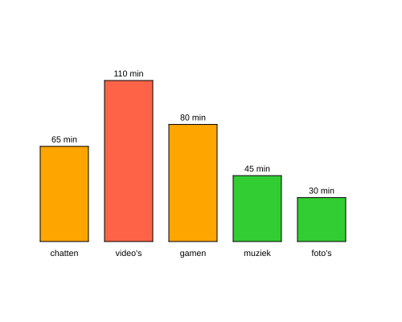
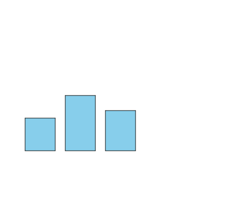

import CodeExercise from '@site/src/components/CodeExercise';

# Stap 1: Eén staaf (parameters)

:::info
Deze stap gebruikt functies met parameters, uit [Functies](site:python/docs/functies/functies) en [Parameters](site:python/docs/functies/09a-parameters). Het tekenen ken je uit de turtle-projecten: [een rechthoek](site:python/docs/projecten/turtle/vierkant/stap-2-rechthoek), [inkleuren](site:python/docs/projecten/turtle/kleuren/stap-2-vullen) en [naar een punt met goto](site:python/docs/projecten/turtle/dobbelsteen/stap-1-goto).
:::

Een klas hield een week lang bij hoeveel minuten ze per dag op hun telefoon
zaten, per soort app. In een rij getallen zie je weinig. In een
staafdiagram zie je in één oogopslag waar de tijd naartoe gaat. Aan het eind
van dit project tekent je programma dit:



Dat programma schrijf je zelf, in zes stappen. Aan het eind tekent het ook
jouw eigen gegevens. Je begint met één staaf.

Een staaf is een ingekleurde rechthoek, en je tekent er veel. Dat wordt een
functie. Waar de staaf staat en hoe hoog hij is, verschilt per staaf: dat
worden parameters. Zo ziet een functie met twee parameters eruit, die een
stip zet op een punt:

```python
import turtle

def stip(x, y):
    turtle.penup()
    turtle.goto(x, y)
    turtle.dot(20)

stip(-100, 0)
stip(0, 50)
stip(100, 0)
```

Bij `stip(-100, 0)` is `x` -100 en `y` 0. De pen gaat eerst omhoog, anders
trekt de schildpad een lijn naar het punt.

## Opdracht: drie staven

Schrijf een functie `staaf(x, hoogte)` die een staaf tekent van 60 breed en
`hoogte` hoog, lichtblauw ingekleurd met `"skyblue"`. De linkeronderhoek
staat op `(x, -100)`: dat is de grond, en alle staven staan erop.

Teken er drie mee: `staaf(-200, 65)`, `staaf(-120, 110)` en
`staaf(-40, 80)`. Verstop aan het eind de schildpad met
`turtle.hideturtle()`, dan staat hij niet in je diagram.



<CodeExercise>{`import turtle`}</CodeExercise>

<details>
<summary>Klik hier voor een tip.</summary>

Begin zoals `stip`: pen omhoog en naar de linkeronderhoek. Zet de pen daarna
weer omlaag, anders zie je de rand niet. Een rechthoek is twee keer
hetzelfde: een stuk naar rechts en een stuk omhoog, met na elk stuk een
hoek van 90 graden. Dat kan met een for-loop die twee rondes doet. Waar de
staaf breed is, staat 60, en waar hij hoog is, staat `hoogte`.

</details>

<details>
<summary>Klik hier voor de oplossing.</summary>

{/* turtle-plaatje: img/stap-1-drie-staven.svg */}

```python
import turtle

def staaf(x, hoogte):
    turtle.penup()
    turtle.goto(x, -100)
    turtle.pendown()
    turtle.fillcolor("skyblue")
    turtle.begin_fill()
    for zijde in range(2):
        turtle.forward(60)
        turtle.left(90)
        turtle.forward(hoogte)
        turtle.left(90)
    turtle.end_fill()

staaf(-200, 65)
staaf(-120, 110)
staaf(-40, 80)
turtle.hideturtle()
```

Na de staaf staat de schildpad weer in de linkeronderhoek en kijkt hij naar
rechts. Zo begint elke staaf op dezelfde manier.

</details>

## Er gaat iets mis

**Er loopt een schuine lijn door je diagram, van het midden naar de eerste
staaf.**

**Oorzaak:** je vergat `turtle.penup()` voor de `goto`. De schildpad begint
in het midden, op `(0, 0)`, en met de pen omlaag tekent hij de weg naar de
eerste staaf mee. De staven die hij daarna inkleurt, vallen over een deel van
die lijn heen. Ook van staaf naar staaf trekt hij een lijn, maar die valt
niet op: hij loopt over de grond.

**Oplossing:** zet `turtle.penup()` boven de `goto`, en `turtle.pendown()`
eronder.

Kopieer je programma voordat je verdergaat: de editor bewaart het niet.

Door naar [stap 2: een rij staven](site:python/docs/projecten/staafdiagram/stap-2-lijst).
