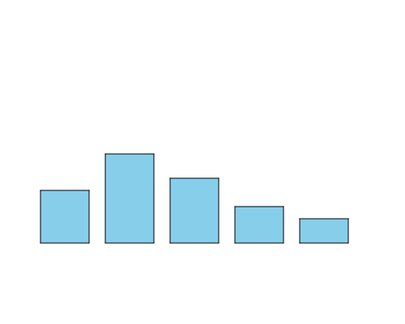

import CodeExercise from '@site/src/components/CodeExercise';

# Stap 2: Een rij staven (lijsten)

:::info
Deze stap gebruikt een lijst en een for-loop over een lijst, uit [Lijsten](site:python/docs/data/10a-lijsten-basis), en `+=` uit [While-loop](site:python/docs/herhalen/while-loop).
:::

Dit zijn de minuten per dag van de klas, voor vijf soorten apps:

```python
minuten = [65, 110, 80, 45, 30]
```

Voor elk getal wil je een staaf. Vijf keer `staaf()` met de hand aanroepen
kan, maar komt er een getal bij, dan moet je weer een regel schrijven. Een
for-loop over de lijst geeft je elk getal om de beurt:

```python
minuten = [65, 110, 80, 45, 30]

for waarde in minuten:
    print(waarde)
```

Uitvoer:

```
65
110
80
45
30
```

## Opdracht: een staaf per getal

Plak je programma uit stap 1 in het veld. Ben je het kwijt, neem dan de
oplossing van [stap 1](site:python/docs/projecten/staafdiagram/stap-1-staaf).

Zet de lijst `minuten` bovenaan, onder `import turtle`. Haal de drie losse
aanroepen van `staaf()` weg, en teken met een for-loop een staaf voor elk
getal in de lijst. De eerste staaf staat op x = -200, en elke volgende 80
verder naar rechts.



<CodeExercise>{`# Plak hier je programma uit stap 1`}</CodeExercise>

<details>
<summary>Klik hier voor een tip.</summary>

Bewaar de plek van de volgende staaf in een variabele `x`. Die begint vóór
de loop op de plek van de eerste staaf. In de loop teken je een staaf op
plek `x`, met het getal van deze ronde als hoogte, en daarna schuif je `x`
op naar de plek van de volgende.

</details>

<details>
<summary>Klik hier voor de oplossing.</summary>

{/* turtle-plaatje: img/stap-2-rij.svg */}

```python
import turtle

minuten = [65, 110, 80, 45, 30]

def staaf(x, hoogte):
    turtle.penup()
    turtle.goto(x, -100)
    turtle.pendown()
    turtle.fillcolor("skyblue")
    turtle.begin_fill()
    for zijde in range(2):
        turtle.forward(60)
        turtle.left(90)
        turtle.forward(hoogte)
        turtle.left(90)
    turtle.end_fill()

x = -200
for waarde in minuten:
    staaf(x, waarde)
    x += 80
turtle.hideturtle()
```

Komt er een getal bij in de lijst, dan komt er een staaf bij. De rest van
het programma blijft hetzelfde.

</details>

## Er gaat iets mis

**Je ziet maar één staaf, met streepjes erin.**

**Oorzaak:** `x = -200` staat in de loop in plaats van erboven. Dan begint
`x` elke ronde opnieuw op -200, en tekent de schildpad alle vijf de staven
op dezelfde plek, over elkaar heen. De streepjes zijn de bovenkanten van de
lagere staven.

**Oplossing:** zet `x = -200` boven de loop. Dan krijgt `x` één keer een
beginwaarde, en schuift hij in de loop steeds verder.

Kopieer je programma voordat je verdergaat: de editor bewaart het niet.

Door naar [stap 3: de getallen erbij](site:python/docs/projecten/staafdiagram/stap-3-f-string).
