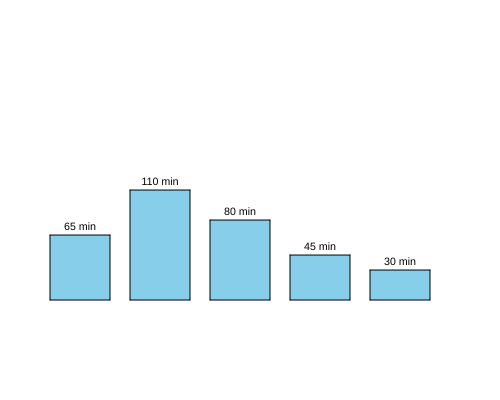

import CodeExercise from '@site/src/components/CodeExercise';

# Stap 3: De getallen erbij (f-strings)

:::info
Deze stap gebruikt een f-string, uit [Slimme berichten met f-strings](site:python/docs/tekst/04a-f-strings).
:::

Je ziet welke staaf het hoogst is, maar niet hoeveel minuten het zijn. Met
`turtle.write()` zet de schildpad tekst in de tekening, op de plek waar hij
staat:

```python
import turtle

waarde = 110
turtle.write(f"{waarde} min", align="center")
```

De f-string maakt van het getal de tekst `110 min`. Met
`align="center"` staat het midden van de tekst bij de schildpad, en de
onderkant van de letters op zijn hoogte. De schildpad zelf blijft staan.

## Opdracht: minuten boven elke staaf

Plak je programma uit stap 2 in het veld. Ben je het kwijt, neem dan de
oplossing van [stap 2](site:python/docs/projecten/staafdiagram/stap-2-lijst).

1. Schrijf een functie `schrijf(x, y, tekst)`. Die tilt de pen op, gaat
   naar het punt `(x, y)` en schrijft daar de tekst, in het midden
   uitgelijnd.
2. Zet daarmee boven elke staaf het aantal minuten, zoals `110 min`. De
   tekst staat in het midden boven de staaf, 5 hoger dan de bovenkant.



<CodeExercise>{`# Plak hier je programma uit stap 2`}</CodeExercise>

<details>
<summary>Klik hier voor een tip.</summary>

Een staaf is 60 breed, dus het midden ligt 30 rechts van `x`. De grond ligt
op -100, dus de bovenkant van een staaf ligt de hoogte boven -100. Roep
`schrijf` in de loop aan, na de staaf, met de f-string als tekst.

</details>

<details>
<summary>Klik hier voor de oplossing.</summary>

{/* turtle-plaatje: img/stap-3-getallen.svg */}

```python
import turtle

minuten = [65, 110, 80, 45, 30]

def staaf(x, hoogte):
    turtle.penup()
    turtle.goto(x, -100)
    turtle.pendown()
    turtle.fillcolor("skyblue")
    turtle.begin_fill()
    for zijde in range(2):
        turtle.forward(60)
        turtle.left(90)
        turtle.forward(hoogte)
        turtle.left(90)
    turtle.end_fill()

def schrijf(x, y, tekst):
    turtle.penup()
    turtle.goto(x, y)
    turtle.write(tekst, align="center")

x = -200
for waarde in minuten:
    staaf(x, waarde)
    schrijf(x + 30, -100 + waarde + 5, f"{waarde} min")
    x += 80
turtle.hideturtle()
```

`-100 + waarde` is de bovenkant van de staaf, en `+ 5` zet de tekst er
net boven.

</details>

## Er gaat iets mis

{/* foutmelding-van: waarde = 110\nwaarde + " min" */}

```
TypeError: unsupported operand type(s) for +: 'int' and 'str'
```

**Oorzaak:** je schreef `waarde + " min"`. Met `+` plak je tekst aan
tekst, maar `waarde` is een getal. Een getal en een tekst kan Python niet
optellen.

**Oplossing:** zet het getal in een f-string: `f"{waarde} min"`. Die maakt
er zelf tekst van.

Kopieer je programma voordat je verdergaat: de editor bewaart het niet.

Door naar [stap 4: namen erbij](site:python/docs/projecten/staafdiagram/stap-4-dictionary).
