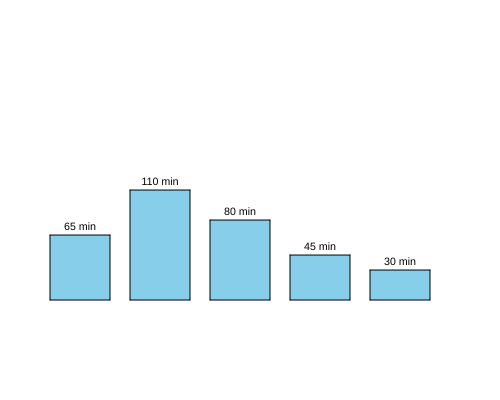

import CodeExercise from '@site/src/components/CodeExercise';

# Stap 4: In het midden (een keyword-argument)

:::info
Deze stap schrijft een functie met drie parameters, zoals `staaf` uit
[stap 1](site:python/docs/projecten/staafdiagram/stap-1-staaf). Nieuw is
alleen hoe je `write` vertelt waar de tekst komt.
:::

De getallen beginnen nu bij de linkerrand van hun staaf. Netter is het als
ze precies in het midden staan. Dat vertel je aan `write` zo:

```python
import turtle

turtle.write("110 min", align="center")
```

Nu staat het midden van de tekst bij de schildpad, en niet het begin.

`align="center"` heet een **keyword-argument**: je zet de naam van de
parameter ervoor, met een `=`. Dat is nodig omdat `write` meer parameters
heeft dan alleen de tekst, en `align` is niet de tweede. Met de naam erbij
weet Python welke je bedoelt. Zonder naam vult Python de parameters op
volgorde, zoals bij je eigen functies, en dan komt `"center"` op de
verkeerde plek terecht.

## Opdracht: de getallen in het midden

Plak je programma uit stap 3 in het veld. Ben je het kwijt, neem dan de
oplossing van [stap 3](site:python/docs/projecten/staafdiagram/stap-3-f-string).

In de volgende stap schrijf je ook een naam onder elke staaf. Dat zijn
dezelfde drie regels nog een keer, dus die worden nu een functie.

1. Schrijf een functie `schrijf(x, y, tekst)`. Die tilt de pen op, gaat
   naar het punt `(x, y)` en schrijft daar de tekst, in het midden
   uitgelijnd.
2. Zet daarmee het aantal minuten in het midden boven elke staaf, 5 hoger
   dan de bovenkant.



<CodeExercise>{`# Plak hier je programma uit stap 3`}</CodeExercise>

<details>
<summary>Klik hier voor een tip.</summary>

De functie krijgt de drie regels die nu in je loop staan, met `x`, `y` en
`tekst` op de plek van de getallen. In de loop blijft één aanroep over. Een
staaf is 60 breed, dus het midden ligt 30 rechts van `plek`.

</details>

<details>
<summary>Klik hier voor de oplossing.</summary>

{/* turtle-plaatje: img/stap-4-midden.svg */}

```python
import turtle

minuten = [65, 110, 80, 45, 30]

def staaf(x, hoogte):
    turtle.penup()
    turtle.goto(x, -100)
    turtle.pendown()
    turtle.fillcolor("skyblue")
    turtle.begin_fill()
    for zijde in range(2):
        turtle.forward(60)
        turtle.left(90)
        turtle.forward(hoogte)
        turtle.left(90)
    turtle.end_fill()

def schrijf(x, y, tekst):
    turtle.penup()
    turtle.goto(x, y)
    turtle.write(tekst, align="center")

plek = -200
for waarde in minuten:
    staaf(plek, waarde)
    schrijf(plek + 30, -100 + waarde + 5, f"{waarde} min")
    plek += 80
turtle.hideturtle()
```

</details>

## Er gaat iets mis

**De getallen beginnen in het midden van de staaf, en steken rechts uit.**

**Oorzaak:** je schreef `turtle.write(tekst, "center")`, zonder `align=`.
Python vult de parameters van `write` dan op volgorde, en de tweede is
`move`. Die zegt of de schildpad na het schrijven naar het eind van de
tekst loopt. Dus loopt hij, en de tekst blijft links uitgelijnd: hij
begint bij de schildpad, in het midden van de staaf. Een foutmelding krijg
je niet, want voor Python is er niets mis.

**Oplossing:** zet de naam ervoor: `turtle.write(tekst, align="center")`.

Kopieer je programma voordat je verdergaat: de editor bewaart het niet.

Door naar [stap 5: namen erbij](site:python/docs/projecten/staafdiagram/stap-5-dictionary).
