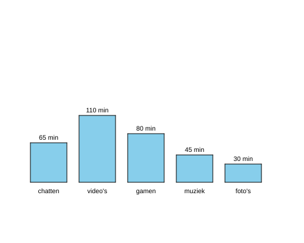

import CodeExercise from '@site/src/components/CodeExercise';

# Stap 5: Namen erbij (dictionaries)

:::info
Deze stap gebruikt een dictionary, uit [Dictionaries](site:python/docs/data/11a-dictionaries-basis).
:::

Bij welke app hoort de hoogste staaf? Dat staat nergens. Bij elk getal
hoort een naam, en in een dictionary zet je ze bij elkaar. Met de naam zoek
je het getal op:

```python
minuten = {"chatten": 65, "video's": 110}

print(minuten["video's"])   # 110
```

Welke staaf waar komt, bepaal je met een lijst van de namen. Loop daarover,
en zoek in elke ronde het getal op:

```python
minuten = {"chatten": 65, "video's": 110}
apps = ["chatten", "video's"]

for naam in apps:
    waarde = minuten[naam]
    print(f"{naam}: {waarde}")
```

Uitvoer:

```
chatten: 65
video's: 110
```

## Opdracht: de naam onder elke staaf

Plak je programma uit stap 4 in het veld. Ben je het kwijt, neem dan de
oplossing van [stap 4](site:python/docs/projecten/staafdiagram/stap-4-midden).

Vervang de lijst `minuten` door deze dictionary en deze lijst met namen:

```python
minuten = {
    "chatten": 65,
    "video's": 110,
    "gamen": 80,
    "muziek": 45,
    "foto's": 30,
}
apps = ["chatten", "video's", "gamen", "muziek", "foto's"]
```

Loop over de namen in `apps`, en teken weer een staaf per app, met het
aantal minuten erboven. Schrijf nu ook de naam onder elke staaf, in het
midden, op hoogte -118.



<CodeExercise>{`# Plak hier je programma uit stap 4`}</CodeExercise>

<details>
<summary>Klik hier voor een tip.</summary>

Je functies `staaf` en `schrijf` blijven precies hetzelfde. Alleen de loop
verandert: die krijgt in elke ronde een naam. Het getal dat bij die naam
hoort, zoek je als eerste in de loop op in de dictionary. De naam schrijf
je met dezelfde functie als het getal.

</details>

<details>
<summary>Klik hier voor de oplossing.</summary>

{/* turtle-plaatje: img/stap-5-namen.svg */}

```python
import turtle

minuten = {
    "chatten": 65,
    "video's": 110,
    "gamen": 80,
    "muziek": 45,
    "foto's": 30,
}
apps = ["chatten", "video's", "gamen", "muziek", "foto's"]

def staaf(x, hoogte):
    turtle.penup()
    turtle.goto(x, -100)
    turtle.pendown()
    turtle.fillcolor("skyblue")
    turtle.begin_fill()
    for zijde in range(2):
        turtle.forward(60)
        turtle.left(90)
        turtle.forward(hoogte)
        turtle.left(90)
    turtle.end_fill()

def schrijf(x, y, tekst):
    turtle.penup()
    turtle.goto(x, y)
    turtle.write(tekst, align="center")

plek = -200
for naam in apps:
    waarde = minuten[naam]
    staaf(plek, waarde)
    schrijf(plek + 30, -100 + waarde + 5, f"{waarde} min")
    schrijf(plek + 30, -118, naam)
    plek += 80
turtle.hideturtle()
```

De staven staan in de volgorde van de lijst `apps`.

</details>

## Er gaat iets mis

{/* foutmelding-van: import turtle\nturtle.forward("chatten") */}

```
TypeError: can't multiply sequence by non-int of type 'float'
```

**Oorzaak:** je verving de lijst door de dictionary, maar je loop is nog
`for waarde in minuten:`. Een loop over een dictionary geeft de namen, niet
de getallen. Dan is `waarde` in de eerste ronde de tekst `"chatten"`, en
`staaf` laat de schildpad `"chatten"` stappen vooruit lopen. Om uit te
rekenen waar hij uitkomt, vermenigvuldigt turtle de afstand met een
kommagetal, en een tekst keer een kommagetal kan niet.

**Oplossing:** loop over de namen in `apps`, en zoek het getal op met
`minuten[naam]`.

Kopieer je programma voordat je verdergaat: de editor bewaart het niet.

Door naar [stap 6: de namen één keer](site:python/docs/projecten/staafdiagram/stap-6-items).
