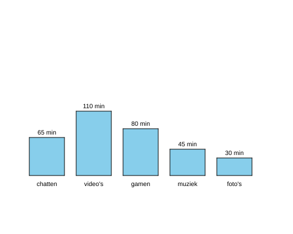

import CodeExercise from '@site/src/components/CodeExercise';

# Stap 6: De namen één keer (door een dictionary lopen)

:::info
Deze stap gebruikt `.items()`, uit [Door een dictionary lopen](site:python/docs/data/11b-itereren-dictionaries).
:::

Elke naam staat nu twee keer in je programma: in de dictionary en in de
lijst `apps`. Wil je er een app bij, dan moet dat op twee plekken. Vergeet
je er één, dan mist er een staaf, of zoekt je programma een naam op die
niet in de dictionary staat.

Een loop over de dictionary zelf geeft je de namen al. Met `.items()` krijg
je in elke ronde de naam én het getal:

```python
minuten = {"chatten": 65, "video's": 110}

for naam, waarde in minuten.items():
    print(f"{naam}: {waarde}")
```

Uitvoer:

```
chatten: 65
video's: 110
```

## Opdracht: zonder de lijst met namen

Plak je programma uit stap 5 in het veld. Ben je het kwijt, neem dan de
oplossing van [stap 5](site:python/docs/projecten/staafdiagram/stap-5-dictionary).

Haal de lijst `apps` weg, en loop met `.items()` over de dictionary. De
tekening blijft hetzelfde.



<CodeExercise>{`# Plak hier je programma uit stap 5`}</CodeExercise>

<details>
<summary>Klik hier voor een tip.</summary>

In de kop van de loop komen nu twee variabelen, met een komma ertussen:
eerst de naam, dan het getal. De regel die het getal opzocht, heb je dan
niet meer nodig.

</details>

<details>
<summary>Klik hier voor de oplossing.</summary>

{/* turtle-plaatje: img/stap-6-namen.svg */}

```python
import turtle

minuten = {
    "chatten": 65,
    "video's": 110,
    "gamen": 80,
    "muziek": 45,
    "foto's": 30,
}

def staaf(x, hoogte):
    turtle.penup()
    turtle.goto(x, -100)
    turtle.pendown()
    turtle.fillcolor("skyblue")
    turtle.begin_fill()
    for zijde in range(2):
        turtle.forward(60)
        turtle.left(90)
        turtle.forward(hoogte)
        turtle.left(90)
    turtle.end_fill()

def schrijf(x, y, tekst):
    turtle.penup()
    turtle.goto(x, y)
    turtle.write(tekst, align="center")

plek = -200
for naam, waarde in minuten.items():
    staaf(plek, waarde)
    schrijf(plek + 30, -100 + waarde + 5, f"{waarde} min")
    schrijf(plek + 30, -118, naam)
    plek += 80
turtle.hideturtle()
```

De staven staan in de volgorde van de dictionary. Zet er eens een app bij,
zoals `"lezen": 20`: dan komt er rechts een zesde staaf, en je veranderde
maar één regel.

</details>

## Er gaat iets mis

{/* foutmelding-van: minuten = {"chatten": 65}\nfor naam, waarde in minuten:\n    pass */}

```
ValueError: too many values to unpack (expected 2)
```

**Oorzaak:** je schreef `for naam, waarde in minuten:` zonder `.items()`.
Een loop over een dictionary geeft alleen de namen, zoals `"chatten"`.
Python probeert die ene tekst over twee variabelen te verdelen, en
`"chatten"` heeft zeven letters: te veel voor twee.

**Oplossing:** loop over `minuten.items()`. Dan krijg je per ronde een paar:
de naam en het getal.

Kopieer je programma voordat je verdergaat: de editor bewaart het niet.

Door naar [stap 7: op schaal](site:python/docs/projecten/staafdiagram/stap-7-schalen).
