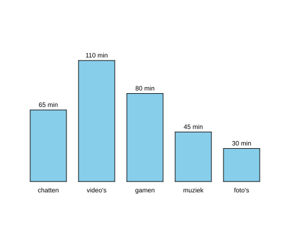

import CodeExercise from '@site/src/components/CodeExercise';

# Stap 7: Op schaal (de hoogste zoeken met if)

:::info
Deze stap gebruikt `if`, uit [If en else](site:python/docs/beslissen/05b-if-else).
Het hoogste getal zoeken deed je ook in [Lijsten](site:python/docs/data/10a-lijsten-basis),
bij het hoogste cijfer. Daar begon je met `cijfers[0]`, het cijfer op plek
0. Een dictionary heeft geen plek 0, want je zoekt erin op naam. Daarom
begin je hier bij 0.
:::

Elke minuut is nu één stap hoog. Bij deze klas komt dat goed uit, maar bij
andere getallen niet. Tel je in uren, dan zijn de staven 1 of 2 stappen
hoog: platte streepjes. En bij grote getallen wordt een staaf veel te hoog.

Probeer het maar: zet in je programma uit stap 6 bij video's 2000 in plaats
van 110. De speeltuin zoomt uit tot de hele tekening past. Je diagram wordt
dan een smalle strook in het midden, met getallen die je niet meer kunt
lezen. Op je eigen computer zoomt turtle niet uit, en steekt de staaf ver
boven het venster uit.

Een diagram op schaal lost dat op. De hoogste staaf is altijd 200 hoog, en
de rest naar verhouding:

```python
hoogste = 110
waarde = 55
hoogte = waarde / hoogste * 200
print(hoogte)   # 100.0
```

55 is de helft van 110, dus die staaf wordt de helft van 200. Daarvoor moet
het programma eerst weten wat het hoogste getal is. Dat zoek je met een
loop: begin bij 0, en kom je een groter getal tegen, onthoud dan dat getal.
Bij 0 beginnen kan, omdat een aantal minuten nooit kleiner is dan 0.

```python
cijfers = [6, 9, 7]

hoogste = 0
for cijfer in cijfers:
    if cijfer > hoogste:
        hoogste = cijfer
print(hoogste)   # 9
```

## Opdracht: de hoogste staaf 200 hoog

Plak je programma uit stap 6 in het veld. Ben je het kwijt, neem dan de
oplossing van [stap 6](site:python/docs/projecten/staafdiagram/stap-6-items).
Heb je video's op 2000 gezet, zet het dan terug op 110.

1. Zoek vóór het tekenen het hoogste aantal minuten in de dictionary.
2. Teken elke staaf op schaal: de hoogste 200 hoog, de rest naar
   verhouding.
3. Boven de staaf staat nog steeds het echte aantal minuten, en de tekst
   staat 5 boven de nieuwe bovenkant.



<CodeExercise>{`# Plak hier je programma uit stap 6`}</CodeExercise>

<details>
<summary>Klik hier voor een tip.</summary>

Je hebt nu twee loops over de dictionary. De eerste zoekt alleen het
hoogste getal en tekent nog niets. De tweede tekent, en rekent in elke
ronde eerst de hoogte van de staaf uit. Let op welk getal waar hoort: de
staaf en de plek van de tekst gaan over de hoogte, de tekst zelf over de
minuten.

</details>

<details>
<summary>Klik hier voor de oplossing.</summary>

{/* turtle-plaatje: img/stap-7-schaal.svg */}

```python
import turtle

minuten = {
    "chatten": 65,
    "video's": 110,
    "gamen": 80,
    "muziek": 45,
    "foto's": 30,
}

def staaf(x, hoogte):
    turtle.penup()
    turtle.goto(x, -100)
    turtle.pendown()
    turtle.fillcolor("skyblue")
    turtle.begin_fill()
    for zijde in range(2):
        turtle.forward(60)
        turtle.left(90)
        turtle.forward(hoogte)
        turtle.left(90)
    turtle.end_fill()

def schrijf(x, y, tekst):
    turtle.penup()
    turtle.goto(x, y)
    turtle.write(tekst, align="center")

hoogste = 0
for naam, waarde in minuten.items():
    if waarde > hoogste:
        hoogste = waarde

plek = -200
for naam, waarde in minuten.items():
    hoogte = waarde / hoogste * 200
    staaf(plek, hoogte)
    schrijf(plek + 30, -100 + hoogte + 5, f"{waarde} min")
    schrijf(plek + 30, -118, naam)
    plek += 80
turtle.hideturtle()
```

Zet video's nu nog eens op 2000. Die staaf blijft 200 hoog, en de andere
worden naar verhouding laag: chatten nog geen 7 stappen. Het hele diagram
past in beeld, en de getallen kun je weer lezen.

</details>

## Er gaat iets mis

{/* foutmelding-van: hoogste = 0\nwaarde = 65\nhoogte = waarde / hoogste * 200 */}

```
ZeroDivisionError: division by zero
```

**Oorzaak:** na de loop die het hoogste getal zoekt, is `hoogste` nog
steeds 0, en delen door 0 kan niet. Dat gebeurt als je in die loop
`waarde = hoogste` schreef in plaats van andersom. Bij `=` krijgt de
variabele links de waarde van rechts, dus nu verandert `waarde`, en blijft
`hoogste` 0. Het gebeurt ook als je de vergelijking omdraaide:
`if hoogste > waarde:`. 0 is nooit groter dan een aantal minuten, dus de
regel eronder komt nooit aan de beurt.

**Oplossing:** vergelijk met `if waarde > hoogste:`, en zet daaronder
`hoogste = waarde`, met `hoogste` links.

{/* foutmelding-van: minuten = {"chatten": 65}\nhoogste = minuten[0] */}

```
KeyError: 0
```

**Oorzaak:** je begon met `hoogste = minuten[0]`, zoals bij het hoogste
cijfer in Lijsten. Een lijst heeft plekken 0, 1, 2, en zo verder, maar een
dictionary zoekt op naam. Een app met de naam 0 is er niet.

**Oplossing:** begin met `hoogste = 0`.

**Je diagram staat er klein en smal in, met piepkleine getallen.**

**Oorzaak:** `hoogste = 0` staat in de loop in plaats van erboven. Dan
begint `hoogste` elke ronde opnieuw bij 0, en na de loop is het het laatste
getal: 30, van foto's. Zet `print(hoogste)` onder de loop, dan zie je het.
Video's wordt dan 110 / 30 * 200 hoog, meer dan 700, en de speeltuin
zoomt uit om alles te laten zien.

**Oplossing:** zet `hoogste = 0` boven de loop, net als `plek = -200` in
[stap 2](site:python/docs/projecten/staafdiagram/stap-2-lijst#er-gaat-iets-mis).

Kopieer je programma voordat je verdergaat: de editor bewaart het niet.

Door naar [stap 8: kleur naar het aantal](site:python/docs/projecten/staafdiagram/stap-8-kleuren).
