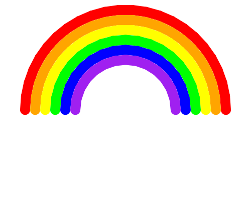

import CodeExercise from '@site/src/components/CodeExercise';

# Stap 2: De regenboog (een lijst en een variabele)

Een regenboog is een halve cirkel per kleur. Eén boog teken je zo:

```python
import turtle

straal = 200

turtle.pensize(20)
turtle.penup()
turtle.goto(-straal, 0)
turtle.setheading(90)
turtle.pendown()
turtle.circle(-straal, 180)
```

<CodeExercise>{`import turtle

straal = 200

turtle.pensize(20)
turtle.penup()
turtle.goto(-straal, 0)
turtle.setheading(90)
turtle.pendown()
turtle.circle(-straal, 180)`}</CodeExercise>

`setheading` en `circle` ken je uit [Cirkels en bogen](site:python/docs/projecten/turtle/cirkels/stap-2-boog).
De schildpad begint links, op `(-straal, 0)`, en kijkt omhoog. Nieuw is de
min voor de straal: daarmee buigt de boog naar rechts in plaats van naar
links, over de top heen.

## Opdracht: een regenboog

Teken voor elke kleur uit de lijst van stap 1 een boog. Elke volgende boog
is 20 kleiner dan de vorige, zodat hij precies binnen de vorige past.



<details>
<summary>Klik hier voor een tip.</summary>

Alles vanaf `turtle.penup()` gaat in een for-loop over `kleuren`. Zet in de
loop ook `turtle.pencolor(kleur)`, en maak onderaan de loop `straal` 20
kleiner met `straal -= 20`.

</details>

<details>
<summary>Klik hier voor de oplossing.</summary>

{/* turtle-plaatje: img/stap-2-regenboog.svg */}

```python
import turtle

kleuren = ["red", "orange", "yellow", "green", "blue", "purple"]
straal = 200

turtle.hideturtle()
turtle.pensize(20)
for kleur in kleuren:
    turtle.penup()
    turtle.goto(-straal, 0)
    turtle.setheading(90)
    turtle.pendown()
    turtle.pencolor(kleur)
    turtle.circle(-straal, 180)
    straal -= 20
```

</details>

## Maak het je eigen

Om de regenboog heen past een heel landschap.

- Zet een wolk van witte stippen aan elk uiteinde, op een lichtblauwe
  achtergrond met `turtle.bgcolor("lightblue")` uit
  [Kleur en dikte](site:python/docs/projecten/turtle/kleuren/stap-1-pen).
- Hoeveel kleuren passen erin? Zet er meer in de lijst, en kijk of de straal
  groot genoeg is.
- Teken de regenboog boven je straat uit
  [Een straat vol huizen](site:python/docs/projecten/turtle/straat-vol-huizen/stap-3-straat).
  Hoe groot moet de straal worden, zodat de huizen eronder passen?
- Maak er een functie `regenboog(x, straal)` van, en zet een kleine
  regenboog naast een grote.

## Verder tekenen

Hiermee heb je de hele turtle-lijn gedaan. Wil je verder tekenen, dan zijn
de vijf grote turtle-projecten de volgende stap. Daarin bouw je in een paar
stappen één grote tekening op, met de commando's uit deze lijn:

- [Bloemenveld](site:python/docs/projecten/bloemenveld/stap-1-for-loop): een
  veld vol bloemen, op plekken en in kleuren die de computer kiest.
- [Spirograaf](site:python/docs/projecten/spirograaf/stap-1-for-loop): een
  patroon van gekleurde cirkels en vormen dat rond het midden draait.
- [Schildpaddenrace](site:python/docs/projecten/schildpaddenrace/stap-1-random):
  schildpadden die met willekeurige stappen naar de finish racen.
- [Pixel art](site:python/docs/projecten/pixel-art/stap-1-vakje): een plaatje
  van gekleurde vakjes, dat je als regels tekst opschrijft.
- [Staafdiagram](site:python/docs/projecten/staafdiagram/stap-1-staaf): een
  diagram van je eigen gegevens, met de getallen en namen erbij.

Terug naar [het overzicht van de projecten](site:python/docs/projecten).
