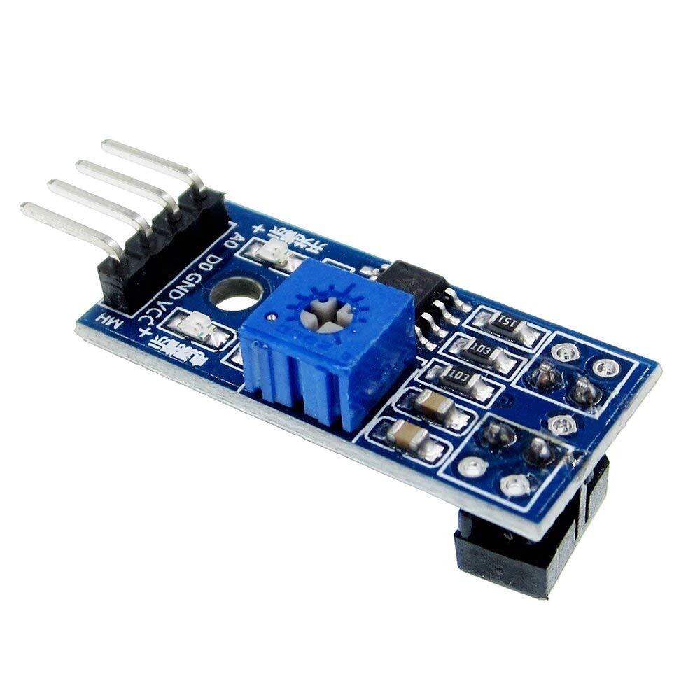
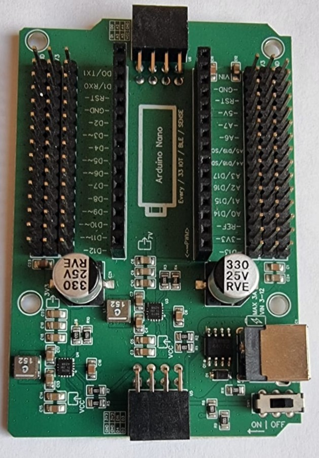

Wat heb je nodig?

1. Arduino Nano RP2040 Connect
2. Analoge IR-sensor
3. Leaphy Murphy Shield

### Analoge IR-sensor

### Leaphy Murphy Shield

Controlevraag

Op welke pinnen sluit je een analoge IR-sensor aan?

Antwoord

Op een **analoge pin**: `A0`, `A1`, `A2`, `A3`, `A6` of `A7`. Niet op `A4` en `A5` — die zijn nodig voor I2C (SDA en SCL).

