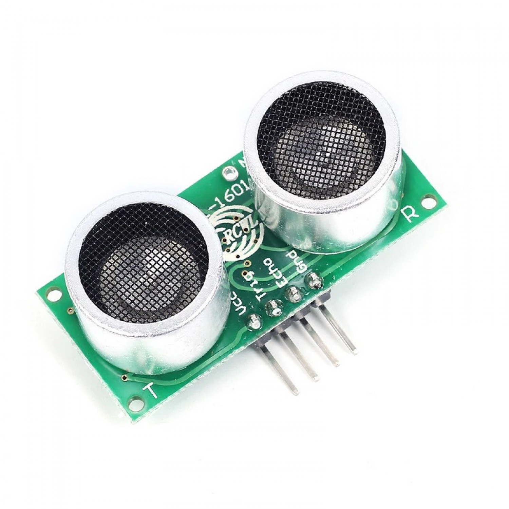

import ShieldRijen from '@site/docs/onderdelen/_delen/shield/rijen.md';

# Afstandssensor

Een **ultrasone afstandssensor** meet hoe ver iets weg is door geluidsgolven te sturen en te kijken hoe lang ze erover doen om terug te komen. Wij gebruiken de **RCWL-1601**.

## Materiaal

Wat heb je nodig?

1. Arduino Nano RP2040 Connect op het **Leaphy Murphy Shield**
2. Afstandssensor type **RCWL-1601**



De sensor heeft vier pinnen: **VCC**, **Trig**, **Echo** en **GND**.

<details>
<summary>Controlevraag</summary>

Wat doet de **Trig**-pin?

</details>

<details>
<summary>Antwoord</summary>

Via **Trig** stuurt de microcontroller een kort signaaltje. Daardoor zendt de sensor een geluidspuls uit. Via **Echo** komt het antwoord terug.

</details>

## Aansluiten


<ShieldRijen />

- **VCC** van de sensor aan een **3V3**-pin (middelste rij)
- **GND** van de sensor aan een **GND**-pin (buitenste rij)
- **Trig** aan de pin **D7** (binnenste rij)
- **Echo** aan de pin **D8** (binnenste rij)

De draden van Trig en Echo kruisen elkaar: op de sensor zit Trig links van
Echo, op het shield zit D7 rechts van D8.

Kies voor Trig en Echo een gewone D-pin. D18 en D19 (de pinnen A4 en A5) werken
niet: in MicroPython lopen die via de wifi-chip, en dat is te traag om de echo
te timen. Bovendien zijn ze nodig voor I2C, als je een TOF of OLED-scherm
gebruikt.

## Code

```python
from time import sleep
from leaphymicropython.sensors.sonar import read_distance

while True:
    print(read_distance("D7", "D8"))
    sleep(1)
```

Je krijgt nu elke seconde de afstand in **centimeters** in de Shell te zien.

### Uitleg

```python
read_distance("D7", "D8")
```

- Eerste naam: de pin van **Trig** (`D7`).
- Tweede naam: de pin van **Echo** (`D8`).
- Schrijf de namen tussen aanhalingstekens. Een kaal getal als `7` betekent voor
  MicroPython iets anders: het nummer van een aansluiting op de chip (GPIO7), en
  dat is hier de pin D11.

Komt er geen echo terug, omdat er niets voor de sensor staat of een draad los
zit, dan geeft `read_distance` het getal **1313.0**. Dat is geen afstand van
13 meter, maar een teken dat de meting mislukte.

<details>
<summary>Opdracht: lampje bij obstakel</summary>

Laat het ingebouwde rode lampje **`LED_RED`** branden zodra een obstakel binnen **10 cm** komt.

</details>

<details>
<summary>Tip</summary>

Bij de ingebouwde RGB-LED is `value(0)` aan en `value(1)` uit. Gebruik een `if`-statement met `< 10`.

</details>

<details>
<summary>Oplossing</summary>

```python
from time import sleep
from machine import Pin
from leaphymicropython.sensors.sonar import read_distance

led = Pin('LED_RED', Pin.OUT)

while True:
    afstand = read_distance("D7", "D8")
    if afstand < 10:
        led.value(0)  # AAN
    else:
        led.value(1)  # UIT
    sleep(0.1)
```

</details>
