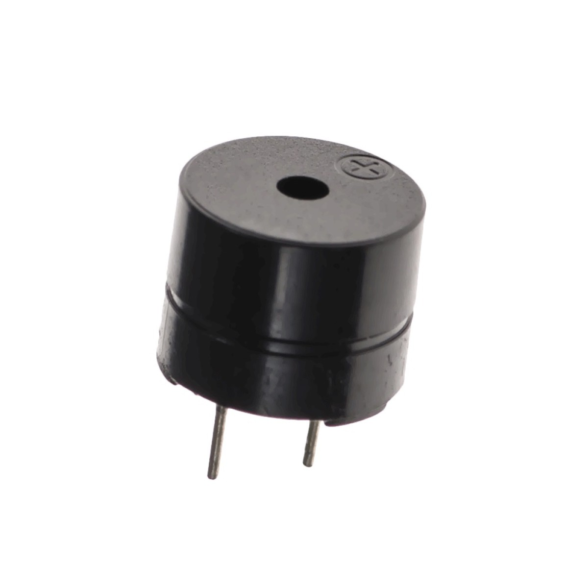
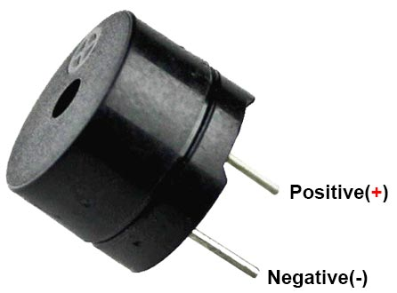

import ShieldRijen from '@site/docs/onderdelen/_delen/shield/rijen.md';

# Buzzer

Een **buzzer** is een klein onderdeel dat geluid maakt. Vanuit je code kies je hoe hoog de toon is en hoe hard hij klinkt.

## Materiaal

Wat heb je nodig?

1. Arduino Nano RP2040 Connect op het **Leaphy Murphy Shield**
2. Buzzer



De buzzer heeft twee pinnen: een **lange** (de plus, met een `+`-teken) en een **korte** (de min, GND).

<details>
<summary>Controlevraag</summary>

Welke pin van de buzzer gaat naar GND?

</details>

<details>
<summary>Antwoord</summary>

De **korte** pin. De **lange** pin (met het `+`-teken) gaat naar een digitale uitgang van de microcontroller.

</details>

## Aansluiten



### Pinnen van de buzzer

- **GND** (korte pin): de min
- **Digital (+)** (lange pin): hier komt het stuursignaal binnen

### Aansluiten op het shield


<ShieldRijen />

- **GND** (korte pin) van de buzzer aan een **GND**-pin (buitenste rij)
- **Digital (+)** (lange pin) van de buzzer aan de pin **D6** (binnenste rij)

<details>
<summary>Controlevraag</summary>

Mag je de `+`-pin van de buzzer rechtstreeks aan `3.3V` aansluiten?

</details>

<details>
<summary>Antwoord</summary>

Nee. De buzzer moet aan een **digitale pin** zitten, zodat je hem vanuit je code aan en uit kunt zetten. Aan `3.3V` zou hij continu aan staan.

</details>

## Code

Een buzzer maakt geluid als je zijn pin heel snel aan en uit zet. Dat doet
**PWM** uit `machine`: hoe vaak per seconde de pin aan en uit gaat, is de
toonhoogte.

### Voorbeeld

```python
from machine import Pin, PWM
from time import sleep

buzzer = PWM(Pin("D6"))
buzzer.freq(440)
buzzer.duty_u16(32768)
sleep(1)
buzzer.duty_u16(0)
```

Je hoort één seconde een toon van 440 Hz (een A) en daarna is het stil.

### Uitleg

- `PWM(Pin("D6"))` maakt van pin **D6** een PWM-pin. De naam staat tussen
  aanhalingstekens, zoals hij op het bord staat.
- `buzzer.freq(440)` kiest de **toonhoogte** in hertz: hoe vaak per seconde de
  pin aan en uit gaat. Lager getal, lagere toon.
- `buzzer.duty_u16(32768)` kiest hoe lang de pin per keer aan staat, tussen
  `0` en `65535`. Met `32768` staat hij de helft van de tijd aan: dan klinkt de
  buzzer het hardst. Met `0` is hij stil.

:::note[Waarom niet `set_buzzer`?]

De bibliotheek leaphymicropython heeft ook `set_buzzer`, maar die accepteert nu
alleen toonhoogtes tot 255 Hz, en dan hoor je vooral gebrom. Daarom gebruik je
hier `PWM` uit `machine`.

:::

<details>
<summary>Opdracht: piepje van 1 seconde</summary>

Laat de buzzer op pin **D6** precies **1 seconde** een toon van 1000 Hz spelen en daarna stil zijn.

</details>

<details>
<summary>Tip</summary>

Verander alleen het getal bij `freq()`. Stil maak je de buzzer met `duty_u16(0)`.

</details>

<details>
<summary>Oplossing</summary>

```python
from machine import Pin, PWM
from time import sleep

buzzer = PWM(Pin("D6"))
buzzer.freq(1000)
buzzer.duty_u16(32768)
sleep(1)
buzzer.duty_u16(0)
```

</details>
