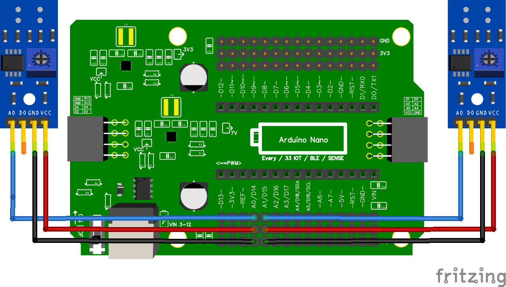

import Materiaal from '@site/docs/onderdelen/_delen/ir-analoog/materiaal.md';

# Analoge IR-sensor

Een **analoge IR-sensor** geeft niet zomaar een 0 of een 1, maar een getal tussen **0 en 65535**. Hoe hoger het getal, hoe minder licht er terugkomt. Daardoor kun je zelf bepalen waar de grens tussen zwart en wit ligt.

## Materiaal

<Materiaal />

## Eén sensor uitlezen \{#een-sensor}

### Aansluiten


Sluit de IR-sensor aan op pin **A0** van het Leaphy Murphy Shield.

### Code

```python
from leaphymicropython.sensors.linesensor import AnalogIR
from time import sleep

a0 = AnalogIR("A0", 2500)

while True:
    a0_ir = a0.get_analog_value()
    a0_color = a0.black_or_white()

    print(a0_ir, a0_color)
    sleep(0.01)
```

### Uitleg

```python
a0 = AnalogIR("A0", 2500)
```

- `"A0"` is de pin waar de sensor op zit.
- `2500` is de **drempelwaarde**. Alles **boven** 2500 noemt de sensor `"black"`, daaronder `"white"`.

```python
a0.get_analog_value()
```

Geeft het ruwe getal terug (tussen 0 en 65535).

```python
a0.black_or_white()
```

Geeft `"black"` of `"white"` op basis van de drempelwaarde.

<details>
<summary>Opdracht: drempel kalibreren</summary>

Houd de sensor boven wit papier en boven zwart papier. Kies een drempelwaarde die precies tussen die twee in ligt en pas `2500` aan.

</details>

<details>
<summary>Tip</summary>

Schrijf de twee getallen op en neem het midden. Bijvoorbeeld: wit = 800, zwart = 5000 → drempel = 2900.

</details>

## Twee sensoren uitlezen \{#twee-sensoren}

Met twee IR-sensoren kun je een **lijn volgen**: één links en één rechts van de lijn.

### Aansluiten


- Sensor 1 op **A0**
- Sensor 2 op **A1**

### Code

```python
from leaphymicropython.sensors.linesensor import AnalogIR
from time import sleep

a0 = AnalogIR("A0", 2500)
a1 = AnalogIR("A1", 2500)

while True:
    a0_ir = a0.get_analog_value()
    a0_color = a0.black_or_white()

    a1_ir = a1.get_analog_value()
    a1_color = a1.black_or_white()

    print(a0_ir, a0_color, "|", a1_ir, a1_color)
    sleep(0.01)
```

### Uitleg

Voor elke sensor maak je een eigen `AnalogIR`-object met de juiste pin. De methodes (`get_analog_value()` en `black_or_white()`) werken precies hetzelfde.

<details>
<summary>Opdracht: welke sensor is links?</summary>

Houd alleen de linkersensor boven een zwarte lijn. Welke waarde wordt zwart? `a0` of `a1`? Noteer dit, dan weet je later welke sensor links zit.

</details>

<details>
<summary>Tip</summary>

Print eerst de waardes en beweeg dan rustig één sensor over een zwarte streep. De sensor waarvan de waarde stijgt is de sensor die je beweegt.

</details>

## Hoeveel sensoren kan ik aansluiten? \{#hoeveel-sensoren}

In totaal zijn er **zes** analoge pinnen bruikbaar voor IR-sensoren. Twee is gangbaar voor lijnvolgen, vier is gevorderd.



### Wel gebruiken

**A0, A1, A2, A3, A6, A7**

### Niet gebruiken

**A4 en A5**

:::danger[A4 en A5 zijn bezet]

Pinnen **A4** en **A5** worden gebruikt voor **I2C communicatie** (SDA en SCL). Als je een multiplexer, TOF-sensor of OLED-scherm gebruikt, zijn deze pinnen al bezet. Sluit hier **geen** IR-sensoren op aan, anders werken je I2C-apparaten niet meer.

:::

<details>
<summary>Controlevraag</summary>

Je gebruikt een OLED-scherm en wilt drie IR-sensoren toevoegen. Welke pinnen kies je?

</details>

<details>
<summary>Antwoord</summary>

Kies drie uit **A0, A1, A2, A3, A6, A7**. Bijvoorbeeld **A0**, **A1** en **A2**. **Niet** A4 of A5, want die heeft het OLED-scherm nodig.

</details>
