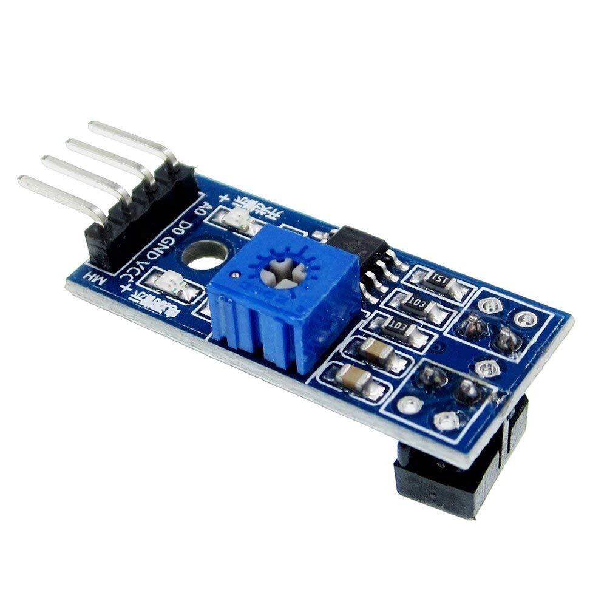
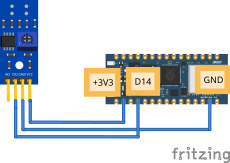
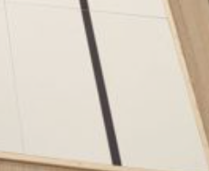

# Digitale IR-sensor

Een **digitale IR-sensor** kijkt of de ondergrond zwart of wit is. Hij stuurt infrarood licht uit en meet hoeveel ervan terugkomt. Wit weerkaatst veel, zwart bijna niets.

## Materiaal

Wat heb je nodig?

1. Arduino Nano RP2040 Connect
2. Digitale IR-sensor



Het potmetertje (klein draaitje) op de sensor stelt de **drempel** tussen zwart en wit in.

<details>
<summary>Controlevraag</summary>

Wat geeft een digitale IR-sensor terug?

</details>

<details>
<summary>Antwoord</summary>

Alleen een **0** of een **1**. Hij heeft al voor je beslist of wat hij ziet zwart of wit is. Wil je het ruwe getal? Gebruik dan een **analoge** IR-sensor (zie [Analoge IR-sensor](site:robotica/docs/onderdelen/ir-analoog)).

</details>

## Aansluiten




Pinnen van de digitale IR-sensor:

- **VCC**: de plus (3,3V)
- **GND**: de min
- **DO**: digitale uitgang

Aansluiten op de Nano RP2040 Connect:

- **VCC** aan **3.3V**
- **GND** aan **GND**
- **DO** aan een digitale pin naar keuze, bijvoorbeeld **D14**

## Code

Een digitale sensor is voor de microcontroller een gewone ingang, net als een
knop: je leest hem met `Pin` uit `machine`.

```python
from machine import Pin
from time import sleep

sensor = Pin("D14", Pin.IN)

while True:
    print(sensor.value())
    sleep(0.5)
```

In de Shell verschijnt steeds een **0** of een **1**.

- `Pin("D14", Pin.IN)` zegt: gebruik pin **D14** als **ingang**. De naam staat
  tussen aanhalingstekens, precies zoals hij op het bord staat.
- `sensor.value()` geeft wat de sensor nu ziet: 0 of 1.

## Hoe gebruik je dit bij de RoboCup?

Pak een competitietegel van de RoboCup (welke maakt niet uit):



Houd je IR-sensor boven de tegel. Wanneer geeft `sensor.value()`:

- de waarde **1**?
- de waarde **0**?

Bij de meeste sensoren is het **1** boven zwart en **0** boven wit: wit kaatst
het licht terug, en dan maakt de sensor zijn uitgang laag. Met een
schroevendraaier draai je aan het potmetertje. Daarmee verschuif je de grens:
hoe donker het moet zijn voordat de sensor "zwart" zegt. Wat 0 en 1 betekenen,
verandert daar niet door.

Voor meer informatie: [Redden Basis](site:robotica/docs/robocup/start).

<details>
<summary>Opdracht: lampje volgt de lijn</summary>

Laat het ingebouwde rode lampje branden zodra de sensor **zwart** ziet, en uit gaan boven **wit**.

</details>

<details>
<summary>Tip</summary>

Bij de ingebouwde RGB-LED is `value(0)` aan en `value(1)` uit. Kijk eerst met
de print-code welke waarde jouw sensor boven zwart geeft.

</details>

<details>
<summary>Oplossing</summary>

```python
from time import sleep
from machine import Pin

sensor = Pin("D14", Pin.IN)
led = Pin('LED_RED', Pin.OUT)
ZWART = 1

while True:
    if sensor.value() == ZWART:
        led.value(0)  # aan boven zwart
    else:
        led.value(1)  # uit boven wit
    sleep(0.1)
```

Geeft jouw sensor boven zwart een 0? Zet dan `ZWART = 0`.

</details>
