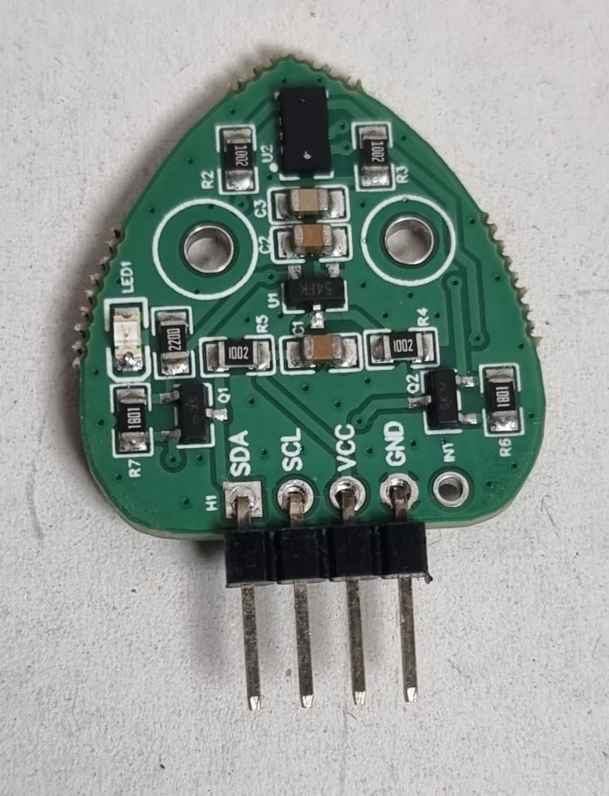
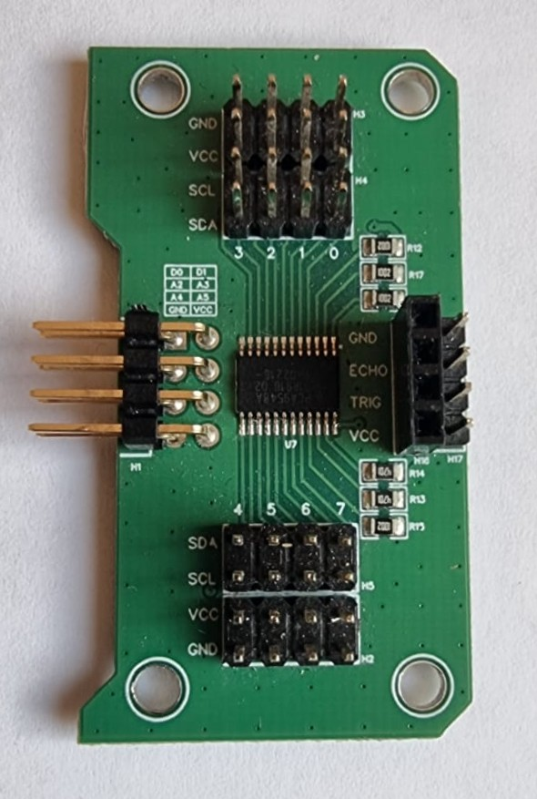
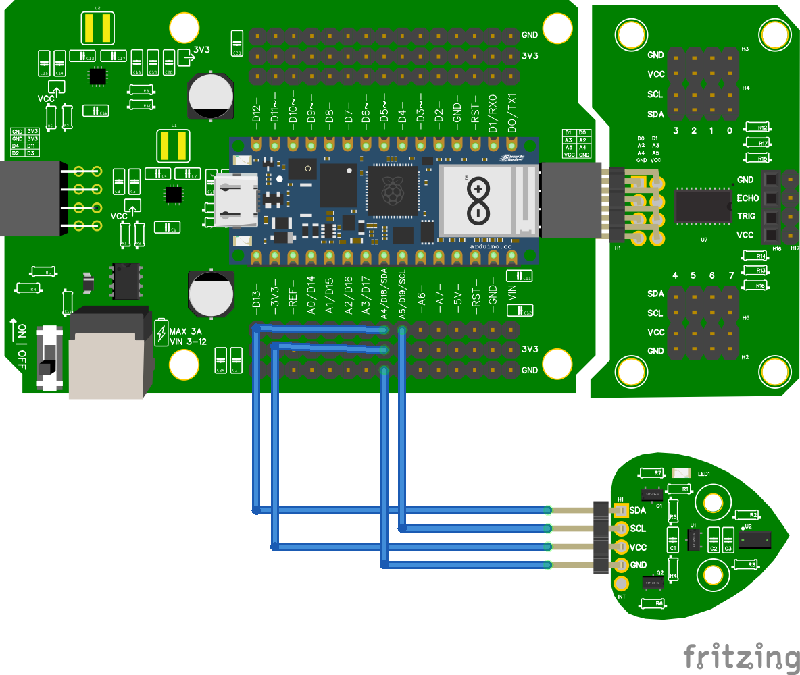
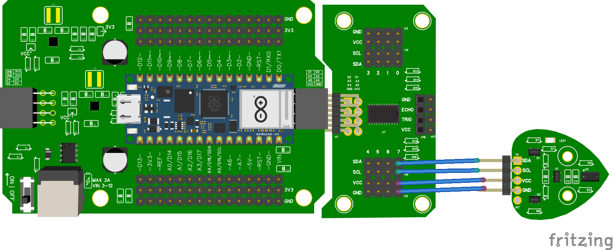
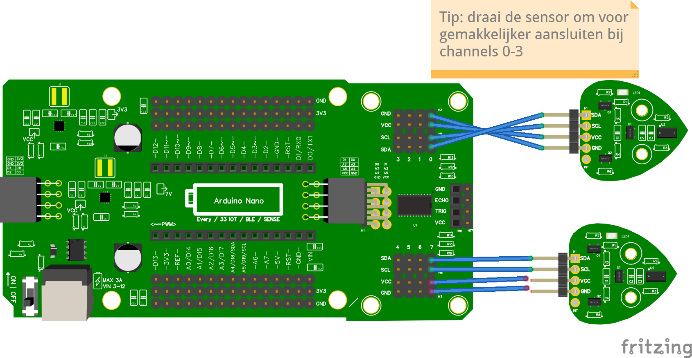

# Time of Flight-sensor

Een **Time of Flight (TOF) sensor** meet afstand met een lichtstraal. Hij is preciezer dan een ultrasone sensor en werkt ook bij geluid. De TOF praat over **I2C**, dus via de pinnen **SDA** en **SCL**.

## Materiaal

Wat heb je nodig?

- Arduino Nano RP2040 Connect
- Time of Flight-sensor
- **Voor 2 of meer TOF-sensoren** ook: SDA/SCL-module voor het Leaphy Murphy Shield (een multiplexer)

### Time of Flight-sensor



### SDA/SCL-module (multiplexer)



<details>
<summary>Controlevraag</summary>

Waarom heb je een multiplexer nodig bij **meerdere** TOF-sensoren?

</details>

<details>
<summary>Antwoord</summary>

Alle TOF-sensoren hebben hetzelfde **I2C-adres**. De microcontroller zou ze niet uit elkaar kunnen houden. Met een multiplexer geef je elke sensor een eigen **channel**, zodat je ze los kunt aanspreken.

</details>

## Eén TOF zonder multiplexer \{#zonder-mux}

### Aansluiten



- **VCC** van de TOF aan **3.3V**
- **GND** van de TOF aan **GND**
- **SDA** van de TOF aan **A4** (SDA)
- **SCL** van de TOF aan **A5** (SCL)

:::tip[Beschermend stickertje]

Op een nieuwe TOF zit vaak een doorzichtig plastic stickertje. Trek dat er voorzichtig af voor een betere meting.

:::

### Code

```python
from leaphymicropython.sensors.tof import TimeOfFlight
from time import sleep

tof = TimeOfFlight()

while True:
    afstand = tof.get_distance()
    print(afstand)
    sleep(1)
```

### Uitleg

- `TimeOfFlight()` maakt een sensor aan op het standaard I2C-adres.
- `tof.get_distance()` geeft de afstand in **millimeters**.

<details>
<summary>Controlevraag</summary>

Wat krijg je terug als er **niets** voor de sensor staat?

</details>

<details>
<summary>Antwoord</summary>

Het getal **8191**. Dat betekent: geen geldige meting. Je krijgt het ook als een object te ver weg is of juist te dichtbij (onder ongeveer **5 cm**). De TOF meet betrouwbaar tussen ongeveer **5 cm** en **200 cm**.

</details>

### Alleen geldige metingen \{#geldige-metingen}

Soms staat er niets voor de sensor, of zit een object buiten bereik. Dan krijg je een hoog getal terug. De regel is simpel: **alles boven 8090 is geen echte afstand**.

```python
from leaphymicropython.sensors.tof import TimeOfFlight
from time import sleep

tof = TimeOfFlight()

while True:
    afstand = tof.get_distance()
    if afstand > 8090:
        print("geen geldige meting")
    else:
        print(afstand)
    sleep(1)
```

- Een echte afstand is een getal tussen **0** en ongeveer **8090** (in millimeters).
- Is het getal **groter dan 8090**? Dan is er geen geldig object: te ver, te dichtbij, niets ervoor, of een storing.

<details>
<summary>Controlevraag</summary>

Wat zie je in de Shell als je je hand vlak (minder dan 5 cm) voor de sensor houdt?

</details>

<details>
<summary>Antwoord</summary>

`geen geldige meting`. Onder ongeveer 5 cm geeft de TOF `8191`, en dat is groter dan 8090.

</details>

## Eén TOF met multiplexer \{#met-mux}

Met de SDA/SCL-module kun je tot acht I2C-apparaten aansluiten op **channels 0 t/m 7**. Elke sensor krijgt zo zijn eigen kanaal.

### Aansluiten



In dit voorbeeld zit de TOF op **channel 7** van de multiplexer. Het cijfer staat boven het stel pinnen waarin je de sensor steekt.

### Code

```python
from leaphymicropython.sensors.tof import TimeOfFlight
from time import sleep

tof = TimeOfFlight(channel=7)

while True:
    print(tof.get_distance())
    sleep(1)
```

### Uitleg

```python
TimeOfFlight(channel=7)
```

Met `channel=7` vertel je de bibliotheek op welk kanaal van de multiplexer de sensor zit. Vergeet niet dit aan te passen als je de sensor in een ander kanaal steekt.

<details>
<summary>Controlevraag</summary>

Welk getal vul je in bij `channel=` als je de sensor in het stel pinnen onder **0** steekt?

</details>

<details>
<summary>Antwoord</summary>

`channel=0`. Het cijfer boven het stel pinnen op de multiplexer is precies het kanaal dat je in je code invult.

</details>

## Twee of meer TOFs met multiplexer \{#twee-met-mux}

Heb je twee TOFs nodig (bijvoorbeeld om links en rechts te meten)? Dan steek je ze in twee verschillende channels van de multiplexer.

### Aansluiten



In dit voorbeeld:

- TOF 1 op **channel 0**
- TOF 2 op **channel 7**

### Code

```python
from leaphymicropython.sensors.tof import TimeOfFlight
from time import sleep

tof_0 = TimeOfFlight(channel=0)
tof_7 = TimeOfFlight(channel=7)

while True:
    afstand_0 = tof_0.get_distance()
    afstand_7 = tof_7.get_distance()
    print(afstand_0, afstand_7)
    sleep(1)
```

In de Shell zie je nu twee getallen naast elkaar: de afstand voor sensor 0 en sensor 7.

<details>
<summary>Opdracht: drie sensoren</summary>

Voeg een derde TOF toe op **channel 3** en print ook die waarde mee.

</details>

<details>
<summary>Oplossing</summary>

```python
from leaphymicropython.sensors.tof import TimeOfFlight
from time import sleep

tof_0 = TimeOfFlight(channel=0)
tof_3 = TimeOfFlight(channel=3)
tof_7 = TimeOfFlight(channel=7)

while True:
    print(tof_0.get_distance(), tof_3.get_distance(), tof_7.get_distance())
    sleep(1)
```

</details>
