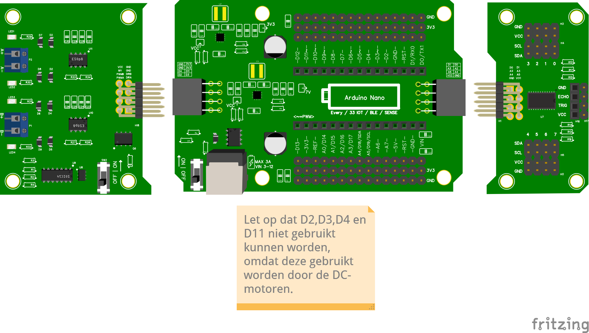

# Pinoverzicht Nano RP2040 Connect

Zo zitten de pinnen in een complete robot voor Redden Basis: de Nano op het
Murphy Shield, met links de motormodule en rechts de multiplexer (de
SDA/SCL-module).

Het Fritzing-bestand: [Fritzing Redden Basis](/docs/redden_basis.fzz).

## Bezet en vrij

- **D2, D3, D4 en D11**: bezet door het motor shield. Niet gebruiken.
- **A4 en A5**: bezet door I2C (SDA en SCL). Daar hangt de multiplexer aan,
  en daarop de TOF-sensoren en het OLED-scherm, elk op een eigen kanaal.
- **A0, A1, A2, A3, A6 en A7**: vrij voor analoge IR-sensoren.
- De andere D-pinnen: vrij voor een servo, een buzzer of de draadjes voor
  de aluminiumtape.

Een ultrasone afstandssensor heeft twee digitale pinnen nodig. De code bij
[Afstandssensor](site:robotica/docs/onderdelen/afstandssensor) gebruikt pin 18
en 19, en dat zijn A4 en A5. In een robot met een multiplexer gebruik je daarom
een [TOF](site:robotica/docs/onderdelen/tof#met-mux).

Controlevraag

Je robot heeft een TOF en een OLED-scherm op de multiplexer, en je wilt twee
analoge IR-sensoren toevoegen. Op welke pinnen sluit je de IR-sensoren aan?

Antwoord

Op twee van **A0, A1, A2, A3, A6 en A7**, bijvoorbeeld **A0** en **A1**. Niet op
A4 of A5, want daar hangt de multiplexer aan.

Terug naar het [begin van RoboCup Junior](site:robotica/docs/robocup/start).
